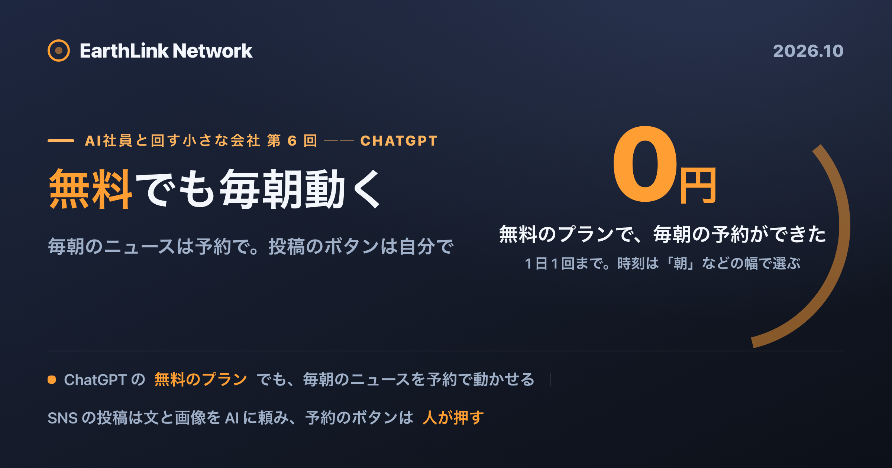
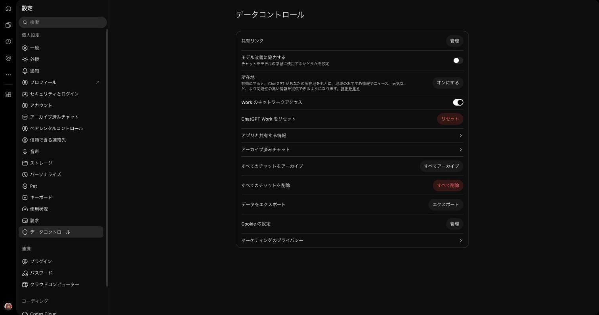
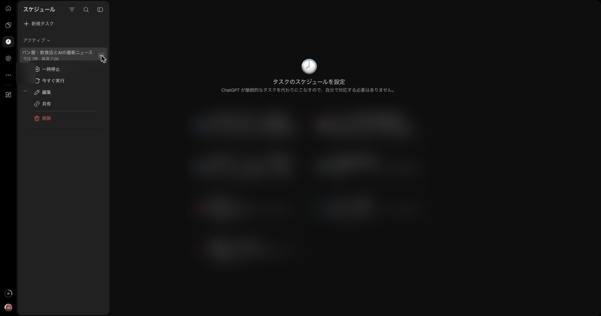
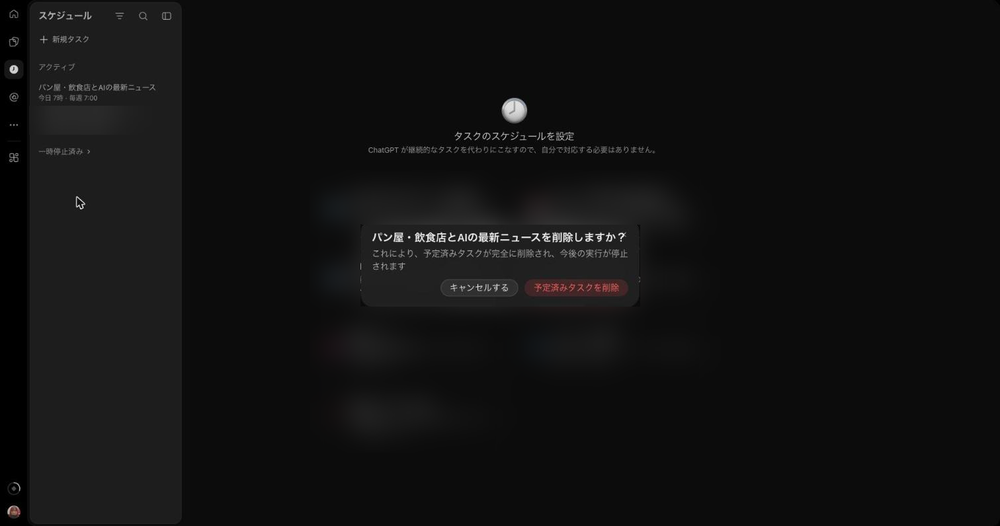
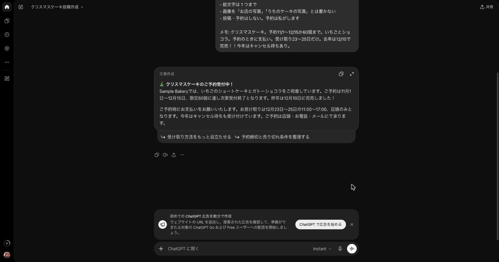
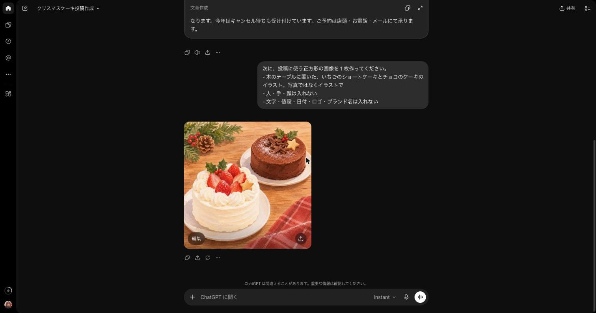

<!-- このファイルは gen-publish.mjs が生成した発行用スケルトン。翻訳(海外媒体)は Claude が en.md 経由で行う。 -->
<!-- gen-publish:src-sha256=4f4714b3105705df2943f17f123089af3a61e6be979aa5c004a89a87f7328b6b -->

上原正吉（EarthLink Network Co., Ltd.）。AI会社・AI社員による業務自動化と、人の逐次介入なしに24時間自動開発を回す仕組みを自社で実践しています。開発ノウハウと具体的な設定方法、運用して分かった改善点を公開しています。

<!-- TODO(Claude): この zenn 版は媒体トーン定義（/docs/platform-tone）に合わせてトーン・長さを調整する。方向性: 技術・実装重視。設計判断と数字を厚く。開発者向け。 以下は基となる本文。調整後にこのコメントを消す。 -->

# ChatGPT に毎朝のニュースと SNS の投稿づくりを任せる ── 画像まで作り、投稿のボタンは自分で



この記事は、連載「AI社員と回す小さな会社 ── 費用を抑えて、頼むところから任せるところまで」の第 6 回です。連載の最後に、私が使っている Paperclip の設定・指示書・おすすめの形を無料で配布する予定です。

**連載の目次**

1. [ChatGPT の dots に Gmail・カレンダー・Slack・Notion をつないで確かめた](https://zenn.dev/chooser/articles/aico-001-tooling)
2. [「AI 会社」の実態を分類した](https://zenn.dev/chooser/articles/aico-002-research)
3. [どの AI ツールで何ができるか](https://zenn.dev/chooser/articles/aico-003-research)
4. [AI に任されている仕事トップ 15](https://zenn.dev/chooser/articles/aico-004-research)
5. [AI のサービスはどれを申し込むか](https://zenn.dev/chooser/articles/aico-005-research)
6. **ChatGPT に毎朝のニュースと SNS の投稿づくりを任せる（この記事）**
7. Claude に朝のまとめと記帳の下書きを任せる（予定）
8. Gemini にメールの返事の下書きと議事録を任せる（予定）
9. Claude Code を、開発者でなくても（予定）
10. 調べ物は必要な人だけ足す（Perplexity と Grok）（予定）
11. 変わった時だけ知らせる見張りと、チャットから自分の PC に頼む（OpenClaw）（予定）
12. お客さんへの返事を、AI が下書きし人が承認して送る（予定）
13. AI 社員の仕組みを通すと 1 件いくらか、どう下げるか（予定）
14. 規約が変わっても止まらないように、月額のプランから使った分だけ払う契約へ（予定）
15. 人が何人かいる会社での置き方（予定）
16. AI 社員が働く小さな会社の組織図（予定）

ChatGPT の無料のプランでも、毎朝のニュースを予約で動かせました。テスト用の無料のアカウントで「毎朝」と頼むと毎日のタスクができ、翌朝、ニュースのメールが届きました。無料のプランで予約できるのは 1 日 1 回までです。1 日 1 回でなく、無料でも何回でも動かす方法として、Paperclip で AI の会社を作るやり方を、この連載の第 12 回から紹介します。

「毎朝、業界のニュースを見て回る時間がない」「SNS の投稿の文と写真を、毎回考えるのが大変」。小さなお店や会社を回していると、こう感じる方は多いと思います。

AI に任せようと思っても、よく次のように言われます。「無料版では、決まった時刻に動かす機能は使えない」「投稿まで任せるなら、有料のサービスが要る」。けれど、無料のプランでも毎日のタスクは作れ、SNS の予約に使う Meta Business Suite も 0 円でした。

この記事は、[連載の第 5 回（AI のサービスはどれを申し込むか）](https://note.com/chooser/n/nba9c9f0ff237)の続きです。今回は、前回の早見表の「毎日ニュースを集めて SNS に投稿するお店」の行を、ゼロから設定します。

ニュースは無人で回します。SNS の投稿は AI に頼み、予約のボタンは自分で押します（2 つの言葉は、最後の「用語」の節に書きました）。

## 結論

- **ChatGPT の無料のプランでも、毎朝のニュースを予約で動かせます。** チャットで 1 回頼めば、毎日のタスクができ、ChatGPT が自分で集めて届けます。無料は 1 日 1 回までで、時刻は「朝」のような幅で選びます。1 日 1 回のニュースなら、0 円で始められます。
- **有料のプランなら、時刻ちょうどに動きます。** Pro では朝 7:00 ちょうどを選べ、2 回ともその前後 2 分以内に届きました。
- **「届いた」は「正しい」ではありません。** 2 回目は出典のリンク 5 件のうち 1 件が開かず、Pro のタスクの通知は設定でオンにしても来ませんでした。最初の 1 週間は、届いた時刻とリンクを確かめます。
- **SNS の投稿は、文と画像を ChatGPT に頼み、Meta Business Suite（0 円）で人が予約します。** 文と画像も、ChatGPT の無料のプランで頼めます。画像は無料のプランでは枚数に上限があり、上限に来たら待つか、有料のプランにします。予約した投稿のプレビューには、AI が作ったことを示す表示が付きました。

## 本文（読了 約 12 分）

## 前提

撮影は、私が契約している ChatGPT Pro と、無料のテスト用アカウントで行いました。お店はパン屋の「Sample Bakery」という架空のお店です。

## 1. ゼロからの設定

### プランを選ぶ

日本から見た料金ページの値段は、無料版 0 円、Go 1,400 円、Plus 3,000 円、Pro 16,800 円からです。Go には「広告が出る場合がある」と書かれています。

料金ページの比較表では、定期タスクの行は、無料版が「—」、Go・Plus・Pro が「✓」です。ところが、公式のヘルプには、無料版でも 1 日 1 回までなら作れると書かれています。この食い違いは、4 章で確かめます。

有効にしておけるタスクの数は、ヘルプによると、無料版と Go が 3 つ、Plus が 5 つ、Pro が 15 です。ニュースのタスク 1 つなら、どのプランでも足ります。この回の作業は、無料のプランで始められます。有料のプランが要る場合は、6 章にまとめました。

### 仕事の内容を ChatGPT の学習に使わせない

どのプランでも、入力した内容が ChatGPT の改善に使われる設定があります。料金表には、どのプランも「オプトアウトできる」と書かれていて、自分でオフにしない限り使われます。お店の値段や予定を入力するなら、先にオフにしておきます。

場所は、左下のアカウントのメニューから「設定」→「データコントロール」→「モデル改善に協力する」です。スイッチをオフにします。アカウント全体の設定なので、スマートフォンのアプリにも効きます。オフにしても、チャットの履歴は残ります。



### ニュースの依頼を、まず手で 1 回試す（AI に頼む）

公式の説明では、定期タスクにする前に、普通のチャットで依頼文を 1 回試すことを勧めています。私が使った依頼文は次のとおりです。[ ] の所は自分の業種に替えてください。

```
毎日 朝 [7:00] に、次の 2 つのニュースを、合わせて 5 件まで集めてください。
- [自分の業種。例: パン屋・小さな飲食店の業界]
- [小さな会社向けの AI の道具]

日本語のニュースを中心に探してください。

1 件ごとに:
1. 見出し
2. 出た日
3. 何があったか（2 行）
4. [小さなパン屋・飲食店] にとっての意味（1 行）
5. 出典の名前とリンク

決まり:
- 出てから 48 時間以内の記事だけ。出た日が分からない記事は入れない
- このチャットで前に送った記事と同じものは入れない
- 新しいものが無ければ、埋めずに「今日は新しいニュースはありません」とだけ書く
- web で探せなかった時は、1 行目にそう書く。覚えていることで埋めない
- 一覧を送るだけにする。登録・購読・問い合わせはしない
```

最初の 1 回は、1 行目の「毎日 朝 [7:00] に、」を消して送ります。

決まりの中で大事なのは、「新しいものが無ければ、埋めずに『今日は新しいニュースはありません』とだけ書く」の行です。日本語のこの依頼文で試すと、ChatGPT は web で 10 件のサイトを調べたうえで、「今日は新しいニュースはありません」の 1 行だけを返しました。48 時間以内の日本語の記事が見つからなかったと判断し、古い記事で一覧を埋めなかったということです。

英語のニュースで同じ依頼をした時は、Pro で 5 件が、出典のリンクつきで返ってきました（2 章）。web の検索はどのプランでも使えます。

もう 1 つ、Pro で最初に英語で試した時、答えが日本語で返ってきました。「設定」の「パーソナライズ」に、日本語で答えるよう書いていたためです。ここに言葉の指定があると、ニュースもその言葉になります。

### 定期タスクにする（ここから無人で回す）

同じチャットで、続けて次のように送ります。

```
この形でお願いします。毎日 朝 7:00（日本時間）に、同じ決まりで動く定期タスクにしてください。
```

ChatGPT は「定期タスクを作成しました」と答え、タスク名「パン屋・飲食店とAIの最新ニュース」、頻度「毎日 7:00（Asia/Tokyo）」と、引き継いだ決まりの要約を返しました。左の一覧の「スケジュール」からも、タスクを作れます。


作ったら、タスクの画面で時刻を確かめます。チャットの中のタスク名を選び、編集を開きます。英語の画面で作った Pro のタスクでは、時刻は「7:00 AM Japan Time」で、15 分刻みで選べました。無料のプランでは時刻ちょうどは選べず、「朝」のような幅から選びます。無料のアカウントでは、「毎朝」と頼んでタスクができました（4 章）。

編集の画面の指示は、私が書いた依頼文そのままではありません。ChatGPT が書き直した文で、決まりは全部残っていました。

PC をつけておく必要があると公式の文書がはっきり書いているのは、デスクトップアプリで自分の PC のファイルを使う定期タスクだけです。仕事用の機能（Work）の説明のページには、web を調べる定期タスクはクラウドで動かすのが向いている、「PC が起きている必要がないため」とあります。

### 通知が来るかを、翌朝に確かめる

アカウントの設定は、「設定」→「通知」で、タスクの知らせ方を選びます。英語の画面では、選択肢は「Push」「Email」「Push, Email」です。私のアカウントは最初は「Push」だけで、「Push, Email」に変えました。

それでも、Pro のタスクの通知は来ませんでした。1 回目の朝、スマートフォンに通知は来ず、メールも届きませんでした。考えられる理由は 2 つです。1 つは、タスクのデータで、そのタスクの通知がオフになっていたことです。もう 1 つは、公式のヘルプに、スマートフォンにプッシュ通知を受けるには、スマートフォンのアプリでタスクを作るとあることです。私は Web で作っていました。無料のアカウントで作ったタスクは、メールが届きました。

タスクを作ったら、翌朝、通知が来るかを見てください。来なくても、結果はタスクを作ったチャットに入っています。

### タスクの止め方

タスクは、左の一覧の「スケジュール」に並びます。タスクの横のメニューから、「一時停止」「今すぐ実行」「編集」「共有」「削除」を選べます。



「削除」を選ぶと、「パン屋・飲食店とAIの最新ニュースを削除しますか？」と確かめる画面が出ます。「予定済みタスクを削除」を押すと、今後の実行が止まります。しばらく止めたいだけなら「一時停止」にし、メニューから再開できます。



ヘルプによると、タスクを削除しても、タスクを作ったチャットは残ります。逆に、タスクを作ったチャットを削除すると、タスクは一時停止します。アーカイブしても止まることがあります。タスクを動かしている間は、そのチャットを消さないでください。

## 2. 2 回の朝に届いたもの

英語のニュースで作った Pro のタスク（朝 7:00）の結果です。

| | 1 回目の朝 | 2 回目の朝 |
|---|---|---|
| 設定した時刻 | 7:00 | 7:00 |
| チャットに結果が入った時刻 | 7:02 | 6:59 |
| 件数 | 5 件 | 5 件 |
| 48 時間より古い記事 | 0 | 0 |
| 前の日と同じ記事 | 0 | 0 |
| 開けた出典のリンク | 確かめていない | 5 件のうち 4 件 |
| 「新しいものが無い」の 1 行 | なし | なし |

中身は、業界のニュースでした。50 年続いたパン屋の閉店、パン屋どうしの買収、小さな会社の経営者向けの AI の研修などです。媒体はどれも英語のニュースサイトでした。

1 回目の結果は、「定期タスクを作成しました」に当たる返事のすぐ下に続けて出て、時刻の表示はありませんでした。チャットの画面だけでは、いつ届いたかは分かりません。2 回目は、一覧の上に「Today 6:59 AM」の表示とタスク名が出ました。

開かなかった 1 件は、パン屋の閉店の記事のリンクでした。元の新聞の記事を転載したサイトへのリンクで、ブラウザは「This site can't be reached」と表示しました。記事の中身は読めましたが、リンクのほうが使えませんでした。

届いた記事をもとに何かを決める前に、リンクを開いて元の記事を確かめてください。

## 3. 「完了」でも中身を確かめる: 遅れ・止まり・壊れ

**遅れ。** 私の 2 回は、2 分遅れと 1 分早めでした。最初の 1 週間は、設定した時刻と届いた時刻を書き留めておくと、遅れに気づけます。

**止まり。** 使われないタスクは、自動で一時停止することがあります。人の確認が要る時や、チャットをアーカイブした時も止まることがあり、チャットを削除すると止まります。

**壊れ・誤り。** 公式の説明は、web の結果をそのまま信用しないように書いています。私の 2 回目は、5 件のうち 1 件のリンクが開きませんでした。

最初の 1 週間に確かめることは、次の 5 つです。

- 設定した時刻と、届いた時刻
- 通知やメールが届いたか
- 動く前に、リンクを開いて元の記事を見たか
- 48 時間より古い記事が混ざっていないか
- タスクを作ったチャットが残っているか（削除・アーカイブしていないか）

## 4. 無料版でできるか

前回、料金表とヘルプが食い違っているので、この回で確かめると書きました。

ヘルプには、無料版は、1 回だけのタスクか、1 日 1 回までの繰り返しを、「朝・午後・夜」のような時間の幅で作れ、有効にできるのは 3 つまでとあります。料金表の定期タスクの行は、無料版が「—」です。毎時の実行や時刻ちょうどの実行は「対象の有料プラン」とだけ書かれていて、どのプランが対象かは書かれていません。

テスト用の無料のアカウントで試した結果は次のとおりです。

- 左の一覧に「Scheduled」（日本語の画面では「スケジュール」）が出ていました。
- ニュースを「毎朝」と頼むと、タスクができました。答えは「approximately 8:00 AM Japan time」で、一覧には「Daily · Next run in 20 hours」と出ました。
- タスクの編集の画面で選べる時刻は、「Morning」「Afternoon」「Evening」「Night」の 4 つだけでした。7:00 のような時刻ちょうどは選べません。繰り返しは「Daily」「Weekdays」「Weekly」「Monthly」から選べました。
- 翌朝 8:52 に、通知のメールが届きました。メールには最初の記事（パン屋の閉店）の書き出しと、「View message」のボタンがありました。

料金表よりも、ヘルプのほうが画面に合っていました。ただ、ヘルプにも、使えるかどうかはアカウントやアプリによって違うとあります。無料版の方は、毎日のタスクを 1 つ頼んでみて、タスクが作れるかを見てください。

SNS の投稿の文と画像も、無料のプランで頼めます。無料版のヘルプには、文のチャットは回数の上限なし（乱用を防ぐ制限は別）とあり、画像の生成やファイルの添付には、それとは別の上限があると書かれています。上限に来ると ChatGPT が知らせ、時間をおいてから使えます。料金表の画像の行は、無料版が「Limited」（制限つき）で、何枚までかの数字は公開されていません。投稿 1 件に画像 1 枚なら、上限に来ても待てば足ります。

## 5. SNS の投稿: 文と画像は ChatGPT、予約は Meta Business Suite

ここは「AI に頼む」です。テスト用の Facebook ページ「Sample Bakery Test」を作って試しました。この章の ChatGPT の画面は Pro で撮りました。無料のプランでも同じ依頼で文と画像を頼めますが、画像は枚数に上限があります（4 章）。題材は、お店のクリスマスケーキの予約です。

### 投稿の文

店の案内（営業時間・定休日・値段）を毎回添付して、次のように頼みます。

```
小さなパン屋「[店の名前]」をやっています。店の案内を添付します。

下のメモから、Facebook ページの投稿を作ってください。短い 2 段落で。

決まり:
- メモと店の案内にある事実だけを使う。「無添加」「最高」「話題の」のような言葉は足さない
- 値段を書くなら、店の案内の値段だけを使う
- 絵文字は 1 つまで
- 画像を「お店の写真」「うちのケーキの写真」とは書かない
- 投稿・予約はしない。予約は私がします

メモ: [自分のメモ]
```

私のメモは「クリスマスケーキ。予約11/1〜12/15か60個まで。いちごとショコラ。予約のときに支払い。受け取り23〜25日だけ。去年は12/10で完売！！今年はキャンセル待ちあり。」です。

返ってきた文は、メモの 6 つの事柄（予約の期間、60 個まで、いちごとショコラの 2 種類、予約のときに支払い、受け取りは 23〜25 日だけ、キャンセル待ちあり）を全部入れていました。2 段落で、絵文字は 1 つ（🎄）、画像を「写真」とは書いていません。

ただ、メモに無いことが 2 つ入り、1 つ抜けました。受け取りの時間「11:00〜17:00」は、店の案内にある普段のケーキの受け取りの時間でした。「店頭のみ」は、店の案内にはっきりとは書かれていません（受け取りがお店なのは事実です）。注文の手段は「店頭・お電話・メール」で、店の案内にあるチャットが抜けていました。投稿する前に、店の案内と見比べて直す所です。



### 投稿の画像

画像は、文とは別に頼みます。

```
次に、投稿に使う正方形の画像を 1 枚作ってください。
- [見せたいもの]のイラスト。写真ではなくイラストで
- 人・手・顔は入れない
- 文字・値段・日付・ロゴ・ブランド名は入れない
```

「木のテーブルに置いた、いちごのショートケーキとチョコのケーキ」と頼むと、1 分かからずに正方形（1254 × 1254 ピクセル）の画像が返ってきました。人も文字も入っていません。英語で同じように頼んだ時は写真に近い見た目でしたが、日本語の回はイラストに近い見た目でした。



OpenAI の利用規約では、ChatGPT が作ったものは利用者のものになります。ただし、ほかの人にも似たものが作られることがあります。また、AI が作ったものを人が作ったように見せることは禁止されています。投稿で「お店の写真」と書かないのはこのためです。売っている商品を見せたい時は、その商品を撮った写真のほうが安全です。

### Meta Business Suite で予約する

Meta Business Suite は、PC でもスマートフォンのアプリでも無料です。使うには business portfolio（ビジネスポートフォリオ）が要ります。Facebook ページや Instagram のアカウント、管理する人をまとめておく所で、1 人 2 つまで作れます。

手順は次のとおりです。ここでは英語の画面の表記を引きます。「Create post」を開き、「Post to」で自分のページを選び、「Media」に画像を入れ、ChatGPT の文を貼り付けます。「Set date and time」をオンにして日時を選び、「Share to」で投稿先を確かめて、「Schedule」を押します。予約は 20 分後から 29 日先までで、時刻は今いる場所のタイムゾーンです。海外にいる時に予約するなら、時刻を確かめてください。

予約した投稿は、カレンダーの画面「Planner」と、投稿の一覧の「Scheduled」に並びます。私が予約した投稿を開くと、プレビューの日時の横に、AI が作ったことを示す「AI content」の表示が付いていました。Meta は、ファイルの中に AI で作ったことを示す情報を見つけると、この表示を付けます。投稿する人が自分で付けることもでき、付けなければいけない場合もあります。

予約をやめる時は、投稿の「•••」のメニューから「Manage post」→「Move to Drafts」を選び、確かめの画面でも「Move to Drafts」を押します。そのあと「Drafts」で「Manage post」→「Delete post」を押すと消えます。予約も削除も、Meta Business Suite の画面で人が操作します。削除したあとは、「Planner」も「Drafts」も空になりました。

Instagram にも同時に投稿するには、Facebook ページと Instagram のアカウントをつなぎ、同じ business portfolio に入れておく必要があります。

### 予約のボタンを AI に押させない理由

OpenAI の公式の説明には、ChatGPT から Facebook や Instagram に直接投稿する方法は見つかりませんでした。予約のサービスの中には、AI に予約まで入れさせられるものがあります。Buffer のヘルプには、ChatGPT をつないで下書きや予約の投稿を作れると書かれています。そうすると、AI が書いたものがそのまま出ていきます。

今回の文にも、店の案内とずれた所がありました。最初は下書きまでを AI に任せ、予約のボタンは自分で押し、元のメモを残して事実を見比べ、予約の取り消し方を知っておくのが安全です。X の自動投稿の決まりは、第 5 回で X の公式の文を引きました。

## 6. 無料のプランで足りること・有料のプランが要ること

前回の早見表の行に戻ります。「毎日ニュースを集めて SNS に投稿するお店は ChatGPT Go 1,400 円〜Plus 3,000 円と Meta Business Suite 0 円」。前回は Go か Plus を選びましたが、この回の作業は ChatGPT の無料のプランで足ります。

- **無料のプランで足りること:** 1 日 1 回のニュースを、朝などの時間の幅で、メールで受け取ること（無人で回す。テスト用の無料のアカウントで確かめました）。投稿の文と画像を頼むこと（AI に頼む。画像は枚数に上限があります）。Meta Business Suite での 0 円の予約（予約のボタンは人）。
- **有料のプランが要ること:** 7:00 のような時刻ちょうどに届けたい時。ChatGPT の定期タスクを 1 日に何回も動かしたい時（有料のプランなら 1 時間に 1 回まで。無料のまま何回も動かすやり方は第 12 回から）。画像を上限より多く作りたい時。タスクを 4 つ以上有効にしておきたい時。
- **Go・Plus の画面は撮っていません。** 公式の記載では、有効にできるタスクは Go 3・Plus 5・Pro 15、画像は Go が「More」、Plus が「More complex and accurate」、Pro が「Unlimited and faster」です。
- **この回で扱わないこと:** カレンダーとメールから作る朝のまとめと、記帳の下書きは第 7 回（Claude）で、LINE のお客さんの窓口は第 12 回で扱います。

## 連載の続きと、取り上げてほしい仕事

次の第 7 回は「Claude に朝のまとめと記帳の下書きを任せる」です。AI に任せたい仕事で、取り上げてほしいものがあれば、コメントで教えてください。

---

ここから先は、もう少し詳しく知りたい方向けの補足です。

## 補足 1. 同じニュースの依頼を Paperclip で動かすと

第 3 回で紹介した Paperclip は、AI の担当にタスクと承認を持たせて束ねるソフトで、決まった時刻に仕事を繰り返す機能（routine）もあります。1 日 1 回より多く動かすやり方は、冒頭に書いたとおり第 12 回から紹介します。1 日 1 回のこの仕事 1 つだけなら、ChatGPT の定期タスクで足ります。2 つのやり方で、プランの毎月の利用上限をどれだけ使うかは、第 13 回でこの依頼を使って測ります。ChatGPT のログインを Paperclip のようなほかのソフトから使うことは、今ははっきり禁止されていませんが、今後注意が要ります。規約の話は第 14 回で扱います。

## 補足 2. 第 1 回の dots との違い

[第 1 回](https://note.com/chooser/n/n285d9a49c96b)では、ChatGPT の別の機能 dots（個人では Pro で使える）で、8:30 に設定した仕事が 8:44 に「遅くなりました。」で始まって届きました。dots の説明のページには、「完了」と出ても、頼んだ結果ができた・届いたことの保証にはならない、と書かれています。今回の定期タスクとは別の機能です。

## 補足 3. タスクの共有

定期タスクは、リンクで共有でき、受け取った人は自分用のコピーを作れます。名前・履歴・結果は渡りませんが、リンクを開ける人は依頼文を全部読めます。依頼文にお客さんの名前を書かないでください。

## 補足 4. 料金ページは日本から開くと円で出る

ChatGPT の料金ページは、日本から開くと、英語の表示にしても円で出ます。ドルの値段は、別の料金の説明のページ（learn.chatgpt.com）に出ています。

## 用語

この連載では、前回と同じ 2 つの言葉を使います。

- **AI に頼む**: 人がその都度頼み、その場で答えが返ってきます。
- **無人で回す**: 人が頼まなくても、決まった時刻に AI が動き、結果が届いています。

## 出典

- Scheduled tasks in ChatGPT: https://help.openai.com/en/articles/10291617-scheduled-tasks-in-chatgpt
- ChatGPT の料金: https://chatgpt.com/ja-JP/pricing/ ・ https://learn.chatgpt.com/docs/pricing
- ChatGPT Free Tier FAQ: https://help.openai.com/en/articles/9275245-using-chatgpt-s-free-plan
- Get started with Work: https://learn.chatgpt.com/docs/get-started-with-work
- デスクトップアプリの定期タスク: https://learn.chatgpt.com/docs/automations
- dots のタスク: https://learn.chatgpt.com/docs/dots/tasks-and-memory
- Data controls in ChatGPT: https://help.openai.com/en/articles/7730893-data-controls-in-chatgpt
- ChatGPT search: https://help.openai.com/en/articles/9237897-chatgpt-search
- OpenAI 利用規約: https://openai.com/policies/terms-of-use/
- Meta Business Suite: https://www.facebook.com/business/help/205614130852988 ・ https://www.facebook.com/business/help/1252240869631062
- Instagram を Meta Business Suite につなぐ条件: https://www.facebook.com/business/help/914097058035853
- Meta の AI の表示: https://www.meta.com/help/artificial-intelligence/1783222608822690/
- Buffer: https://support.buffer.com/en-us/articles/connecting-buffer-to-automation-tools-and-ai-assistants-MMoXpjDEEo

---

このシリーズでは、個人事業主や小さな会社が、普段の仕事を AI の担当（AI 社員）に分けて任せ、人は確認と承認だけをする形を、順に作っていきます。始めはサブスクの範囲で、費用を式で見積もりながら進めます。Paperclip のように担当と承認で AI を束ねると費用は大きくなりますが、AI を直接使う値段に近づける方法も示します。シリーズの最後には、私が使っている Paperclip の設定・指示書・おすすめの形を無料で配布する予定です。
興味のある方は、ぜひ「いいね」と記事の購読をお願いいたします。

自社プロダクトは https://www.eln.ne.jp/products にまとめています。

## 筆者について

上原正吉。EarthLink Network Co., Ltd. 代表。AI社員に日々の業務を任せ、開発では人が逐一指示しなくても作業が進むHOOTL（Human Out Of The Loop）の仕組みを自社で実践しています。このブログでは、業務自動化と24時間自動開発のノウハウ、具体的な設定方法、日々の運用で見つかった問題と改善を共有します。

また、AIで業務や開発を組み替えたい会社・チーム向けに、AI活用のコンサルティングも受け付けています。ご相談は [www.eln.ne.jp](https://www.eln.ne.jp) からどうぞ。

---

**EarthLink Network** は、会社の全業務を AI で回すために、必要になったものを自社で作っています。いま作っているプロダクトの一覧と概要は、こちらにまとめています。

→ [EarthLink Network が自社でつくっている18のプロダクト](https://zenn.dev/chooser/articles/in-house-products)

会社と各プロダクトの詳細は、公式サイト [www.eln.ne.jp](https://www.eln.ne.jp) をご覧ください。
