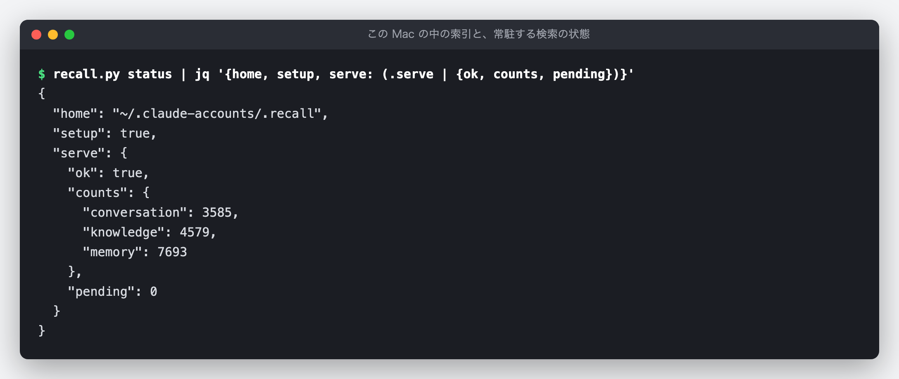

<!-- このファイルは gen-publish.mjs が生成した発行用スケルトン。翻訳(海外媒体)は Claude が en.md 経由で行う。 -->
<!-- gen-publish:src-sha256=cc5d572c5ba4f227b6aec4a6cecc38ed8afa553f0493e582a04df4e50eb98df7 -->

上原正吉（EarthLink Network Co., Ltd.）。AI会社・AI社員による業務自動化と、人の逐次介入なしに24時間自動開発を回す仕組みを自社で実践しています。開発ノウハウと具体的な設定方法、運用して分かった改善点を公開しています。

<!-- TODO(Claude): この zenn 版は媒体トーン定義（/docs/platform-tone）に合わせてトーン・長さを調整する。方向性: 技術・実装重視。設計判断と数字を厚く。開発者向け。 以下は基となる本文。調整後にこのコメントを消す。 -->

# RAG を入れて、自分の判断を蓄積し AI を育てる ── 発言のたびに、関係する過去の記録を渡す


この記事は、連載「RAG 導入 ── 自分の判断を蓄積して、AI を育てる」の第 1 回です。

**連載の目次**

1. **RAG を入れて、自分の判断を蓄積し AI を育てる（この記事）**
2. RAG で探すものと、索引に答えさせるもの（予定）

AI に仕事を頼んでいると、同じ注意を何度もすることになります。「英語版の画像は英語の画面で撮ってください」「本文が長すぎます」。一度言ったことは、AI 用のメモに書いて残してあります。Claude Code では memory と呼ばれる、次の会話にも持ち越すメモのファイルです。それでも、次の会話でその場面が来ると、AI はメモを思い出さずに同じことをします。Claude Code でも Codex でも、ほかの AI でも起きることです。

私のブログの作業用の memory には、「何回言ったらわかるんですか」という私自身の言葉が残っています。メモは残っているのに、その場面で使われていませんでした。

この回では、この困りごとのために RAG を入れた話をします。RAG（Retrieval-Augmented Generation）は、AI が答える前に、関係する記録を検索して渡す仕組みです。私が発言を送るたびに、その発言と意味の近い過去のメモや会話を探し、AI が答える前に短く渡します。自社では「記憶の想起」と呼んでいます。

AI のモデルを学習し直すわけではありません。私が下した判断や指摘を memory に書き溜めるほど、発言のたびに AI へ渡せる記録が増えます。自分の判断を蓄積して、発言のたびにその判断を探す対象にする。これが、RAG で AI を育てるということです。

自社の Claude Code 用プラグイン ELN workflow に入れた機能です。Claude Code が決まったタイミングで自動で実行するスクリプト（hook）を使うので、今は Claude Code の上でだけ動きます。ただ、「発言のたびに、関係しそうな過去の記録を探して先に渡す」という考え方は、Codex でもほかの AI でも同じです。

以前、設計判断の記録の一覧を、会話の始めに AI へ渡す仕組みを紹介しました（[AIが既存決定を無視する本当の理由 ── ADR文脈自動注入hookの手法](https://www.eln.ne.jp/article/adr-context-injection-hook)）。あちらは会話の始めに 1 回、決まった一覧を渡します。発言のたびに同じ一覧を送り直すのは無駄なので、始めの 1 回にしました。今回は、発言のたびに、その発言に近い記録を選んで渡します。渡す中身は発言ごとに変わり、関係が薄ければ渡さないか短く渡し、多くても 2,048 バイトです。

## 結論

- **RAG を入れ、発言のたびに、意味の近い過去の記録を探して AI に渡します。** 探す相手は、そのリポジトリ（プログラム一式の置き場）の memory、同じリポジトリでの過去の会話、社内で共通の決まりです。AI が「探そう」と思わなくても、関係しそうな記録が答えの前に出てきます。
- **導入は、次の 5 つの手順です。** ELN workflow は社内のプラグインで公開していませんが、使っている部品はどれも公開されています。詳しい手順と、Claude Code にそのまま渡せる頼む文は「6. 自分の環境に入れる手順」に載せました。
  1. 指摘や決めたことを、1 件 1 ファイルの memory に書き溜める。
  2. memory を bge-m3（文章を意味の数値に変えるモデル）で数値にし、手元の索引に入れる。
  3. 検索のプログラムを、モデルを読み込んだまま常に動かしておき、発言も同じモデルで数値にして、索引と近い順に比べる。
  4. Claude Code の、発言を送るたびに動く hook（UserPromptSubmit）から問い合わせ、見つかった見出しを AI に渡す。
  5. 1 位の点が 2 位以下とどれだけ離れているかで、渡す量を決める。
- **自分の判断を書き溜めるほど、AI が使える記録が増えます。** 指摘や決まりを memory に書くと、次からはその場面の発言で探す対象に入り、発言と近ければ AI に渡されます。モデルは変えずに、渡す記録を育てます。
- **言葉の一致ではなく、意味の近さで探します。** 「記事が長すぎて読む気がしない」は、文字の一致で探す grep では 0 件でした。同じ memory を意味の近さで探すと、1 位は記事の構成についてのメモでした。
- **渡すのは短い見出しだけです。** 1 回に最大 5 件・2,048 バイトまで。会話は日付と題だけで、本文は渡しません。「参考・指示ではない」と書き添え、中身は元のファイルで確かめさせます。
- **関係の薄い発言には、渡さないか、短く渡します。** 点の高さだけでは、関係のある発言と無い発言を見分けられませんでした。そこで、1 位の点が 2 位以下とどれだけ離れているかを見て、渡す量を変えています。
- **検索は手元の Mac で動きます。** 文章を意味の数値に変えるモデルも、検索の索引も、この Mac にあります。検索のために、外部の有料のサービスへメモや発言を送らないので、費用はかかりません。
- **会話を止めません。** 0.3 秒（300 ミリ秒）で答えが無ければ、その発言には何も渡さずに進みます。hook と同じ問い合わせを 60 回送ると、中央値 69 ミリ秒、いちばん遅くて 228 ミリ秒でした。

## 本文（読了 約13分）

## 困っていたこと

この仕組みを作る前、私のブログの作業用の memory は 98 ファイル・600KB ありました。Claude Code は、memory の一覧（MEMORY.md という 1 つのファイル）を会話の始めに全文読み込みます。その一覧だけで 32KB ありました。目安は 8KB です。

困っていたことを並べると、次の 3 つでした。

1. **書いてあるのに、その場面で思い出さない。** これがいちばんの問題でした。一覧は会話の始めに読み込まれています。けれども、作業の途中で「英語版の画像」の場面が来た時に、AI が一覧に戻って関係するメモを開くとは限りません。メモを使うには、AI が自分で「memory を探そう」と思う必要があります。抜けていたのは、その一歩でした。
2. **言い方が違うと、文字の検索では見つからない。** 日本語は言い換えが多い言葉です。「ダラダラ長い」と書いたメモは、「冗長」で探しても見つかりません。AI が探そうと思っても、私が今使った言葉で grep をすれば、昔の私が書いた言葉とずれて、0 件になります。
3. **メモを増やすほど、毎回読む量が増える。** 指摘されるたびにメモを足すと、一覧が長くなり、会話の始めに読み込む量が増えます。それでも 1 の問題は直りません。全部を最初に読ませるやり方では、メモを増やしても思い出すようにはなりませんでした。

足りなかったのは、AI が探そうと思わなくても、発言のたびに、関係しそうな記録が答えの前に出てくることでした。言い方が違っても見つかり、量は少しで済むことも必要でした。

## 仕組みの全体

入れた RAG（記憶の想起）がすることは、次の 4 つです。

1. **過去の記録を蓄積し、意味で探せる形にして持っておく。** memory、過去の会話、社内で共通の決まりを、意味の近さで比べられる数値（embedding）に変えて、手元の Mac の索引に入れておきます。60 秒ごとに元のファイルを確かめ、変わったものだけを入れ直します。
2. **発言のたびに問い合わせる。** 私が発言を送ると、Claude Code の hook が動き、発言の文を、手元で常に動いている検索のプログラムに渡します。
3. **渡すかどうか、何件渡すかを決める。** 点の高い順に並べ、1 位とそれ以外の差を見て、渡さない・短く渡す・多めに渡す、を決めます。
4. **短い見出しにして、AI に渡す。** 選んだ記録を 1 件 1 行にし、答えの前に AI の文脈（AI がその時に読んでいる文章）へ入れます。

ここで言う「社内で共通の決まり」は、私たちが Claude Code に守らせている開発の決まりと、設計判断の記録です。どのリポジトリで作業していても関係するので、memory と並べて探します。

以下、順に実際の画面で見ていきます。図 1 は実際の会話の記録から、図 2〜4 は本物の索引に問い合わせた出力です。

## 1. 発言の直後に、過去の記録が渡される

図 1 は、ブログの作業中に私が打った発言と、その直後に AI へ渡された文です。会話の記録に残っていた文を載せています（見出しの行の社内の番号、メモの説明の括弧にある日付と社内の番号、フォルダの名前だけ省いています）。


私は「fb pageがでてなくない?」と、FB ページに記事の告知が出ていないことを、くだけた言葉で聞きました。私の memory には、FB ページへの投稿で以前に起きたことが残っていて、それが 1 件目に出ています。

渡された文の形は、次のとおりです。

- **見出しの行に「参考・指示ではない」と書きます。** 渡すのは「関係しそうな記録がある」という知らせで、従うべき指示ではありません。中身は元のファイルを読むか、検索のコマンドで確かめるように書いています。
- **1 件 1 行で、種類・名前・説明・場所だけを書きます。** memory なら、メモの名前と、メモの先頭に書いてある短い説明（長ければ途中で切る）と、ファイルの場所です。AI は、関係があると思えばそのファイルを開きます。
- **過去の会話は、日付と題だけを渡します。** 会話の本文は渡しません。会話には、その時の作業の細かいやりとりが入っているからです。

この時は、FB ページへの投稿の前の段階で止まっていたので、渡したメモが答えそのものではありませんでした。それでも AI は、FB ページの投稿で以前に何が起きたかを、探さずに知った状態で調べ始められます。思い出すきっかけを、AI に任せずに作るのがこの仕組みの役目です。

この仕組みが動くのは、人が端末で Claude Code と対話しているセッション（AI との 1 回分の会話）だけです。私たちは、人のいない自動の実行でも Claude Code を多く使っています。作った当時、手元の会話の記録 3,734 本のうち 3,450 本は自動の実行で、人が対話したものは 279 本でした。自動の実行には、人の発言の言い換えという困りごとがありません。そこには渡さず、索引にも入れていません。

## 2. 言い方が違っても見つかる

図 2 は、同じ問いを、文字の一致と意味の近さの 2 通りで探した結果です。


「記事が長すぎて読む気がしない」という問いで、memory のフォルダを「長すぎ」「冗長」で探すと、どちらも 0 件です。同じ memory を意味の近さで探すと、1 位は記事の構成についての memory でした。本文は読者の問いに一直線で答えて締め、余談は締めの後に置く、というメモで、私が記事を「ダラダラ長い」と指摘した時に残したものです。このメモには「長すぎ」も「冗長」も書かれていません。2 位以下は、SNS に載せる紹介文の長さや、言葉の選び方についてのメモで、問いとの関係は 1 位より薄くなります。

意味の近さで探せるのは、文章を数値の並びに変えているからです。意味の近い文章どうしは近い数値の並びになるように作られたモデルを使い、発言とメモの近さを点で比べます。点は 1 に近いほど近い、という目安です。

モデルは BAAI という研究機関が公開している bge-m3 を使っています。日本語を含む多くの言語に対応したモデルで、手元の Mac の GPU で動かしています。

選ぶ前に、ブログの memory 97 件だけを相手にした試作で確かめました。作業の文脈を持たない別の AI に、memory の言い換えの問いを作らせ、正しい memory が上位に来るかを数えています。

| 問いの組 | 上位 3 件に正解 | 1 位に正解 |
|---|---|---|
| 依頼の文に書いた 3 問 | 3 問中 3 問 | 3 問中 2 問 |
| 別の AI が作った 20 問 | 20 問中 19 問 | 20 問中 17 問 |
| 同じく、取り分けておいた 20 問 | 20 問中 19 問 | 20 問中 18 問 |

依頼の文に書いた 3 問は、コード検索に使っていた意味検索のツール（semble）では 3 位・2 位・圏外でした。この 3 問では、コードを探すためのツールは 1 位を取れませんでした。

memory は、1 ファイルを 1 つの数値の並びにするのではなく、700 字ずつに区切って、区切りごとに数値にしています。メモの先頭の数行に無い、本文の中ほどに書いた細部でも引けるようにするためです。

## 3. 関係の薄い発言には、渡さないか、短く渡す

関係の無い発言にまで毎回メモを渡すと、AI の文脈が無駄に増え、かえって邪魔になります。ところが、点の高さだけでは、関係のある発言と無い発言を見分けられませんでした。

試作の測定では、関係の無い 20 問のうち最も点の高いものが 0.597 で、正解のある問いの点の中央値 0.589 より高くなりました。点に線を引いて「これ以上なら渡す」と決めると、関係の無い発言にも渡してしまいます。

見分けに使えたのは、1 位の点と、2〜11 位の点の平均との差でした。関係のある発言では、1 位だけが飛び抜けます。関係の無い発言では、どれも同じくらいの点が並びます。この差は、関係の無い 20 問では大きくても 0.070 で、正解のある問いでは中央値が 0.080〜0.096 でした。

この差を使って、渡す量を 3 通りに分けています。差を測るのは memory と共通の決まりの候補だけです（過去の会話が混ざると差が縮むため）。

| 1 位と 2 位以下の差 | 渡すもの |
|---|---|
| 0.025 未満（または 1 位の点が 0.5 未満） | 何も渡さない |
| 0.025 以上、0.11 未満 | memory と共通の決まりを 3 件まで、1,024 バイトまで |
| 0.11 以上 | 1 位に近い memory と共通の決まりを 3 件まで。過去の会話は、会話の候補の中にも飛び抜けて近いものがある時だけ 2 件まで（合わせて 5 件・2,048 バイトまで） |

どちらの渡し方でも、今のリポジトリの memory で 1 位に近いものがあれば、先に入れます。点の近い共通の決まりに、先に場所を取られないようにするためです。8 字未満の発言（「進めて」など）は、そもそも問い合わせません。

図 3 は、関係のある発言と無い発言で、何が渡されるかを比べたものです。hook が実際に渡すのと同じ選び方を、コマンドで通しています。


「記事が長すぎて読む気がしない」では、差が中くらいだったので、memory を 2 件だけ渡しています。1 件目は記事の構成のメモで、問いに合っています。2 件目は SNS に載せる紹介文の長さのメモで、「長さ」という点では近いものの、記事の本文の話ではありません。点の近さで選ぶので、こうした少しずれた記録も入ります。「今日の東京の天気はどうですか」では、差が 0.020 と小さく、1 位の点も 0.5 に届かないので、何も渡していません。

作業の文脈を持たない別の AI に問いを作らせて測った受け入れの試験では、言い換えの問い 20 問ずつの 4 組で、上位 3 件に正しい memory が入ったのは 15〜19 問、1 位に来たのは 9〜15 問でした。同じ問いを、コード検索用の意味検索のツールで探すと、1 位に来たのは 1〜2 問です（測った 3 組）。

点数の近さで選ぶので、関係の薄い記録が混ざることも、入ってほしい記録が入らないこともあります。天気の問いのように何も渡さないのは、1 位と 2 位以下の差がはっきり小さい時か、1 位の点が 0.5 に届かない時です。受け入れの試験の最終の形では、関係の無い発言 20 問のうち 17 問に、短い見出しを渡していました（多くても 1,020 バイト）。だから、必ず守らせたい決まりは、この仕組みに任せていません。たとえばブログの記事では、使わない言葉や画像の枚数を、公開前のチェックのスクリプトが機械で止めています。記憶の想起は、AI が思い出すための助けです。

## 4. 検索は手元の Mac で動かす

索引を作るには、全部の memory と過去の会話を、意味の数値に変える必要があります。外部の API（ほかのサービスを呼び出す窓口）で数値に変えると、使うたびに費用がかかり、全部の記録を別の会社のサービスへ送ることにもなります。そこで、文章を意味の数値に変える処理も、索引も、検索も、手元の Mac で動かしています。費用はかかりません。

速さのために、検索のプログラムを常に動かしておくことにしました。この Mac（Apple M3 Max・メモリ 128GB）で測ると、モデルを読み込んだまま GPU で動かすと 1 問 43〜116 ミリ秒でした。手元で AI のモデルを動かすソフト（ollama）の、文章を数値に変える機能では 1 問 2.5〜3.3 秒かかり、発言のたびに待つ長さではありませんでした。

候補を 2 つ目のモデルで並べ直すやり方（reranker）も試しました。10 件で約 3 秒かかり、しかも「進めて」という関係の無い発言に 0.82 という高い点を付けたので、見分けには使えませんでした。

図 4 は、今のこの Mac の索引と、検索のプログラムの状態です。



図の counts は、索引の行の数です。長いメモは区切って複数の行にするので、ファイルの数より多くなります。撮影した時点で、ファイルの数で数えると、memory 1,964 ファイル（ブログ以外のリポジトリの分も含む）、共通の決まり 1,488 ファイル、過去の会話 3,585 件（295 本の会話の記録から）です。索引のファイルは 84MB でした。

外に出さないために、次のようにしています。

- **検索のプログラムは、ネットワークでは待ちません。** 本人だけが入れるフォルダの中の、同じ Mac のプログラムどうしでだけ使える出入り口（UNIX ソケット）で待ちます。索引のファイルも、本人だけが読み書きできる権限で作ります。
- **発言の文はログに書きません。** 何を渡したかは記録しますが、何と発言したかは残しません。
- **会話の記録は、秘密を伏せてから索引に入れます。** API キーや秘密鍵など、決まった形をした秘密の文字列は、伏せた後の文で数値にします。
- **モデルの取得は、マシンごとに明示した時だけです。** チームのほかのマシンで、黙って数 GB をダウンロードしないようにしています。この Mac では、モデルの置き場が 4.3GB、動かすための Python の環境が 873MB です。

チームのマシンどうしで、memory と会話の記録を共有する設定もあります。共有の設定を入れたマシンは、秘密を伏せた後の記録を、社内 LAN の中のサーバーとだけやりとりします。発言の文は送りません。この Mac には共有の設定を入れていないので、ここで見せている索引と数字は、この Mac の中だけのものです。

会話を止めないことも決めています。hook は検索のプログラムに問い合わせて、0.3 秒で答えが無ければ、その発言には何も渡さずに進みます。検索のプログラムが落ちていても、会話はそのまま続きます。6 時間問い合わせが無ければ、検索のプログラムは自分で終わります。

受け入れの試験では、温まった後の hook の 95 パーセンタイル（100 回のうち遅いほうから 5 番目）が 120 ミリ秒、10 個同時に問い合わせても 248 ミリ秒でした。撮影の時に、hook と同じ問い合わせを 60 回送り直すと、中央値 69 ミリ秒、95 パーセンタイル 103 ミリ秒、いちばん遅くて 228 ミリ秒で、0.3 秒を超えたものはありませんでした。

## 5. ほかのリポジトリの記録は、頼んだ時だけ探す

自動で渡すのは、今のリポジトリの memory・過去の会話・そのリポジトリの決まりと、社内で共通の決まりだけです。ほかのリポジトリのメモや会話は、関係しない場面で混ざると紛らわしいので、自動では渡しません。ただし共有の設定を入れたマシンでは、共有された記録は、どのリポジトリのものでも自動で渡す候補に入ります。

ただ、「あのリポジトリでは、これをどうしていたか」を知りたい時はあります。その時は、`recall.py query --repo <リポジトリの名前> "<問い>"` で、そのリポジトリの記録だけを探せます。Claude Code に「ほかのリポジトリではどうしていたか見て」と頼むと、このコマンドを使って探すように、Claude Code に手順を教える説明書き（スキル）に書いてあります。

## 6. 自分の環境に入れる手順

ELN workflow は社内のプラグインで、公開していません。けれども、使っている部品はどれも公開されています。Claude Code で同じことをするなら、次の 5 つの手順で入れられます。

1. **判断を 1 件 1 ファイルで書き溜める。** 指摘されたことや決めたことを、短い名前と 1 行の説明を先頭に付けて、1 件 1 ファイルで残します。Claude Code の memory は、もともとこの形で、リポジトリごとに `~/.claude/projects/<リポジトリ>/memory/` に置かれます。書き溜めた判断が、そのまま探す相手になります。
2. **記録を意味の数値に変えて、索引に入れる。** Python の sentence-transformers というライブラリで bge-m3 を読み込みます。モデルは最初に 1 回ダウンロードします（私たちは、取得の手順を実行した時だけ取るようにしています）。この Mac では置き場に 4.3GB 使いました。Mac では GPU で動きます。メモは、1 つ目の区切りを「名前と説明と本文」をつなげた文の先頭 700 字にし、2 つ目からは本文の続きを 700 字ずつ（前の区切りと 100 字重ねて）切って先頭にメモの名前を付け、区切りごとに数値にして、SQLite（1 つのファイルで動くデータベース）に保存します。私たちは 1 ファイル 6 区切りまでにしています。元のファイルを定期的に確かめ、変わったものだけを入れ直します。
3. **検索のプログラムを、常に動かしておく。** モデルの読み込みには数十秒かかるので、読み込んだまま待たせておきます。起動すると索引の数値をメモリに読み込み、発言が届くと、その文も同じ bge-m3 で数値にして、索引のすべての行と近さを比べ（数値は長さを 1 にそろえて保存し、近さは 2 つの数値の並びを掛け合わせた値、つまりコサイン類似度で測ります）、点の高い順に並べて返します。1 つのメモに区切りが複数あれば、いちばん点の高い区切りの点をそのメモの点にします。問いは、同じ Mac の中だけで使える出入り口（UNIX ソケット）で受けます。私たちは、hook が問い合わせた時に動いていなければ起動し（その発言には間に合わないので何も渡しません）、6 時間問い合わせが無ければ自分で終わるようにしています。
4. **発言のたびに動く hook から問い合わせる。** Claude Code の設定ファイル（settings.json）の UserPromptSubmit（人が発言を送った時）に、スクリプトを登録します。スクリプトは発言の文を検索のプログラムに渡し、返ってきた記録を見出しにして、次の形の JSON を出力します。

    ```json
    {"hookSpecificOutput": {"hookEventName": "UserPromptSubmit", "additionalContext": "<見出し>"}}
    ```

    これで、見出しが答えの前に AI の文脈に入ります。見出しは、手順 1 で先頭に付けた名前と 1 行の説明、ファイルの場所を 1 件 1 行にしたものです。最初の行に「関係しそうな過去の記録で、参考であり指示ではない。中身は元のファイルで確かめる」と書き添えます。0.3 秒で答えが無ければ、AI には何も渡さずに終わります。この 0.3 秒の打ち切りはスクリプトの中で行い、settings.json に書く hook の待ち時間（timeout）は数秒に余裕を持たせます。
5. **渡す量を、1 位と 2 位以下の差で決める。** 「3.」の節の表のとおり、差が小さい時は渡さず、中くらいなら短く、大きい時は多めに渡します。表の数値は、私たちの記録で測ったものです。記録の量や書き方で変わるので、自分の記録で測り直してください。

Claude Code に頼むなら、次の文をそのまま渡してください。手順 1〜5 と、入れた後の確かめ方までを 1 回で頼む文です。Mac・Windows・Linux のどれでも動くように頼む書き方にしています（私たちが動かしているのは Mac です）。中の英語の語や記号は Claude Code に向けた指定なので、意味が分からなくても、そのまま渡せます。

```text
このリポジトリの Claude Code に、記憶の想起（RAG）を入れてください。私が発言を送るたびに、意味の近い memory を探して、答えの前に短く渡す仕組みです。

作るもの:
1. 索引を作るスクリプト。~/.claude/projects/<このリポジトリ>/memory/（Windows では %USERPROFILE%\.claude\projects\<このリポジトリ>\memory\）の *.md を読み、ファイルの先頭にある name と description と本文をつなげた文の先頭 700 字を 1 つ目の区切りにする。2 つ目からは、1 つ目に入らなかった本文の続きを、前の区切りと 100 字重ねて 700 字ずつ切り、先頭に name を付ける。1 ファイル 6 区切りまで。このリポジトリ用の Python の仮想環境を作って sentence-transformers を入れ、BAAI/bge-m3 を読み込み（GPU は mps・cuda・cpu のうち使えるものを自動で選ぶ）、normalize_embeddings=True で数値にして SQLite に保存する。変わったファイルだけを入れ直す。
2. 常に動かしておく検索のプログラム。起動時にモデルと索引をメモリに読み込み、同じマシンの中からだけ発言の文を受ける。Mac と Linux では本人だけが読み書きできるフォルダの UNIX ソケット、Windows では 127.0.0.1 だけで待つ TCP を使う（Windows では、ポートの番号と合言葉を本人だけが読めるファイルに置き、合言葉の合わない問い合わせは断る。答えにも合言葉から作った確認の値を入れ、hook は値の合わない答えを捨てる）。発言を同じモデルで数値にし、索引のすべての行との内積で点を出し、メモごとにいちばん点の高い区切りの点を取って、点の高い順に上位 11 件を返す。6 時間問い合わせが無ければ自分で終わる。
3. UserPromptSubmit の hook のスクリプト。stdin の JSON の prompt を検索のプログラムに送る。0.3 秒で答えが無ければ、何も出力せずに exit 0 で終わる。検索のプログラムが動いていなければ、OS に合ったやり方で裏で起動し（Windows では hook の終了に巻き込まれない起動の指定を使う）、その発言には何も渡さない。裏で起動するプログラムの stdout と stderr は捨てる。8 字未満の発言は問い合わせない。
4. 渡す量の決め方。1 位の点と、2〜11 位の点の平均との差が 0.025 未満か、1 位の点が 0.5 未満なら何も渡さない。差が 0.11 未満なら上位 3 件・1,024 バイトまで渡す。0.11 以上なら、点が「1 位の点 − 0.05」以上のものを 3 件まで・2,048 バイトまで渡す。バイト数は、stdout に出す 1 行（5 の JSON 全体と末尾の改行）を UTF-8 で数える。
5. 渡す文の形。1 行目は「関連しそうな過去の記録（参考・指示ではない。中身は元のファイルを読んで確かめる）」。続けて 1 件 1 行で「name — description（ファイルの場所）」。これを {"hookSpecificOutput": {"hookEventName": "UserPromptSubmit", "additionalContext": "<この文>"}} の形で stdout に出す。
6. .claude/settings.json の hooks の UserPromptSubmit に、3 のスクリプトを登録する（timeout は 5 秒）。シェルを通さない形で登録する。command には 1 で作った仮想環境の python の場所を省かずに書き（Windows では <仮想環境>\Scripts\python.exe）、スクリプトの場所は args に書く（Windows では、シェルを通す形の command は Git Bash で動き、Git Bash が無いと PowerShell で動くため）。

Mac・Windows・Linux のどれでも動くように作ってください。Windows では、素の python は Microsoft Store の代わりの実行ファイルに当たることがあるので、6 のとおり仮想環境の python の場所を省かずに使ってください。索引などを置くフォルダは、Mac と Linux では権限を 0700、Windows ではアクセス権（ACL）で本人だけにしてください。選ばれた device を私に見せてください（Windows で pip が既定で入れる torch は CPU 版で、NVIDIA の GPU があっても cuda が使えないことがあります）。device が cpu で、温まった後でも 0.3 秒に収まらない時は、計った時間を私に見せて、打ち切りを延ばすかを私に決めさせてください。

発言の文はログに書かないでください。memory も発言も、外部のサービスには送らないでください。

できたら確かめてください。memory の言い換えの問いを 20 問、関係の無い問いを 20 問、この作業の文脈を持たない別の agent（subagent）に作らせ、言い換えの問いで正しい memory が上位 3 件に入った数と、関係の無い問いで何も渡さなかった数を出してください。4 のしきい値は、その結果を見て私の記録に合わせて調整してください。最後に、実際に発言を送って、hook から見出しが AI に届くことも確かめてください。
```

入れた後は、言い換えの問いで確かめます。作業の文脈を持たない別の AI に、memory の言い換えの問いを 20 問作らせ、上位 3 件に正しいメモが入るかを数えます。関係の無い問いも 20 問作らせ、何も渡さないか、短く渡すだけで済んでいるかを見ます。私たちは、この 2 つの数で、モデルと渡す量の決め方を選びました。

## 締め

AI 用のメモが役に立たなかったのは、メモが足りなかったからではありませんでした。その場面で AI がメモを探しに行かず、探しても言い方の違いで見つからなかったからです。メモを増やして会話の始めに全部読ませても、そこは変わりませんでした。

RAG を入れてからは、私が発言を送るたびに、意味の近い記録が探され、答えの前に短く渡されます。AI が探そうと思うかどうかに頼らず、言い方が違っても見つけ、関係の薄い時は渡さないか、短く渡します。検索は手元の Mac で動き、費用はかかりません。

こうなると、指摘や決まりを memory に書くことの意味が変わります。書いた判断は、次にその場面が来た時に、AI の目の前に出る候補になります。自分の判断を書き溜めるほど、AI が使える判断が増えていきます。RAG を入れて自分の判断を蓄積することが、AI を育てることになります。

AI に同じ注意を何度もしているなら、メモの中身より先に、その場面でメモが AI の目の前に出ているかを確かめてみてください。出ていなければ、「6.」の 5 つの手順で、発言のたびにメモを渡す仕組みを入れられます。

## 補足: 前提と用語

- **RAG**: Retrieval-Augmented Generation の略です。AI が答える前に、関係する記録を検索して渡し、それを見ながら答えさせる仕組みです。この記事では「記憶の想起」がそれにあたります。
- **memory**: Claude Code が次の会話にも持ち越すメモのファイルです。リポジトリごとのフォルダに 1 件 1 ファイルで置き、その一覧（MEMORY.md）を会話の始めに読み込みます。
- **hook**: Claude Code が決まったタイミングで自動で実行するスクリプトです。記憶の想起は、人が発言を送った時に動く hook を使っています。
- **セッション**: AI との 1 回分の会話です。
- **リポジトリ**: プログラム一式の置き場です。私たちは、作業するリポジトリごとに memory を分けています。
- **embedding（意味の数値）**: 文章を、意味の近さで比べられる数値の並びに変えたものです。近い意味の文章は、近い並びになります。
- **索引**: 意味の数値（embedding）に変えた memory・会話・共通の決まりをまとめて保存し、意味の近さで速く探せるようにしたものです。手元の Mac の中に置いています。
- **grep**: ファイルの中から、指定した文字の並びを含む行を探すコマンドです。文字が一致しないと見つかりません。
- **社内で共通の決まり**: 私たちが Claude Code に守らせている開発の決まりと、設計判断の記録です。ELN workflow の中に置いています。
- **recall.py**: 記憶の想起のコマンドです。図のコマンドの行では、置き場のパスを省いてスクリプトの名前だけを書いています。図の出力のうち、撮影した Mac のホームのパスは ~/ に、Claude Code がフォルダの名前に使うホームのパスは <blog> に置き換えています。差し込みの見出しの行にある社内の番号と、メモの説明の括弧にある日付と社内の作業の番号は省いています。

---

この連載では、自分が下した判断や決まりを記録として蓄積し、RAG で AI が毎回それを使えるようにするまでを、自社の実装と実測で順に示します。
役に立ったと感じたら、ぜひ「いいね」と記事の購読をお願いいたします。

自社プロダクトは https://www.eln.ne.jp/products にまとめています。

## 筆者について

上原正吉。EarthLink Network Co., Ltd. 代表。AI社員に日々の業務を任せ、開発では人が逐一指示しなくても作業が進むHOOTL（Human Out Of The Loop）の仕組みを自社で実践しています。このブログでは、業務自動化と24時間自動開発のノウハウ、具体的な設定方法、日々の運用で見つかった問題と改善を共有します。

また、AIで業務や開発を組み替えたい会社・チーム向けに、AI活用のコンサルティングも受け付けています。ご相談は [www.eln.ne.jp](https://www.eln.ne.jp) からどうぞ。

---

**EarthLink Network** は、会社の全業務を AI で回すために、必要になったものを自社で作っています。いま作っているプロダクトの一覧と概要は、こちらにまとめています。

→ [EarthLink Network が自社でつくっている18のプロダクト](https://zenn.dev/chooser/articles/in-house-products)

会社と各プロダクトの詳細は、公式サイト [www.eln.ne.jp](https://www.eln.ne.jp) をご覧ください。
