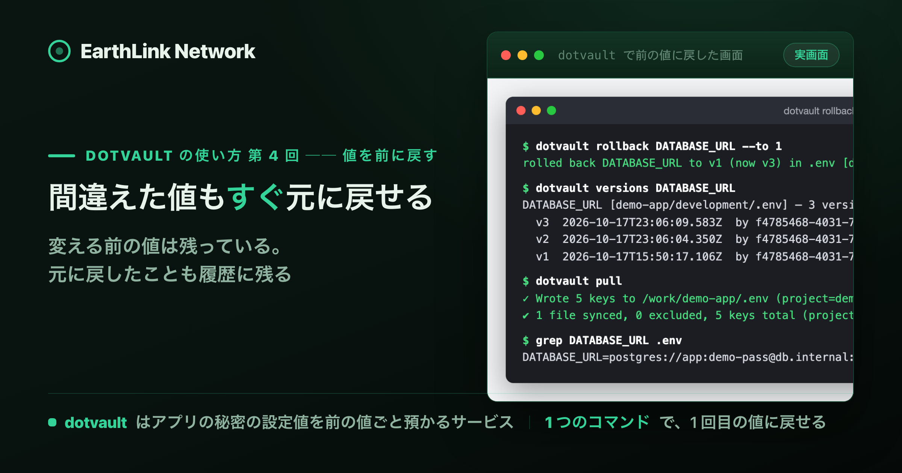
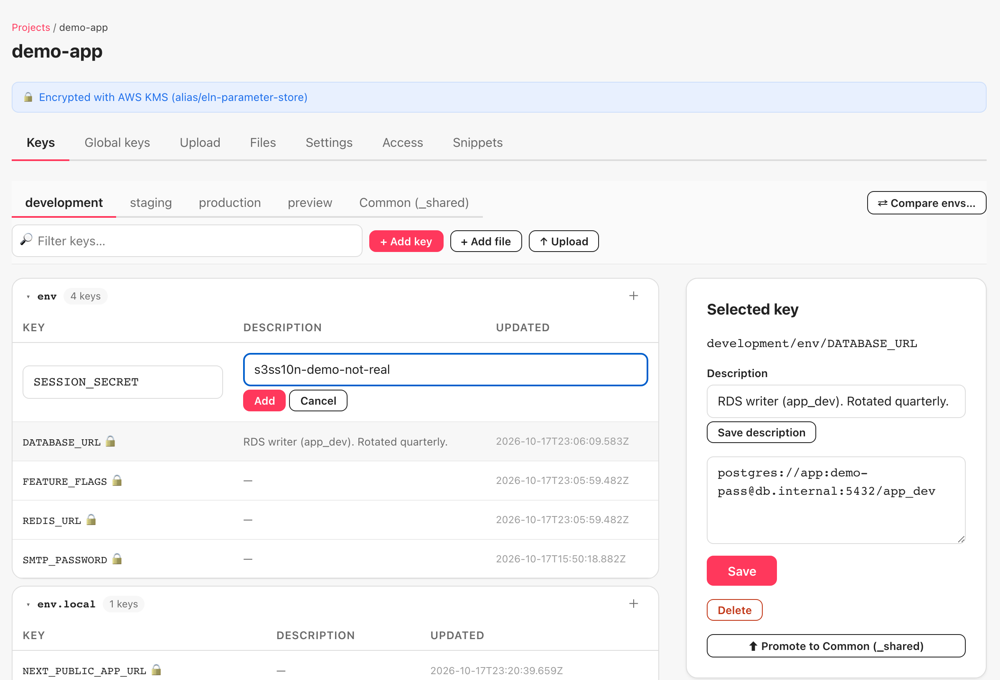
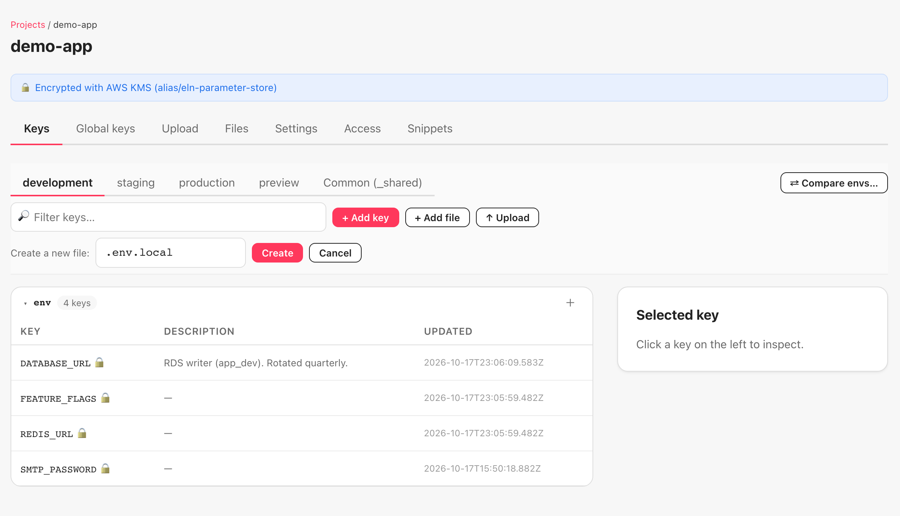
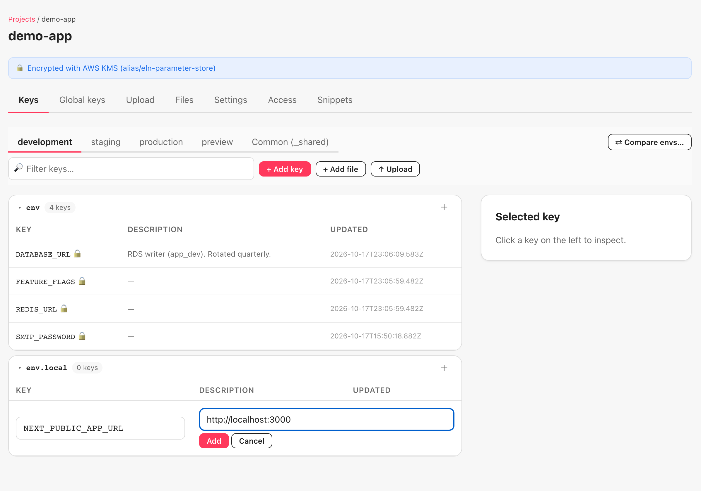
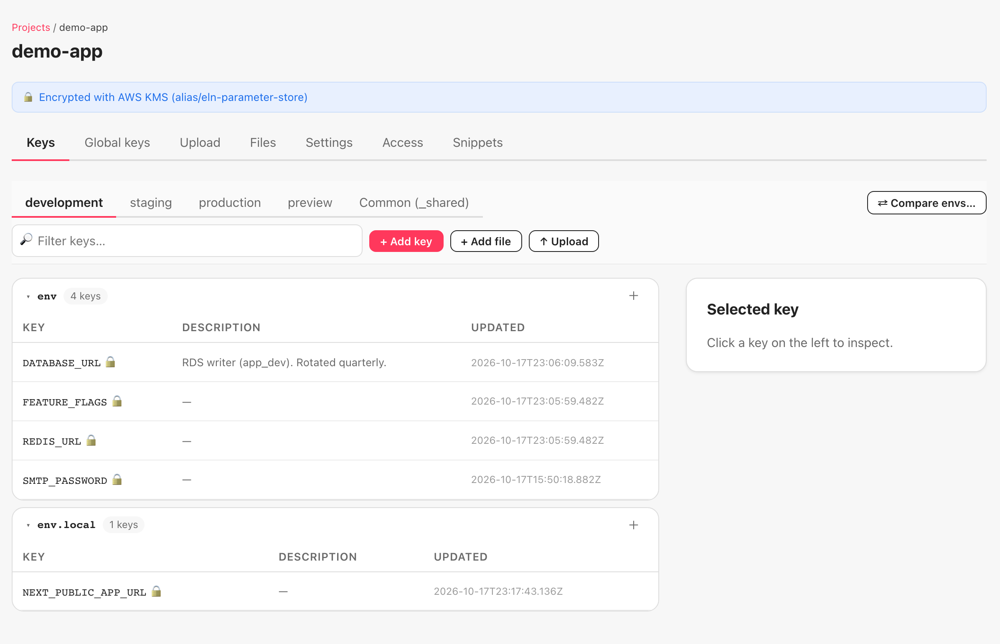
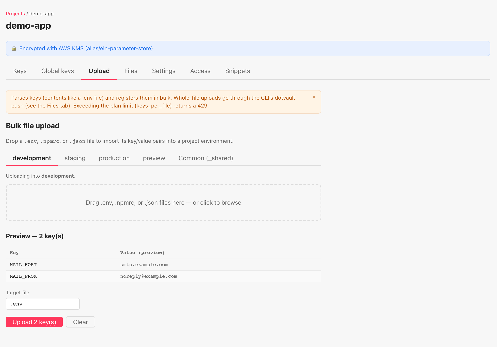
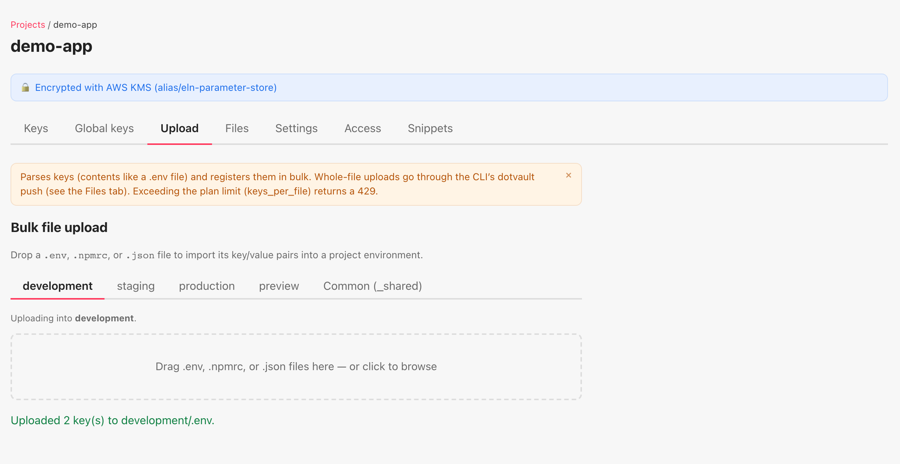
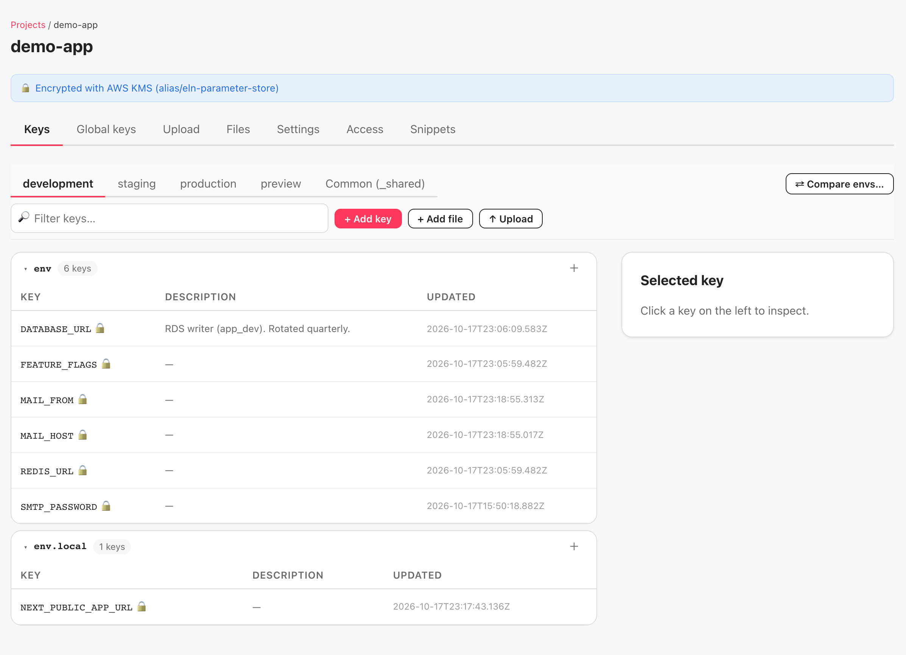
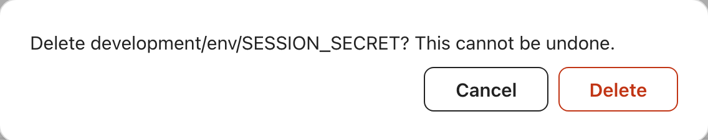

<!-- このファイルは gen-publish.mjs が生成した発行用スケルトン。翻訳(海外媒体)は Claude が en.md 経由で行う。 -->
<!-- gen-publish:src-sha256=55bb0044eac7a05c200c4b4edd313d2937a36c2fdd7162dc67272e15b99b5917 -->

上原正吉（EarthLink Network Co., Ltd.）。AI会社・AI社員による業務自動化と、人の逐次介入なしに24時間自動開発を回す仕組みを自社で実践しています。開発ノウハウと具体的な設定方法、運用して分かった改善点を公開しています。

<!-- TODO(Claude): この zenn 版は媒体トーン定義（/docs/platform-tone）に合わせてトーン・長さを調整する。方向性: 技術・実装重視。設計判断と数字を厚く。開発者向け。 以下は基となる本文。調整後にこのコメントを消す。 -->

# 値を間違えて上書きしてしまった ── key を書く・取り出す・前の値に戻す

この記事は、連載「dotvault の使い方 ── .env を手で配るのをやめ、CI・チーム・AI エージェントに 1 コマンドで配るまで」の第 4 回です。この連載が終わる時に、dotvault を誰でも無料で使える形で公開する予定です。

`.env` の `DATABASE_URL` を、staging の値で上書きしてしまう。気付くのは、開発サーバーが staging のデータベースにつながってからです。戻そうとすると、前の値がどこにも残っていません。`.env` はただのテキストファイルで、保存した瞬間に前の内容は消えます。チャットで「前の DATABASE_URL を持っている人はいますか」と聞いて回ることになります。

「上書きしなければ済む」と考えがちですが、環境が増え、key が増え、書く人が増えるほど、上書きの回数は増えます。気を付けるだけでは防げません。

この回では、key を書く・取り出す・前の値に戻す、の 3 つを扱います。dotvault では、間違えて上書きしても前の値が残っていて、1 コマンドで戻せます。`DATABASE_URL` の 1 回目の値（v1）を 2 回目（v2）で上書きしても、v1 は消えません。`dotvault rollback DATABASE_URL --to 1` で v1 の値に戻り、戻したことも 3 回目の変更（v3）として履歴に残ります。2 回目で作り、3 回目で環境を増やした `demo-app` を、そのまま使います。

## 結論

- **key は画面からも、端末で実行するコマンド（CLI）からも書けます。** 画面は Keys タブの + Add key と、`.env` を落として一括登録する Upload タブです。CLI は 1 つずつなら `dotvault set KEY=VALUE`、ファイルごとなら `dotvault import .env` です。CLI で複数の key を入れる時は、値がコマンド履歴に残らない `import` を先に使います。
- **値を変えても、前の値は消えません。** `dotvault versions KEY` で、何回目の変更か・日時・書いた人・値のハッシュが新しい順に並びます。
- **前の値に戻すのは `dotvault rollback KEY --to N` の 1 コマンドです。** 戻したことも新しい変更として記録されます。v1 に戻すと v3 になり、間違えた v2 も残ります。履歴は消えません。
- **取り出すのは `dotvault pull` です。** 引数なしで、その project の今の環境が持つ全部のファイルを書きます。`--file .env.local` で 1 ファイルだけ受け取れます。
- **値を見るのは画面の Reveal value、消すのは画面の Delete か `dotvault delete` です。** 消した後も `versions` には前の値の記録が残ります。監査の画面は 10 回目で扱います。

## 本文（読了 約12分）

## 前提

3 回目で `demo-app` に development・staging・production・preview の 4 環境と Common を作った状態から続けます。3 回目を読んでいなくても、画面の流れは追えます。

## 1. 画面から key を 1 つずつ書く

Keys タブの「+ Add key」を押すと、一覧の先頭に名前と値の入力欄が出ます。名前を入れ、値を入れ、Add で確定します。

一覧は名前順に並びます。入れた順ではありません。ここで入れた `SESSION_SECRET` は、この回の後半で消します。

project には `.env` のほかに、`.env.local` のような別のファイルも持たせられます。「+ Add file」を押すと、ファイル名の入力欄が出ます。最初から `.env.local` が入っています。

Create を押すと、`.env` の一覧の下に `.env.local` の一覧が増えて、最初の key の入力欄が開きます。key を 1 つ入れるまでは、ファイルは保存されません。

Add で確定すると、`.env` の 4 つと `.env.local` の 1 つが、別の一覧で並びます。この回の後半で、CLI から `.env.local` だけを受け取ります。

## 2. 手元の .env をまとめて登録する

key が 10 個あるのに 1 つずつ入れるのは手間です。Upload タブに、手元の `.env` を落とします。

先に環境を選びます。落としたファイルがどの環境に入るかは、領域の上の「Uploading into development.」で分かります。ファイルを落とすと、登録する前に key と値の一覧が出ます。

ここで中身を確かめてから、Upload を押します。終わると 1 行で結果が出ます。

Keys タブに戻ると、`.env` の一覧が 6 行になっています。

注意書きにある「Whole-file uploads」は、`.npmrc` や kubeconfig のようにファイルをそのまま配る別の仕組みで、5 回目で扱います。この Upload は、ファイルの中の key と値を読み取って、1 つずつ登録するものです。

## 3. CLI から書く: import と set

端末に戻ります。ここから 5 節までの端末の画面は、1 節と 2 節より前に撮りました。そのため、ファイルは `.env` の 1 つだけ、key の数は Keys タブの 4 行に Common の `API_BASE_URL` を足した 5 で出ています。2 節で入れた `MAIL_HOST` と `MAIL_FROM` は、撮影の後に `dotvault delete MAIL_HOST MAIL_FROM` で消してあります（本文の図には出しません）。

CLI で key を書く方法は 2 つあります。`dotvault import <ファイル>` は、ファイルの中の key と値を全部登録します。`dotvault set KEY=VALUE` は、引数に書いた key を登録します。

先に使うのは `import` です。`set` は値をコマンドの引数に書くので、シェルの履歴（`~/.zsh_history` など）に値が残ります。`import` はファイルを読むので、履歴に残るのはファイル名だけです。

![`dotvault import` の端末画面（再構成）。cat .env.import で REDIS_URL と FEATURE_FLAGS の 2 行（コメント 1 行つき）、dotvault import .env.import で「imported 2 keys into .env [demo-app/development]」、dotvault versions DATABASE_URL で「1 versions」と v1 の 1 行。](../assets/DVLT-004/4-7-import.png)

`import` は、ファイルの `KEY=VALUE` の行だけを読みます。`#` で始まるコメント行は読みません。引用符で囲んだ値（`FEATURE_FLAGS="beta,new-dashboard"`）は、引用符を外して登録されます。`KEY=VALUE` の行が 1 つも無いファイルを渡すと、VALIDATION_ERROR で止まります（8 節）。

同じ画面の 3 つ目で、`DATABASE_URL` の変更の履歴を見ています。2 回目で画面から入れたままなので、v1 の 1 つだけです。次の節で、これを上書きします。

## 4. 間違えて上書きする

冒頭の事故を、そのまま再現します。`DATABASE_URL` に staging のデータベースの名前を書いてしまいます。

![`dotvault set` で上書きした端末画面（再構成）。dotvault set DATABASE_URL=…/app_staging で「set DATABASE_URL (v2) in .env [demo-app/development]」、dotvault pull で 5 keys・1 file synced、grep DATABASE_URL .env で app_staging の値、dotvault versions DATABASE_URL で「2 versions」と v2・v1 の 2 行（日時・by・sha つき）。](../assets/DVLT-004/4-8-mistake.png)

`set` の出力に `(v2)` と出ています。2 回目の変更として記録され、v1 の値は消えていません。`dotvault pull` すると `.env` には v2 の値（`app_staging`）が書かれます。5 keys のうち 1 つは、3 回目で Common に移した `API_BASE_URL` です。Common の key は、どの環境を pull しても一緒に書かれます。ここまでは、ただのテキストファイルで起きることと同じです。

違いは `dotvault versions DATABASE_URL` です。v2 と v1 が、新しい順に並びます。各行には、日時、書いた人の ID、値のハッシュ（`sha=`）が付きます。値そのものは出ません。ハッシュが同じなら値が同じ、違えば違う、ということだけが分かります。

## 5. 1 コマンドで前の値に戻す

`dotvault rollback DATABASE_URL --to 1` で、v1 の値に戻します。

![`dotvault rollback --to 1` の端末画面（再構成）。「rolled back DATABASE_URL to v1 (now v3) in .env [demo-app/development]」、dotvault versions DATABASE_URL で「3 versions」と v3・v2・v1 の 3 行（v3 と v1 の sha が同じ）、dotvault pull で 5 keys、grep DATABASE_URL .env で app_dev の値。](../assets/DVLT-004/4-9-rollback.png)

出力は「rolled back DATABASE_URL to v1 (now v3)」です。v1 に戻したのに、今の番号は v3 です。これが dotvault の戻し方です。v2 を消して v1 に戻るのではなく、v1 と同じ値を 3 回目の変更として記録します。`versions` を見ると、v3 と v1 の `sha=` が同じで、v2 の `sha=` だけ違います。間違えた v2 も、戻した v3 も、全部残ります。

戻した値を手元に反映するのは、いつもの `dotvault pull` です。`grep` で `app_dev` に戻ったことが確かめられます。rollback は dotvault の側の値を変えるだけで、手元の `.env` は pull するまで変わりません。

戻す先に指定できるのは、履歴にある番号だけです。無い番号を指定した時の出力は 8 節にまとめました。

## 6. 取り出す: pull と --file

2 回目から使っている `dotvault pull` は、引数なしだと、その project と環境が持つ全部のファイルを書きます。1 節で `.env.local` を足したので、今は 2 ファイルです。1 ファイルだけ欲しい時は `--file` を付けます。

`.env.local` も、`.env` と同じように BEGIN / END のマーカーで囲まれて書かれ、権限は所有者だけが読み書きできる `-rw-------` です。`dotvault list demo-app` の表には、development の `.env` と `.env.local` が別の行で出ます。

`.env` の key の数が 5 なのは、Keys タブの 4 行に Common の `API_BASE_URL` が足されるからです。2 節で入れた `MAIL_HOST` と `MAIL_FROM` は、3 節の冒頭に書いたとおり、撮影の後に消してあります。

`set` や `versions` にも `--file` があります。付けないと、`project-config.json` の `files` の最初のファイル（2 回目の init で `.env`）が対象です。`.env.local` の key を扱う時は、毎回 `--file .env.local` を付けます。

![`--file` の有無で対象のファイルが変わる端末画面（再構成）。dotvault versions NEXT_PUBLIC_APP_URL で「[demo-app/development/.env] — 0 versions」、--file .env.local を付けると「[demo-app/development/.env.local] — 1 versions」と v1 の行、dotvault set --file .env.local NEXT_PUBLIC_APP_URL=http://localhost:3001 で (v2)、dotvault rollback NEXT_PUBLIC_APP_URL --file .env.local --to 1 で「to v1 (now v3)」。](../assets/DVLT-004/4-12-file-scope.png)

`--file` を付け忘れると、`.env` の側を見に行って「0 versions」と出ます。エラーにはなりません。key が無いように見えたら、まずファイルを疑います。

## 7. 値を見る・説明を付ける・消す

画面で key を選ぶと、右側の Selected key に、説明の欄と「Reveal value (audit-logged)」のボタンが出ます。Reveal value を押すと、値が入った欄と Save のボタンに変わります。この回では Save は押していません。

ボタンには「audit-logged」とあります。監査の画面は 10 回目、チームのほかの人が値を見られるかどうかは、人を招く 9 回目で扱います。

説明（Description）は、値とは別に持てる短い文です。画面には Save description のボタンがあります。この回では CLI の `dotvault describe KEY "説明"` で付けました。説明を変えても、値の変更の回数は増えません。

key を消すのは、画面の Delete か、CLI の `dotvault delete KEY` です。画面では確認が出ます。

CLI では確認なしで消えます。複数の key を 1 回で消せます。

![`dotvault describe` と `dotvault delete` の端末画面（再構成）。describe DATABASE_URL "RDS writer (app_dev). Rotated quarterly." で「described DATABASE_URL in .env [demo-app/development]」、describe NO_SUCH_KEY "x" で黄色の「warning: NO_SUCH_KEY has no current value … — description not applied」と echo $? で 1、set FOO=1 BAR=2 で (v1) が 2 行、delete FOO BAR で「deleted 2 keys from .env [demo-app/development]」、versions FOO で「1 versions」と v1 の行。](../assets/DVLT-004/4-10-describe-delete.png)

最後の `dotvault versions FOO` を見てください。消した後なのに、v1 が残っています。delete は今の値を無くす操作で、変更の履歴は消しません。

無い key に `describe` すると、warning が出て、終了コードは 1 です。終了コードは、コマンドが終わる時に返す数字で、0 が成功、0 以外が失敗を表します。コマンドの直後に `echo $?` と入力すると見られます。赤い `✖` ではなく黄色の warning なので、スクリプトから使う時は色ではなく終了コードを見ます。

## 8. うまくいかない時の出力

この回で出た失敗を、終了コードと一緒にまとめます。

| 操作 | 出力の種類 | 終了コード |
|---|---|---|
| `rollback --to 9`（履歴に無い番号） | PROJECT_NOT_FOUND（server の文に version 9 … not found） | 5 |
| `rollback --to 0` | VALIDATION_ERROR（positive integer） | 6 |
| `import empty.env`（KEY=VALUE が無い） | VALIDATION_ERROR（No KEY=VALUE lines） | 6 |
| `pull --file .env.nope`（無いファイル） | PROJECT_NOT_FOUND（server の文に No DDB secrets for .env.nope） | 5 |
| `describe NO_SUCH_KEY`（無い key） | warning（description not applied） | 1 |

履歴に無い番号と無いファイルは、どちらも PROJECT_NOT_FOUND と終了コード 5 です。何が見つからなかったのかは、括弧の中の server の文に出ます。

## 次回

5 回目は「.npmrc と kubeconfig を、まだ手で渡している ── ファイルごと配る push と、commit の前に止める scan」です。key と値に分かれないファイルをそのまま配る `dotvault push` と、コミットする前に secret（API キーやパスワードのように外に出してはいけない値）の混入を見つける `dotvault scan` を、画面と一緒に進めます。

---

dotvault は、.env や設定ファイルの secret をサーバー側に置き、権限のある人・CI・AI エージェントが 1 コマンドで受け取るサービスです（https://dotvault.io）。この連載が終わる時に、dotvault を誰でも無料で使える形で公開する予定です。公開したら、この連載の手順どおりに使い始められます。

興味のある方は、ぜひ「いいね」と記事の購読をお願いいたします。

自社プロダクトは https://www.eln.ne.jp/products にまとめています。

## 筆者について

上原正吉。EarthLink Network Co., Ltd. 代表。AI社員に日々の業務を任せ、開発では人が逐一指示しなくても作業が進むHOOTL（Human Out Of The Loop）の仕組みを自社で実践しています。このブログでは、業務自動化と24時間自動開発のノウハウ、具体的な設定方法、日々の運用で見つかった問題と改善を共有します。

また、AIで業務や開発を組み替えたい会社・チーム向けに、AI活用のコンサルティングも受け付けています。ご相談は [www.eln.ne.jp](https://www.eln.ne.jp) からどうぞ。

---

**EarthLink Network** は、会社の全業務を AI で回すために、必要になったものを自社で作っています。いま作っているプロダクトの一覧と概要は、こちらにまとめています。

→ [EarthLink Network が自社でつくっている18のプロダクト](https://zenn.dev/chooser/articles/in-house-products)

会社と各プロダクトの詳細は、公式サイト [www.eln.ne.jp](https://www.eln.ne.jp) をご覧ください。
