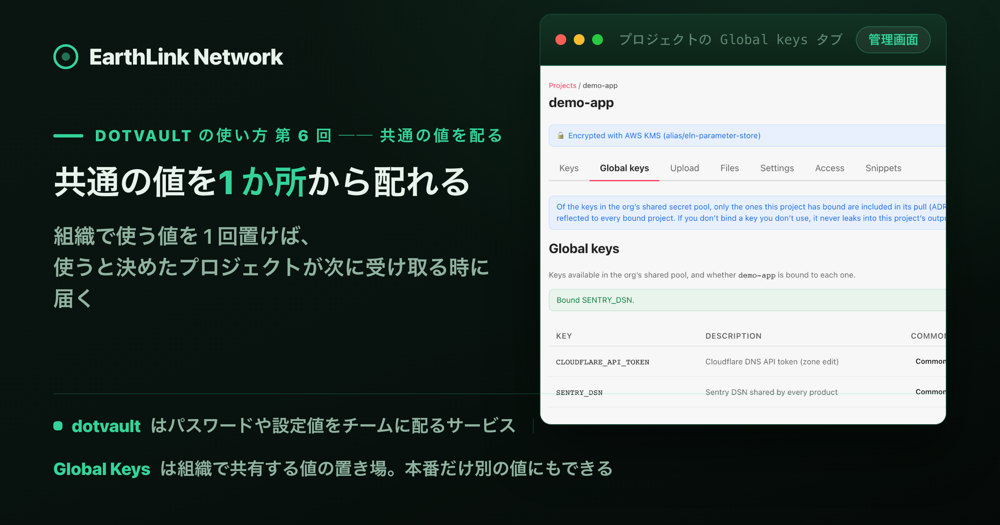
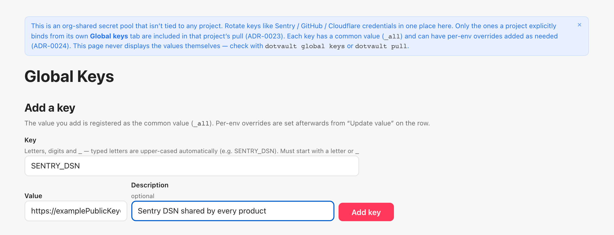
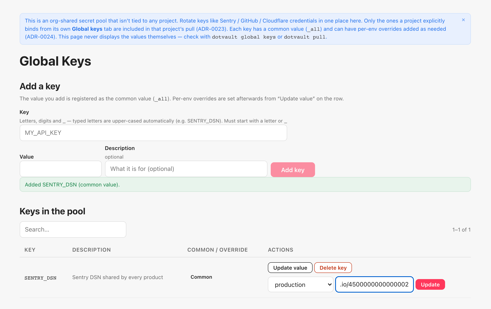
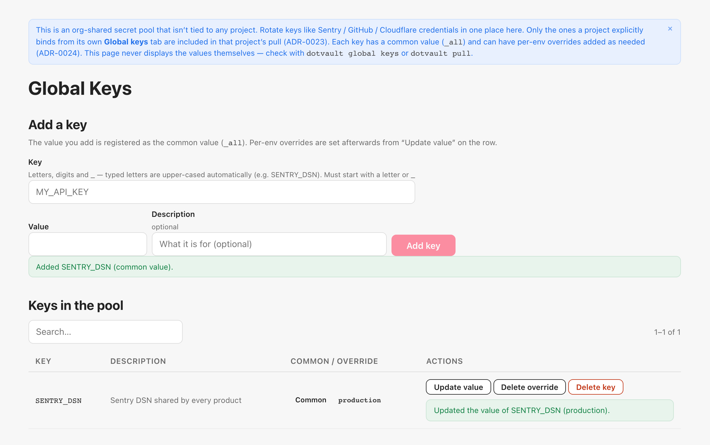
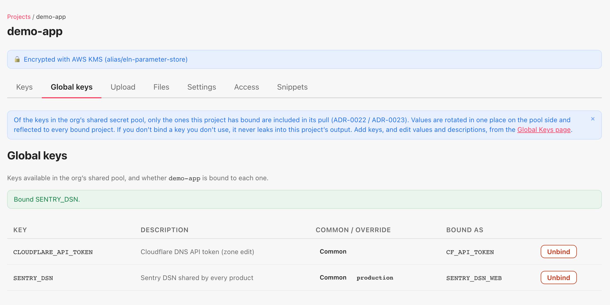
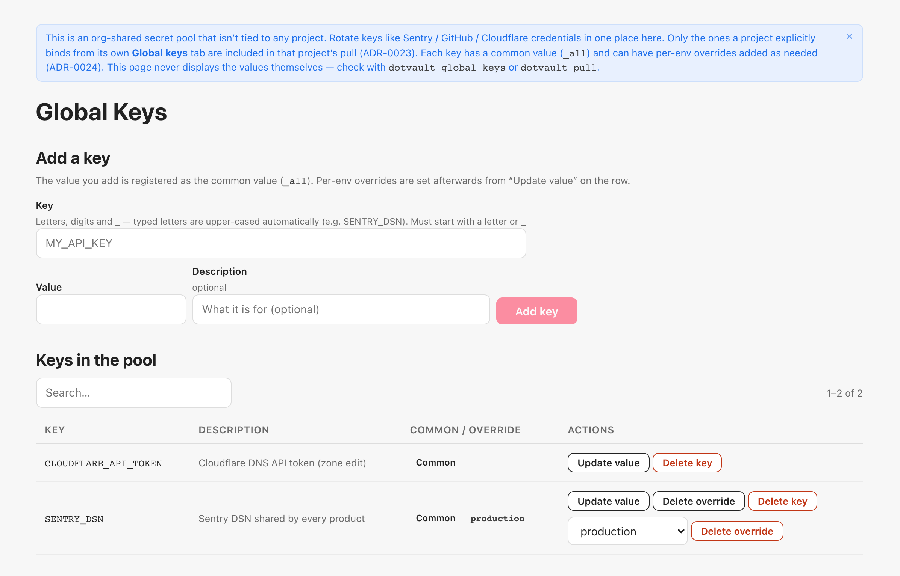
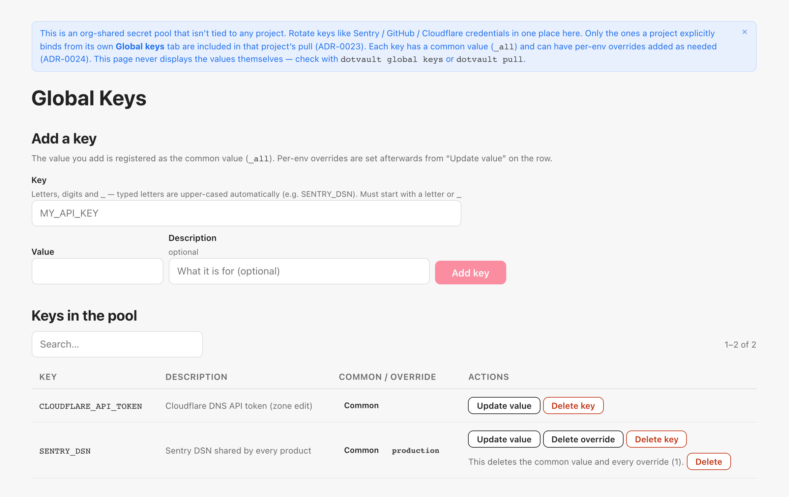

<!-- このファイルは gen-publish.mjs が生成した発行用スケルトン。翻訳(海外媒体)は Claude が en.md 経由で行う。 -->
<!-- gen-publish:src-sha256=ab8ee3b6aeabfe1626876a89fe483b577502070cfe866fdcb410ac8eced1badf -->

上原正吉（EarthLink Network Co., Ltd.）。AI会社・AI社員による業務自動化と、人の逐次介入なしに24時間自動開発を回す仕組みを自社で実践しています。開発ノウハウと具体的な設定方法、運用して分かった改善点を公開しています。

<!-- TODO(Claude): この zenn 版は媒体トーン定義（/docs/platform-tone）に合わせてトーン・長さを調整する。方向性: 技術・実装重視。設計判断と数字を厚く。開発者向け。 以下は基となる本文。調整後にこのコメントを消す。 -->

# 同じ SENTRY_DSN を project ごとに貼っている ── 共通の値は Global Keys に置いて bind する

この記事は、連載「dotvault の使い方 ── .env を手で配るのをやめ、CI・チーム・AI エージェントに 1 コマンドで配るまで」の第 6 回です。この連載が終わる時に、dotvault を誰でも無料で使える形で公開する予定です。

Sentry の DSN を取り替える日には、その値を使っている project の `.env` を順に開いて、同じ値を project の数だけ貼り直すことになります。Cloudflare の API トークンも同じです。どの project が持っているかを覚えていなければ、grep で探してから貼ります。1 つ貼り忘れると、その project だけ古い値で動きます。

「project ごとに `.env` があるのだから、共通の値も project ごとに持つしかない」と考えがちですが、それは組織で 1 つしか無い値を、project の数だけ複製しているだけです。複製が project の数だけあれば、取り替えも、漏れた時に止めるのも、project の数だけ必要です。Global Keys に 1 回置けば、bind した project は次の `pull` で受け取ります（この回の実測では、`demo-app` の development の `.env` が 5 key から 7 key に増えました）。

この回では、組織で共有する値（API トークンや DSN）を 1 か所に置く Global Keys と、それを使う project が自分で受け取りを宣言する bind を扱います。画面と CLI で `SENTRY_DSN` と `CLOUDFLARE_API_TOKEN` を置き、2 回目から使っている `demo-app` に bind し、`pull` で `.env` に混ざるところ、production だけ別の値になるところ、project が同じ名前の key を持っていたらどちらが勝つかまで進めます。

## 結論

- **組織で共有する値は、project ではなく Global Keys に置きます。** 画面のサイドバーの Global Keys か、CLI の `dotvault global set` です。置いた値は「共通の値」（画面では Common、CLI では `_all`）として全環境に効き、環境ごとに別の値（上書き）を足せます。
- **project は、bind した key だけを受け取ります。** 置いただけでは、どの project にも配られません。project の Global keys タブで Bind するか、project のディレクトリで `dotvault global use <KEY>` を実行します。受け取る時の名前は `--as`（画面では alias）で変えられます。
- **受け取りは、いつもの `pull` と `run` です。** 追加の操作はありません。bind した key は `.env` の管理区間の先頭に並びます（並ぶ位置の話で、優先順位とは別です）。production を `pull` すると、production の上書き値が入ります。`pull` は実行したディレクトリの `.env` を書き換えるので、production を確かめる時は別のディレクトリで実行します。production に project の key が 1 つも無くても `pull` は通り、bind した key 2 つ（production の上書き値）と、project の Common (_shared) の `API_BASE_URL` の 3 key が書かれます。
- **同じ名前の key を project が環境の値として持っていれば、project の値が勝ちます。** pool の値は（共通の値も、環境ごとの上書きも）いちばん弱い層です。受け取りをやめるのは、project の Global keys タブの Unbind か、CLI の `global drop` です。CLI の `global delete KEY` は共通の値を消し、`global delete KEY -E <env>` はその環境の上書きを消します。上書きも含めて key をまるごと消すのは、画面の Delete key です。
- **CLI の `global` のコマンドで pool を触る時は `--org <id>` が要ります。** `global keys` と `global set` を `--org` 無しで実行すると、`ORG_CONTEXT_REQUIRED` で止まりました（終了コード 1）。1 つの org にしか入っていなくても、pool を触る `global` のコマンドは org を自動で選びません。`describe` と `delete` も `--org` を付けて実行します。project のディレクトリで実行する `global use`・`global status`・`global drop` は、`--org` 無しで動きます（どれも終了コード 0）。org の id は `dotvault whoami` に出ます。ただし、`global` を付けない素の `dotvault set` は別です。`project-config.json` の無いディレクトリで実行すると、`--org` 無しでもそのまま pool の共通の値に書かれます（終了コード 0）。project の key を `set` する時は、project のディレクトリで実行します。
- **bind の状態を見る場所は、project の Global keys タブと `global status` です。** project の Keys タブは project に置いた key の一覧で、bind した key は Global keys タブの BOUND AS の列に出ます。

## 本文（読了 約14分）

## 前提と注意

- **読者。** 5 回目の「.npmrc と kubeconfig を、まだ手で渡している ── ファイルごと配る push と、commit の前に止める scan」までで、`demo-app` の development に `.env`（5 key）と `.env.local`（1 key）がある状態から続けます。5 回目で push した `.npmrc` と `.kube/config` も development に残っていますが、push したファイルは key ではないので、この回の key の数には入りません。5 回目を読んでいなくても、画面の流れは追えます。
- **環境。** 画面は、本番の app.dotvault.io と、公開されている CLI（0.15.7）で確かめました。端末は 2 回目と同じ Node 20 の Linux コンテナです。
- **org は Personal です。** 2 回目で作った、自分 1 人の org です。権限の設定が無く、Global Keys も含めて全部の操作が最初からできます。人を招いた org（Company）での権限の見え方は、9 回目で扱います。
- **端末の画面は再構成です。** 実行した出力を文字どおりに写し、見やすい形に組み直しています。生の出力はそのまま保存しています。別々に実行したコマンドを `cd … && …` の 1 行にまとめた所と、生の出力に [exit=N] として残した終了コードを `echo $?` の行で示した所があります。
- **画面は英語です。** 管理コンソールの表示言語は、2 回目の付録の手順で日本語にできます。
- **デモのアカウントです。** project 名、key の値、org の id は、この連載のために作ったデモのものです。`https://examplePublicKey@o4500000000000000.ingest.sentry.io/…` や `cf_demo_…` は、どこにもつながらないデモの値です。
- **用語。** 「pool」は org で共有する値の置き場（画面の Global Keys）です。「共通の値」は、環境を指定せずに置いた値で、画面では Common、CLI では `_all` と出ます。「上書き」は、環境を指定して置いた値です。「bind」は、project が pool の key を受け取ると宣言することで、「alias」は受け取る時の別名です。「終了コード」は、コマンドが終わる時に返す数で、0 が成功、それ以外が失敗です。「管理区間」は、dotvault が `.env` に書き込む範囲で、`# BEGIN` の行と `# END` の行の間です。手で書いた行はその外に残ります。bind をやめることを unbind と言い、画面では Unbind、CLI では `global drop` です。

## 1. project の key と Global Keys の違い

4 回目までの key は、project の、環境の中にありました。Global Keys は、そのどちらにも属しません。

| | project の key | Global Keys（pool）の key |
|---|---|---|
| 置き場 | project × 環境（3 回目の Common (_shared) は、project の中の、全環境に共通の key の置き場所） | org に 1 つ。project には属さない |
| 置く | project の Keys タブ、`set` / `import` | サイドバーの Global Keys、`global set` |
| 値の層 | 環境の値と、project の Common (_shared) の値 | 共通の値（Common / `_all`）と、環境ごとの上書き |
| 配る先 | その project | **bind した project だけ**。置いただけでは配られない |
| 受け取る | `pull` / `run` | 同じ `pull` / `run`。追加の操作は無い |
| 同じ名前なら | ── | project の値が勝つ。pool の値はいちばん弱い |
| 値を見る | Keys タブの Reveal、`pull` | 画面には出ない。`pull` の結果で見る |

画面の Global Keys の注意書きにも、同じことが書いてあります。「This is an org-shared secret pool that isn't tied to any project. … Only the ones a project explicitly binds from its own Global keys tab are included in that project's pull. … This page never displays the values themselves — check with dotvault global keys or dotvault pull.」

## 2. 画面で pool に値を置く

サイドバーの Global Keys を押します。最初は空です。

Add a key に、key の名前・値・説明を入れます。名前に使えるのは英字・数字・`_` で、先頭は英字か `_` です（例: SENTRY_DSN）。

Add key を押すと、「Added SENTRY_DSN (common value).」と出て、Keys in the pool に 1 行増えます。COMMON / OVERRIDE の列に Common のタグが付きます。ここで置いた値は共通の値で、development でも staging でも production でも、この値が配られます。

production だけ別の値にするには、行の Update value を押します。

選択肢は Common (_all) と 3 つの環境です。production を選んで値を入れ、Update を押すと「Updated the value of SENTRY_DSN (production).」と出ます。

Common と production の 2 つのタグが付きました。この状態の意味は、「production は上書きの値、それ以外の環境は共通の値」です。上書きが付くと、Delete override のボタンも出ます。

画面には、値そのものは出ません。4 回目の Keys タブにあった Reveal に当たるものが、この画面にはありません。入れた値を確かめるのは、5 節の `pull` です。

## 3. CLI で pool に値を置く

同じことを CLI でやります。pool を触るコマンドは `dotvault global` の下にあります。

![CLI で pool に値を置く端末画面（再構成）。dotvault whoami で email と「org: org_personal_f4785468-… Personal (personal, org_admin)」、dotvault global keys で「ORG_CONTEXT_REQUIRED: X-Org-Context header required to resolve an org for this session」、--org を付けた global keys で SENTRY_DSN の行（envs 列が common,production）、global set CLOUDFLARE_API_TOKEN=… で「set 1 key(s) in the global pool [_all]」、-E production を付けて「[production]」、global describe で「described CLOUDFLARE_API_TOKEN in the global pool [_all]」、最後の global keys で 2 行。](../assets/DVLT-006/6-4-global-set.png)

最初の `dotvault global keys` は失敗しています。`ORG_CONTEXT_REQUIRED` は、「どの org の pool か分からない」という意味です。pool を触る `global` のコマンドは、1 つの org にしか入っていなくても、login から org を選びません。pool は project に属さないので、project から org をたどることもできません。`--org <id>` を付けます。id は `dotvault whoami` の `org:` の行に出ます。この連載の demo の org は Personal なので `org_personal_…` という長い id ですが、入力するのは 1 回で、あとは端末の履歴から呼び出せます。

`global set KEY=VALUE` は、`-E` を付けなければ共通の値（`[_all]`）、`-E production` を付ければ production の上書きです。`global describe KEY "説明"` で説明を付けます。`global keys` の envs の列は、`common,production` のように、共通の値があるか・どの環境に上書きがあるかを並べます。

ここまでで、pool には画面で置いた `SENTRY_DSN` と CLI で置いた `CLOUDFLARE_API_TOKEN` の 2 つがあり、どちらも共通の値と production の上書きを持っています。画面で置いたものが CLI に、CLI で置いたものが画面に、同じ行として出ます。

## 4. project に bind する

pool に置いただけでは、`demo-app` には何も届きません。project の側で受け取りを宣言します。

CLI では、project のディレクトリで `dotvault global use <KEY>` です。

`--as CF_API_TOKEN` は、受け取る時の名前を変える指定です。pool の名前は `CLOUDFLARE_API_TOKEN` のまま、`demo-app` の `.env` には `CF_API_TOKEN=…` として書かれます。アプリのコードが読んでいる名前に合わせたい時に使います。

3 つ目の `GH_TOKEN` は、pool に無い名前を bind してみたものです。「Bound」と出た後に、「the global project has no value yet for: GH_TOKEN」という警告が付きます。bind は通りますが、値が無いので `pull` には入りません（5 節で確かめます）。

画面では project の Global keys タブで、BOUND AS の列に bind の状態が出ます（6b 節で、画面から alias を付けて bind します）。

`global status` と `global use` / `drop` は、project のディレクトリで実行するか、`-p <project>` で project を指定します。`project-config.json` の無いディレクトリで `-p` も無しに実行すると、9 節の VALIDATION_ERROR になります。

## 5. pull で受け取る

`demo-app` のディレクトリで `dotvault pull` を実行します。追加の指定はありません。

![dotvault pull の端末画面（再構成）。dotvault pull で「Wrote 7 keys to /work/demo-app/.env」「Wrote 1 keys to /work/demo-app/.env.local」「2 files synced, 0 excluded, 8 keys total」、cat .env で手書きの PORT=3000 の下の管理区間に CF_API_TOKEN=cf_demo_…、SENTRY_DSN=https://examplePublicKey@…、API_BASE_URL、DATABASE_URL、FEATURE_FLAGS、REDIS_URL、SMTP_PASSWORD の 7 行。cd ../prod-check && dotvault pull -E production で「Wrote 3 keys」「1 file synced, 1 excluded, 3 keys total」、cat .env で CF_API_TOKEN=cf_demo_prod_…、SENTRY_DSN=https://prodPublicKey@…、API_BASE_URL の 3 行。](https://raw.githubusercontent.com/EarthLinkNetwork/blog_public/main/images/dvlt-006/6-6-pull-mixed.png)

development の `.env` は 5 key から 7 key になりました。増えた 2 つ、`CF_API_TOKEN` と `SENTRY_DSN` は、管理区間（`# BEGIN` と `# END` の間）の先頭に並びます。project の key は、その後に名前順です。4 節で bind した `GH_TOKEN` は、pool に値が無いので書かれていません。警告も出ません。

出力の「7 keys」には、pool から来た 2 つも含まれます。pool から来た key は管理区間の先頭に並び、どれを bind しているかは `global status` で見られます。

下半分は production です。`pull` は、実行したディレクトリの `.env` の管理区間を、指定した環境の値で書き直します（下の `prod-check` の `.env` の管理区間が production の 3 key だけになっているのは、そのためです）。`demo-app` で `-E production` を実行すると、development の `DATABASE_URL` なども管理区間から消え、production の値が手元の `.env` に入ります。そこで、`project-config.json` だけを写した別のディレクトリ（`prod-check`）で `pull -E production` を実行しました。`demo-app` の production には、4 回目まで key を 1 つも置いていません。それでも `pull` は通り、3 key が書かれました。`CF_API_TOKEN` と `SENTRY_DSN` は production の上書きの値（`cf_demo_prod_…` と `prodPublicKey`）で、`API_BASE_URL` は 3 回目で project の Common (_shared) に置いた値です。「1 excluded」は、production に key の無い `.env.local` が書かれなかった、という意味です。

staging も試しました。staging には上書きが無いので、`CF_API_TOKEN` と `SENTRY_DSN` は共通の値で入ります（画像は省略・生の出力は保存しています）。環境を指定して置いた値はその環境だけ、それ以外は共通の値、という決まりが、`pull` の結果で確かめられました。

`run` でも同じです。6b 節の最後の画面で、`dotvault run -- sh -c 'printenv CF_API_TOKEN SENTRY_DSN_WEB'` が 2 つの値を出しています。

## 6. 同じ名前の key を project が持っていたら

pool の `SENTRY_DSN` を bind したまま、`demo-app` の development に同じ名前の key を置いてみます。

![同じ名前の key の端末画面（再構成）。dotvault set SENTRY_DSN=https://projectOwnKey@… で「set SENTRY_DSN (v1) in .env [demo-app/development]」、dotvault pull で 7 keys、grep -n SENTRY .env で 6 行目が projectOwnKey の値、dotvault global drop GH_TOKEN と global drop SENTRY_DSN で「Dropped … from demo-app.」、global status で CLOUDFLARE_API_TOKEN -> CF_API_TOKEN の 1 行、dotvault delete SENTRY_DSN で「deleted 1 keys from .env」、dotvault pull で 6 keys、grep で 5 行目の CF_API_TOKEN だけ。](../assets/DVLT-006/6-7-project-wins.png)

`pull` の後の `.env` で、`SENTRY_DSN` の値は project に置いた `projectOwnKey` の方です。key の数は 7 のまま（pool の分が project の分に置き換わり、増えていません）。位置は bind の並び（管理区間の先頭側）のままで、値だけが project のものになっています。

pool の値は、いちばん弱い層です。project が環境の値を持っていれば、そちらが勝ちます。

受け取りをやめるのは `global drop` です。画面では、Global keys タブの行の Unbind ボタンが同じ操作です（CLI のヘルプでも drop は「Unbind an org global key from this project.」と説明されています）。`GH_TOKEN` と `SENTRY_DSN` を drop すると、`global status` は `CLOUDFLARE_API_TOKEN` の 1 行になります。その後、撮影のために置いた project 側の `SENTRY_DSN` を `dotvault delete` で消して、`pull` すると 6 key（5 回目までの 5 key + `CF_API_TOKEN`）に戻ります。drop は project の bind を外すだけで、pool の key はそのまま残っています。

6b に進む前に、`CLOUDFLARE_API_TOKEN` の production の上書きを CLI で消しておきます。`dotvault global delete CLOUDFLARE_API_TOKEN -E production --org <id>` で、出力は「deleted 1 key(s) from the global pool [production]」です。この後の `global keys` で `CLOUDFLARE_API_TOKEN` の envs は `common` だけになります（どちらの出力も、7 節の最後の端末画面にあります）。6b の画面で `CLOUDFLARE_API_TOKEN` の行が Common だけなのは、このためです。

### 6b. 画面で bind し直す（alias を付ける）

drop した `SENTRY_DSN` を、今度は画面から、別の名前を付けて bind し直します。画面では、project の Global keys タブです。pool の key が全部並び、この project が bind しているかどうかが BOUND AS の列に出ます。

`SENTRY_DSN` は直前に drop したので、Bind のボタンが出ています。CLI で bind した `CLOUDFLARE_API_TOKEN` は、画面にも CF_API_TOKEN として出ています。`SENTRY_DSN` の行の alias (optional) の欄に `SENTRY_DSN_WEB` と入れて Bind を押すと、「Bound SENTRY_DSN.」と出て、BOUND AS に `SENTRY_DSN_WEB` が入ります。

project の Keys タブは project に置いた key の一覧で、development は 5 回目の終わりと同じ 4 key（development の値として置いたもの）です。5 回目の `.env` が 5 key だったのは、残りの 1 つ `API_BASE_URL` が、3 回目に project の Common (_shared) に置いた値だからです。bind の状態を見る場所は、Global keys タブと `global status` です。

画面で bind したものは CLI の `global status` にも出ます。

`global status` は `CLOUDFLARE_API_TOKEN -> CF_API_TOKEN` と `SENTRY_DSN -> SENTRY_DSN_WEB` の 2 行で、`pull` は 7 key、`.env` には `SENTRY_DSN_WEB=…` として書かれます。7 回目はこの状態から始めます。

## 7. pool から消す

消す操作は 2 段あります。上書きだけ消すか、key ごと消すかです。

画面では、行の Delete override を押すと、消す環境を選ぶ欄と Delete override ボタンが出ます（CLI では、下の `global delete … -E production` が同じ、production の上書きだけを消す操作です）。

Delete key は、共通の値と上書きを全部消します。押すと、行の下に「This deletes the common value and every override (1).」と、上書きの数を添えた確認が出て、もう一度 Delete を押します。

Delete を押すと、さらにブラウザの確認ダイアログが出て、消す key の名前が入ります。捨てるために作った key TMP_DELETE_ME で確かめると、「Delete TMP_DELETE_ME entirely (the common value and every override)? This cannot be undone.」と出ました（ブラウザのダイアログは画像に撮れないので、文言だけ引用します）。

CLI では、`global delete KEY` が共通の値、`global delete KEY -E production` が production の上書きだけです。下の画面は、6 節の最後の `CLOUDFLARE_API_TOKEN` の上書きの削除を撮ったものです。撮影では、その直前に素の `set` も試しています（そのため、途中の 3 行の `global keys` では、`CLOUDFLARE_API_TOKEN` にまだ production の上書きがあります）。

![bare set と delete の端末画面（再構成）。project-config.json の無い /work/nowhere で、dotvault set BARE_TEST=1 で「set 1 key(s) in the global pool [_all]」、global keys で BARE_TEST を含む 3 行、global delete BARE_TEST で「deleted 1 key(s) from the global pool [_all]」、global delete CLOUDFLARE_API_TOKEN -E production で「[production]」、global keys で CLOUDFLARE_API_TOKEN の envs が common だけになった 2 行。](../assets/DVLT-006/6-8-bare-set.png)

この画面の最初の 2 行は、別の話です。`project-config.json` の無いディレクトリで、`global` を付けない素の `dotvault set BARE_TEST=1` を実行すると、「set 1 key(s) in the global pool [_all]」と出ます。project が決まらない `set` は、pool に書きます。`--org` も要りません。1 つの org にしか入っていなければ、素の `set` は org を自動で決めます。`global` のコマンドには、3 節のとおり `--org` を付けます。4 回目の `set` を、`project-config.json` の無い場所で実行すると、project ではなく pool に入る、ということです。意図せず pool に書いたら、`global keys` で見て `global delete` で消します。

最後の `global keys` で、`CLOUDFLARE_API_TOKEN` の envs が `common` だけになりました。production の上書きを消しても、共通の値は残ります。

## 8. 権限と service token

この回の org は Personal（自分 1 人の org）なので、権限の設定はありません。CI に渡す service token は 7 回目で、人を招いた org で誰が pool に書けるかは 9 回目の権限の回で、画面を見ながら扱います。

## 9. うまくいかない時の出力

この回で出た失敗と、名前が間違っていても成功の文が出る操作をまとめます。

![失敗の端末画面（再構成）。dotvault global keys で ORG_CONTEXT_REQUIRED と 1、global describe NO_SUCH_KEY "does not exist" --org … で「described NO_SUCH_KEY in the global pool [_all]」と 0、global drop NOT_BOUND で「Dropped NOT_BOUND from demo-app.」と 0、config の無いディレクトリでの global status で VALIDATION_ERROR（No project-config.json found …）と 6、global set --org … で「error: missing required argument 'pairs'」と 1。](../assets/DVLT-006/6-14-gotchas.png)

| 操作 | 出力 | 終了コード |
|---|---|---|
| `global keys` / `global set` を `--org` 無しで | ORG_CONTEXT_REQUIRED: X-Org-Context header required to resolve an org for this session | 1 |
| `global describe NO_SUCH_KEY "…"`（pool に無い名前） | described NO_SUCH_KEY in the global pool [_all]（key は作られない） | 0 |
| `global use GH_TOKEN`（pool に無い名前） | Bound GH_TOKEN … + Warning: the global project has no value yet for: GH_TOKEN | 0 |
| `global drop NOT_BOUND`（bind していない名前） | Dropped NOT_BOUND from demo-app. | 0 |
| `global status`（`project-config.json` の無い場所・`-p` 無し） | VALIDATION_ERROR: No project-config.json found … For the org-wide pool use `dotvault global …` | 6 |
| `global set --org …`（KEY=VALUE 無し） | error: missing required argument 'pairs' | 1 |

1 行目は、どの org の pool かが決まらない、という意味です。`--org <id>` を付けて実行し直します（3 節の `global keys --org …` の実行例）。

2 行目と 4 行目は、pool に無い名前に説明を付けても、bind していない名前を drop しても、成功の文で 0 が返ります。名前が合っているかは、`global keys` と `global status` で確かめます。3 行目の `use` には、警告が付きます。

この表は CLI 0.15.7 の出力です。名前の入力の間違いや bind の漏れは、4 節と 5 節のとおり `global status` と `pull` の出力で確かめます。

## 次回

7 回目は、CI に人のパスワードを置かずに secret を渡す回です。画面で発行した service token 1 つで、GitHub Actions が production の値を受け取るところまで進めます。この回で bind した `CF_API_TOKEN` と `SENTRY_DSN_WEB` も、7 回目の `pull` の結果に出てきます。

---

dotvault は、.env や設定ファイルの secret をサーバー側に置き、権限のある人・CI・AI エージェントが 1 コマンドで受け取るサービスです（https://dotvault.io）。この連載が終わる時に、dotvault を誰でも無料で使える形で公開する予定です。公開したら、この連載の手順どおりに使い始められます。

興味のある方は、ぜひ「いいね」と記事の購読をお願いいたします。

自社プロダクトは https://www.eln.ne.jp/products にまとめています。

## 筆者について

上原正吉。EarthLink Network Co., Ltd. 代表。AI社員に日々の業務を任せ、開発では人が逐一指示しなくても作業が進むHOOTL（Human Out Of The Loop）の仕組みを自社で実践しています。このブログでは、業務自動化と24時間自動開発のノウハウ、具体的な設定方法、日々の運用で見つかった問題と改善を共有します。

また、AIで業務や開発を組み替えたい会社・チーム向けに、AI活用のコンサルティングも受け付けています。ご相談は [www.eln.ne.jp](https://www.eln.ne.jp) からどうぞ。

---

**EarthLink Network** は、会社の全業務を AI で回すために、必要になったものを自社で作っています。いま作っているプロダクトの一覧と概要は、こちらにまとめています。

→ [EarthLink Network が自社でつくっている18のプロダクト](https://zenn.dev/chooser/articles/in-house-products)

会社と各プロダクトの詳細は、公式サイト [www.eln.ne.jp](https://www.eln.ne.jp) をご覧ください。
