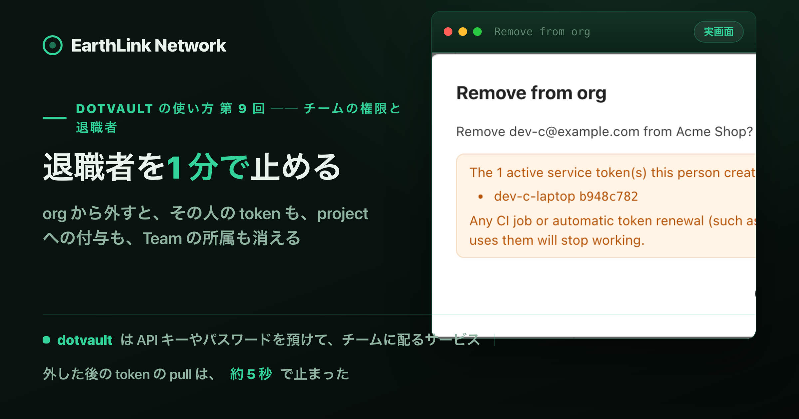
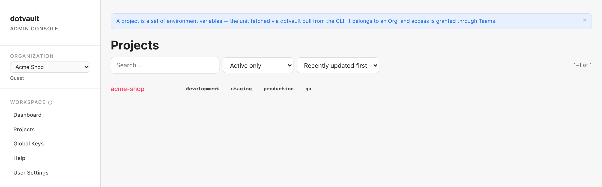
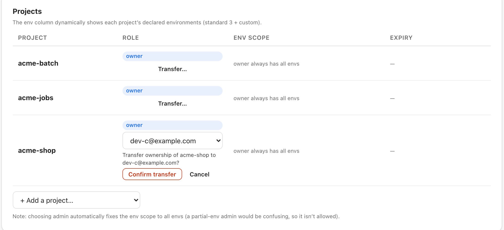

<!-- このファイルは gen-publish.mjs が生成した発行用スケルトン。翻訳(海外媒体)は Claude が en.md 経由で行う。 -->
<!-- gen-publish:src-sha256=2c44d85cf672fa3c39cbece02145c4e963b7220b50f536511e1994283f1cc2c6 -->

上原正吉（EarthLink Network Co., Ltd.）。AI会社・AI社員による業務自動化と、人の逐次介入なしに24時間自動開発を回す仕組みを自社で実践しています。開発ノウハウと具体的な設定方法、運用して分かった改善点を公開しています。

<!-- TODO(Claude): この zenn 版は媒体トーン定義（/docs/platform-tone）に合わせてトーン・長さを調整する。方向性: 技術・実装重視。設計判断と数字を厚く。開発者向け。 以下は基となる本文。調整後にこのコメントを消す。 -->

# 退職者の .env をどう無効にするか分からない ── Company org・招待・4 つのロール・Team・1 分で止める



この記事は、連載「dotvault の使い方 ── .env を手で配るのをやめ、CI・チーム・AI エージェントに 1 コマンドで配るまで」の第 9 回です。この連載が終わる時に、dotvault を誰でも無料で使える形で公開する予定です。

人が辞める時、その人の手元にある .env をどうするか。.env をチャットやファイルで配っていると、渡した値を取り戻す方法がありません。共有のパスワードを変えても、.env に書かれた API キーやデータベースの接続先は、そのまま使えます。

dotvault で配っていれば、止めるのは、org からその人を外す操作 1 つです。外すと、その人の pull が止まり、その人が作った service token も失効し、project への付与と Team の所属も消えます。デモでは、外してから約 5 秒後に試した token の pull も、約 15 秒後に試した login の pull も、止まっていました。

すでに pull した値は、その人の PC に残ります。そこで最後に、その人が読めた値を新しい値に替えます。

この回では、demo の会社「Acme Shop」で、Personal の org を Company に切り替え、人を招待し、project と環境ごとに権限を付けるところから、人が辞める時に止める順番までを通して見ます。

## 結論

- **Company に切り替えると、人を招待できます。** User Settings の Organization で切り替え、Members の + Invite member で、email と役割と最初の付与（project・役割・環境）を決めて招待します。
- **project の役割は owner・admin・writer・reader の 4 つで、writer と reader は環境ごとに付けられます。** development だけを付けた人は、production を pull できません。Team に付けると、Team の全員に同じ権限が付きます。
- **人が辞める時は、控える → Audit Log を見る → owner を移す → Remove from org → 確かめる → 値を替える、の順です。** 外すと、その人の token・付与・Team の所属が一緒に消えます。owner を持つ人は、先に owner を移さないと外せません。
- **デモでは、外して 15 秒後には、token の pull も login の pull も止まっていました。** 最後に、その人が読めた値を `dotvault set` で替えます。

## 本文（読了 約11分）

## 前提

2 回目（pull）と 7 回目（service token）の続きです。Audit Log の読み方は 10 回目にあります。

## 1. Personal の org を Company に切り替える

dotvault に初めて login すると、自分だけの org（Personal）ができます。Personal は自分だけの場所で、人を招待できません。チームで使う時は、Company の org に切り替えます。

この記事に出る人は 3 人です。

| 人（demo のユーザー） | 役割 | この記事での役 |
|---|---|---|
| dev-b | org_admin | Acme Shop の管理者。招待・権限の付与・人を外す操作をする |
| dev-c | member | 社員。後半で辞める人として外す |
| dev-d | guest | 社外の協力者 |

切り替えは、管理者になる人（dev-b）が、左の User Settings の Organization で行います。会社の名前を入れて Convert to Company を押すと、確認の文が出ます。


「This cannot be undone.」のとおり、Company から Personal には戻せません。project と、そこに置いた値は、そのまま引き継がれます。Yes, convert を押すと「Converted to a Company organization.」と出て、左に My Organizations と Teams が増えます。切り替えると、前から作っていた project `acme-shop` の owner に dev-b が付きました。

## 2. org の役割は 3 つ、project の役割は 4 つ

Company の org には、2 種類の役割があります。org の中で何ができるか（org の役割）と、project ごとに値を読めるか・書けるか（project の役割）です。Members の画面の上に、それぞれの説明が並びます。

| 役割 | 画面の説明 | 意味 |
|---|---|---|
| `owner` | Exactly one per project. Full access + can appoint/remove admins + transfer ownership. | project に 1 人。すべてができ、admin を決め、owner を他の人に移せる |
| `admin` | Manages this project's permissions (grant/revoke writer/reader) + read/write on all envs. Cannot appoint/remove owner or admin (owner only). | project の writer・reader を付け外しし、全部の環境を読み書きできる |
| `writer` | Read + write (equivalent to a token's member role). Can be scoped to specific envs. | 読み書きできる。環境を絞れる |
| `reader` | Read only, i.e. pull (equivalent to a token's viewer role). Can be scoped to specific envs. | 読む（pull する）だけ。環境を絞れる |
| `org_admin` | Can always manage the org (members, owner transfers, project settings). Cannot read/write values — grant that to yourself if needed (audited). | org の管理者。人の招待・外す操作・owner の移し替えができる。値を読むには、自分に project の役割を付ける（Audit Log に残る） |
| `member` | Org role: a regular member who can see the workspace (project list, member list, Teams). Data access depends on project role. | 社員。project の一覧や人の一覧は見えるが、値を読めるかは project の役割で決まる |
| `guest` | Org role: sees nothing except projects explicitly granted (list views are hidden too). For external collaborators. | 社外の人。付けた project しか見えない |

上の 4 つが project の役割、下の 3 つが org の役割です。org_admin は org を管理する役割で、それだけでは値を読めません。

## 3. メールアドレスで招待し、development だけを付ける

dev-b が、Members の + Invite member で dev-c を招待します。email に dev-c のメールアドレス、Org role に Member を選び、Add initial access (optional) に印を付けると、最初の付与を一緒に決められます。デモでは、Target に `acme-shop`、Role に writer、環境は Selected で development だけにしました。


Send invitation を押すと、一覧に dev-c の行が Invited で出ます。行の Access には `acme-shop: writer (development)` と、招待で付ける権限が出ます。

行の Resend を押すと、新しい招待のリンクが出ます。リンクは `https://app.dotvault.io/invite/` で始まります。Copy で写して、チャットなどで本人に渡します。


図のリンクの続きは、招待ごとに違う文字列なので塗りつぶしました。リンクは本人にだけ渡します。

## 4. 招待された人は Join を押し、付けた環境だけを pull できる

デモでは、dev-c が app.dotvault.io に login してから、渡されたリンクを開きました。login した時点で、画面の上に「You have 1 pending organization invitation(s). View →」と出ます。

リンクを開くと「Invitation to Acme Shop」と、役割（Member）と、Join のボタンが出ます。Join を押すと「You joined Acme Shop」と出て、Go to console で Acme Shop の画面に入れます。CLI を使う人は、同じ画面の「Using the CLI (dotvault pull)? Set a password first →」から、CLI の login に使うパスワードを決めておきます。

dev-c が CLI で login し、`dotvault pull` を打ちます。

![端末の画面（再構成）。Right after joining — writer on acme-shop, development only の見出しの下で、dotvault whoami が dev-c のメールアドレスと、Acme Shop (company, member) と Personal (personal, org_admin) の 2 つの org を出す。dotvault pull acme-shop -E development は Wrote 2 keys。dotvault pull acme-shop -E production は「✖ PERMISSION_DENIED: You do not have permission for project 'acme-shop' env 'production' …」で、echo $? は 4。After dev-c was added to Team backend — writer on acme-shop, all environments の見出しの下では、-E production と -E qa の pull がどちらも Wrote 2 keys。](https://raw.githubusercontent.com/EarthLinkNetwork/blog_public/main/images/dvlt-009/9-4-member-pull.png)

`dotvault whoami` には、参加した Acme Shop（`company, member`）と、dev-c 自分の Personal の 2 つの org が出ます。付けた development の pull は通り、付けていない production の pull は `PERMISSION_DENIED`（権限が無い）で、終了コード 4 で止まります。図の下半分は、次の節で dev-c を Team に入れた後の結果です。

## 5. Team に付けると、Team の全員に同じ権限が付く

人ごとに付けるほかに、Team に付ける方法があります。Team は、同じ権限を持つ人をまとめたものです。左の Teams で Team を作り（デモでは `backend`）、Team の詳細の + Add member で、org の人を email で選んで入れます。無料の plan（free）では、Team は 1 つまでです。2 つ目を作ろうとすると「Team limit reached for your plan (free): 1/1」と出ます。

Team への権限は、project の画面の Access で付けます。Grant to で Team を選び、Role と環境を決めて Grant を押します。環境に「All environments (including ones added later)」を選ぶと、後から足した環境にも、その権限が効きます。

![acme-shop の Access の画面の切り抜き。上に Access の見出しと「Members and teams granted directly to acme-shop.」。Grant access の欄に Grant to（Member・Team）、Member、Role（writer — view and edit）、Environments（All environments (including ones added later)・Only selected environments）。下の一覧は 4 行で、Member dev-b・owner・All environments・「Owner (change it via "Transfer ownership" on the member page)」、Team backend・writer・All environments、Member dev-c・writer・development、Member dev-d・reader・development。一覧の下に「If someone holds both a personal and a team grant with different roles, only the stronger role applies, with that grant's environment limits. With the same role, their environments are combined (a grant for all environments gives access to all).」](https://raw.githubusercontent.com/EarthLinkNetwork/blog_public/main/images/dvlt-009/9-5-access-tab.png)

一覧の下の説明のとおり、人への付与と Team への付与の両方がある人は、役割が違えば強い方の役割が効きます。役割が同じなら、両方の環境を合わせた範囲になります。dev-c は、本人への付与が writer（development）、Team backend への付与が writer（All environments）なので、全部の環境を読み書きできます。前の節の図の下半分のとおり、dev-c の production と qa の pull が通るようになりました。

## 6. 社外の人は guest で招く

社外の協力者は、Org role を Guest にして招待します。デモでは、dev-d を guest で招き、`acme-shop` の reader を development だけに付けました。

guest が見える project は、付けた project だけです。左のメニューにも、Members・Teams・Service Tokens・Audit Log が出ません。



Acme Shop には `acme-shop` のほかに `acme-batch` もありますが、dev-d の Projects には `acme-shop` しか出ません。URL で Members の画面を開いても「Guests cannot access this resource」と出ます。`acme-shop` の Keys には「You have read-only access to this project. Editing actions are hidden (revealing a value is audit-logged).」と出て、値を書き換えるボタンは出ません。

CLI でも同じです。dev-d の `dotvault project list` には `acme-shop` だけが出ます。development の pull は通り、production の pull と、`dotvault set` での書き込みは、どちらも `PERMISSION_DENIED`（終了コード 4）で止まりました。

## 7. 人が辞める時は、6 つの手順で止める

ここから、dev-c が辞める場面です。順番は次のとおりです。

| 手順 | すること | 理由 |
|---|---|---|
| ① | Member の詳細で、その人が読めた project と環境を控える | 外すと付与と Team の所属が消えるので、先に見ておく |
| ② | Audit Log で、その人の操作を見る | その人が作った token や、権限の変更を知る |
| ③ | owner を持っていれば、他の人に移す | owner を持つ人は、先に移さないと外せない |
| ④ | Remove from org を押す | pull が止まり、token・付与・Team の所属が消える |
| ⑤ | 一覧と Audit Log で、消えたことを確かめる | 止まったことを、後から 1 つずつ確かめられる |
| ⑥ | その人が読めた値を、新しい値に替える | すでに pull した値は、その人の PC に残る |

デモでは、辞める前の dev-c に、CI などで使う service token を 1 つ作らせておきました（名前は `dev-c-laptop`）。member も、自分に付与のある project と環境に限って、token を作れます。期限は 1 day から 1 year までで、既定は 90 days です。

### ① Member の詳細で、読めた project と環境を控える

Members で dev-c の行の Details を押すと、dev-c の詳細が出ます。


Projects の欄が本人への付与、TEAMS の欄が Team を通した付与です。dev-c は、本人への付与では development だけですが、Team backend を通して `acme-shop` の全部の環境を読めました。⑥ で替える値は、この全部の環境の値です。外すとこの画面ごと無くなるので、先に控えておきます。

### ② Audit Log で、その人の操作を見る

左の Audit Log で、Actor (email / sub) に dev-c のメールアドレスを入れて Apply を押します。


dev-c が作った service token（`service_token.created`）と、招待を受けた記録（`rbac.invitation.accepted`）が並びます。デモでは dev-c を何度か招き直したので、招待を受けた行が 3 つあります。token の行には、前の日に作った 3 つ（もう失効しています）も一緒に出ています。

`rbac.invitation.accepted` の Actor は、email ではなく、dev-c のユーザー ID（`64782458-…`）で出ています。操作によって、Actor が email で記録されるものと、ユーザー ID で記録されるものがあります。Actor に email を入れて絞れば、ユーザー ID で記録された行も一緒に出ます。

辞める人が管理者だった場合は、その人が Team に誰を足したか、project を作ったか消したかも Audit Log に出ます。次の図は、管理者の dev-b で絞った例です。


右の Change の列に、何がどう変わったかが出ます。`team.member.added` の「+」に続くメールアドレスは Team に足した人、`team.updated` の「name: backend → backend-qa」は Team の名前の変更前と変更後です。

### ③ owner を持っていれば、他の人に移す

project の owner を持っている人は、そのままでは org から外せません。先に owner を他の人に移します。

移すのは、Member の詳細の Projects の欄です。owner の行の Transfer… を押し、org の人の一覧から移す相手を選ぶと、行の中に確認の文が出ます。Confirm transfer を押すと、その場で移ります。



デモでは、先に dev-b から dev-c へ `acme-shop` の owner を移しておきました（図はその時の画面です）。dev-c を外す前に、dev-c の詳細の Transfer… で、owner を dev-b に戻しました。移した記録は、Audit Log に `rbac.assignment.owner_transferred` で残ります。

Company で新しく作った project には、owner が付いていません。その project の Access には「This project has no owner.」と出て、org_admin が Designate owner で owner を決めます。

### ④ Remove from org を押す

dev-c の詳細の一番下の Remove from org を押すと、確認の画面が出ます。


確認の画面に、dev-c が作った service token の名前（`dev-c-laptop`）と Token ID の先頭が出ます。外すと、この token も一緒に失効します。その token を使っている CI などは止まるので、その時に止まって困るものが無いかを、ここで見ます。

Remove を押す前と後で、dev-c の login の pull と、`dev-c-laptop` の token の pull を比べました。


外した後、token の pull は `AUTH_REQUIRED`（token が無効・期限切れ・失効）で終了コード 3、login の pull は `PERMISSION_DENIED` で終了コード 4 になりました。外してから約 5 秒後に token を、約 15 秒後に login を試した時点で、どちらも止まっていました。1 分後も同じです。

dotvault は、誰がどの org にいるかを、最大 60 秒は覚えたまま使います。外したことが伝わるまで、長くても 1 分です。

### ⑤ 一覧と Audit Log で、消えたことを確かめる

外した後、Members から dev-c の行が消えます。`acme-shop` の Access からも dev-c の行が消え、Team backend のメンバーは dev-b だけになりました。

Service Tokens の一覧で、All (incl. revoked) を選ぶと、失効した token も出ます。


`dev-c-laptop` の Status が revoked（失効）になっています。Created by の列で、誰が作った token かが分かります。

Audit Log には、外した時の記録が、同じ秒に 3 行並びます。Metadata の列は表の右の端にあるので、表を横にスクロールして読みます（下の図では下の段）。

![Audit Log の切り抜き（Actor の絞り込みなし）を上下 2 段に並べた図。同じ 7 行で、上の段はスクロールする前の表（Timestamp・Actor・Action・Target・Change の左の部分）、下の段は表を右の端までスクロールした後（Target・Change・Metadata）。上の 3 行はどれも同じ時刻で、member.removed（Target は org_member/64782458-…・Change は「− role: member」・Metadata は revoked_token_ids:b948c782…）、member.grants_removed（Actor は dev-b のメールアドレス・Metadata は kept_owner_targets:・reason:member_removed・removed:{"kind":"env_permission","projectEnv":"acme-shop:development"}, {"kind":"team_membership","teamId":"team_3mZFhAxahvkT"}）、service_token.revoked（Target は service_token/b948c782…・Metadata は name:dev-c-laptop・reason:member_removed・removed_sub:64782458-10c1…）。その下に rbac.assignment.owner_transferred（project#acme-shop）が 2 行（1 行目は Change が「subject: 64782458… → dev-b のメールアドレス」・Metadata が self_granted:true、2 行目は Change が「subject: dev-b のメールアドレス → 64782458…」）、service_token.created（Actor は dev-c のメールアドレス・Metadata は envs:development・expires_at・name:dev-c-laptop）、rbac.assignment.owner_transferred（project#acme-jobs・Change は「subject: none → dev-b のメールアドレス」・Metadata は self_granted:true）。](https://raw.githubusercontent.com/EarthLinkNetwork/blog_public/main/images/dvlt-009/9-14-audit-after-remove.png)

| Action | 意味 |
|---|---|
| `member.removed` | dev-c を org から外した。Change の「− role: member」は外す前の役割、Metadata の `revoked_token_ids` は一緒に失効させた token |
| `member.grants_removed` | dev-c の project への付与（`env_permission`）と、Team の所属（`team_membership`）を消した |
| `service_token.revoked` | dev-c が作った token `dev-c-laptop` を失効させた |

どの付与を消したかも Metadata に残るので、① で控えるのを忘れても、ここで読めます。

### ⑥ その人が読めた値を、新しい値に替える

dotvault から外しても、dev-c がすでに pull した .env は、dev-c の PC に残ります。その中の値を使えなくするには、値そのものを新しくします。

デモでは、`acme-shop` の development の 2 つの値を、dev-b が新しい値に替えました。

```bash
dotvault set STRIPE_SECRET_KEY=<新しい値> -p acme-shop -E development
dotvault set DATABASE_URL=<新しい値> -p acme-shop -E development
```

どちらも `set STRIPE_SECRET_KEY (v3) in .env [acme-shop/development]` のように、3 回目の変更として置かれました。dev-c は Team を通して全部の環境を読めたので、運用では production・staging・qa の値も同じように替えます。

外部のサービスが発行した API キー（決済サービスのキーなど）は、そのサービスの管理画面で新しく発行し、古いキーを無効にしてから、新しい値を `set` で置きます。データベースのパスワードも、データベースの側で変えてから置きます。dotvault の中の値を替えるだけでは、dev-c の PC に残った古い値は、相手のサービスでは使えたままです。

## まとめ

.env をチャットやファイルで配っていると、辞めた人の手元の値を取り戻せません。dotvault で、Company の org に人を招待し、project と環境ごとに権限を付けておけば、人が辞める時は、読めた範囲を控え、Audit Log を見て、owner を移し、Remove from org を押します。外すと、その人の token・project への付与・Team の所属が一緒に消え、デモでは 15 秒後には pull が止まっていました。残る作業は、その人が読めた値を新しい値に替えることだけです。

---

dotvault は、.env や設定ファイルの secret をサーバー側に置き、権限のある人・CI・AI エージェントが 1 コマンドで受け取るサービスです（https://dotvault.io ）。この連載が終わる時に、dotvault を誰でも無料で使える形で公開する予定です。公開したら、この連載の手順どおりに使い始められます。

興味のある方は、ぜひ「いいね」と記事の購読をお願いいたします。

自社プロダクトは https://www.eln.ne.jp/products にまとめています。

## 筆者について

上原正吉。EarthLink Network Co., Ltd. 代表。AI社員に日々の業務を任せ、開発では人が逐一指示しなくても作業が進むHOOTL（Human Out Of The Loop）の仕組みを自社で実践しています。このブログでは、業務自動化と24時間自動開発のノウハウ、具体的な設定方法、日々の運用で見つかった問題と改善を共有します。

また、AIで業務や開発を組み替えたい会社・チーム向けに、AI活用のコンサルティングも受け付けています。ご相談は [www.eln.ne.jp](https://www.eln.ne.jp) からどうぞ。

---

**EarthLink Network** は、会社の全業務を AI で回すために、必要になったものを自社で作っています。いま作っているプロダクトの一覧と概要は、こちらにまとめています。

→ [EarthLink Network が自社でつくっている18のプロダクト](https://zenn.dev/chooser/articles/in-house-products)

会社と各プロダクトの詳細は、公式サイト [www.eln.ne.jp](https://www.eln.ne.jp) をご覧ください。

