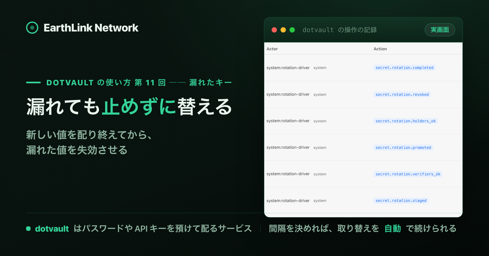

<!-- このファイルは gen-publish.mjs が生成した発行用スケルトン。翻訳(海外媒体)は Claude が en.md 経由で行う。 -->
<!-- gen-publish:src-sha256=600023ec19114649f33d95bbb0acbdb5f917165121305135feb032ce3211be62 -->

上原正吉（EarthLink Network Co., Ltd.）。AI会社・AI社員による業務自動化と、人の逐次介入なしに24時間自動開発を回す仕組みを自社で実践しています。開発ノウハウと具体的な設定方法、運用して分かった改善点を公開しています。

<!-- TODO(Claude): この zenn 版は媒体トーン定義（/docs/platform-tone）に合わせてトーン・長さを調整する。方向性: 技術・実装重視。設計判断と数字を厚く。開発者向け。 以下は基となる本文。調整後にこのコメントを消す。 -->

# 漏れた API キーを、サービスを止めずに取り替える ── dotvault の rotate で新しい値を配ってから失効させる



この記事は、連載「dotvault の使い方 ── .env を手で配るのをやめ、CI・チーム・AI エージェントに 1 コマンドで配るまで」の第 11 回です。この連載が終わる時に、dotvault を誰でも無料で使える形で公開する予定です。

サービスどうしの呼び出しに使う API キーが漏れたら、すぐに新しい値へ替えたくなります。ところが、値を替えるには順番の問題があります。

呼ばれる側（照合する側）を先に新しい値にすると、古い値を持ったままの呼ぶ側（使う側）が弾かれます。使う側を先に替えると、まだ古い値しか知らない照合する側が弾きます。どちらを先にしても、もう一方が替わるまでの間、呼び出しが失敗します。それを避けようとすると、両方をそろえて入れ替えるために、サービスを止めることになります。

この回では、dotvault の rotate（取り替え）で、漏れた API キーをサービスを止めずに替えます。dotvault は、照合する側に新しい値を先に受け付けさせ、使う側に新しい値を配り、両方が新しい値を読んだことを確かめてから、漏れた値を失効させます。デモでは、取り替えの間、応答が取れた呼び出しはすべて受け付けられました。

もう 1 つ、この回では、決めた間隔でキーを自動で取り替える機能を扱います。

rotate は、漏れた時だけのものではありません。ふだんのキーの管理にも使えます。登録の時に間隔を決めておけば、漏れていなくても、dotvault が取り替えを自動で続けます。人が手で取り替える作業が無くなるので、キーの有効期限を短く保てます。

## 結論

- **取り替えたいキーは、先に「取り替えの管理」に登録します。** 登録の時に、そのキーを使う側（holder）と照合する側（verifier）の service token を決めます。
- **漏れたら `dotvault rotate <KEY> --reason leak` を打ちます。** dotvault が新しい値を照合する側 → 使う側の順に渡し、両方が読んだのを確かめてから漏れた値を失効させるので、サービスを止めずに替えられます。デモでは、応答が取れた 111 回の呼び出しすべてで、使う側の値が受け付けられました。
- **ふだんの取り替えも自動にできます。** 登録の時に間隔（`interval_seconds`）を決めると、使う側と照合する側がふだんから dotvault を読み直していれば、dotvault が決めた間隔で取り替えを続けるので、キーの有効期限を短く保てます。
- **待てない時は、使う側のすべてが新しい値に移った後に `--revoke-now` を打ちます。** 今すぐ止める最後の手段は retire です。

## 本文（読了 約10分）

## 前提

4 回目（値の上書きと rollback）と 7 回目（service token の作り方）の続きです。読んでいなくても、画面の流れは追えます。

## 1. 取り替えたいキーを、取り替えの管理に登録する

デモの場面は次のとおりです。注文の処理をする `order-worker` が、決済の API である `payment-api` を呼びます。その時に送るのが `PAYMENT_API_KEY` で、`payment-api` は届いた値が正しいかを確かめます。この `PAYMENT_API_KEY` が漏れた、という想定です。

この記事で使う言葉は次のとおりです。

| 言葉 | 意味 |
|---|---|
| 取り替えの管理（rotation management） | dotvault がそのキーの値を作り、誰に渡すかを決めて管理する状態。登録したキーだけが対象 |
| 使う側（holder） | その値を持って、相手のサービスを呼ぶ側。デモでは `order-worker` という token |
| 照合する側（verifier） | 呼ばれた時に、届いた値が正しいかを確かめる側。デモでは `payment-api` という token |
| rotate（取り替え） | 新しい値を配ってから、古い値を失効させる操作 |
| retire（即時失効） | 新しい値を配らずに、その場で値を失効させる操作 |

取り替えの管理で値を替えられるのは、使う側も照合する側も dotvault から値を受け取る、自分たちのサービスどうしのキーです。新しい値は dotvault が作ります。外部のサービスが発行した API キーは、発行したサービスの管理画面で替えます。

デモでは、`shop-backend` という project の production の環境に、`dotvault set` で `PAYMENT_API_KEY` の最初の値を置きました。使う側の `order-worker` と照合する側の `payment-api` には、Read only の service token を 1 つずつ作りました。service token は、CI やサービスが login せずに dotvault を使うための文字列で、`est_` で始まります。作り方は 7 回目と同じです。

登録には、Credential rotation という種類の token を使います。Service Tokens の画面で Create token を押し、Role で「Credential rotation」を選びます。


画面の説明のとおり、この token は 1 つの project と、選んだ環境の中でだけ、token の発行とキーの登録ができます。登録が済めば要らない token なので、期限は 1 day にしました。

この token で、HTTP の PUT を 1 回送ります。PUT は、指定した URL にデータを送って置かせる要求の種類で、ここでは `curl -X PUT` で送ります。送る中身は、使う側と照合する側の token を Token ID で書いた JSON です。


`HTTP 201`（新しく作った、というサーバーの返事）と `"created":true` が返れば、登録は済みです。JSON の項目は次のとおりです。

| 項目 | 中身 |
|---|---|
| `bindings` | そのキーを渡す相手。`tokenId` は service token の Token ID、`role` は `holder`（使う側）か `verifier`（照合する側）、`label` は自分で付ける名前 |
| `residual_seconds` | 使う側が全員新しい値に移った後、古い値を失効させるまでに待つ秒数。デモでは 60 秒 |
| `generator`（返事に出る） | 取り替えの時に新しい値を作る方法。`random-base64url-32` は、32 バイトの乱数を英数字と記号の文字列にしたもの |

URL の `key=` が登録するキーの名前、`project=`・`env=`・`file=` がその置き場所です。`Authorization` の行の `$DOTVAULT_TOKEN` には、さきほど作った Credential rotation の token を入れています。

登録してから 5 分は、取り替えを始められません。漏れてからでは間に合わないので、サービスどうしの呼び出しに使うキーは、置いた時に登録しておきます。

## 2. 登録すると、値は使う側の token にだけ渡る

登録した後に、人、使う側の token、照合する側の token で、同じ project の pull を打ちます。


値が入るのは、使う側の `order-worker` の pull だけです。この図は、4 節の取り替えが済んだ後に撮りました。登録したキーは、取り替えの前でも後でも、同じように渡ります。人（org admin）の pull と照合する側の pull には、「withheld 1 rotation-managed key(s)」という警告にキーの名前だけが出て、値は入りません。手元の開発で同じ名前のキーが要る時は、開発用の値を別のキーの名前で置いておきます。

照合する側は、pull ではなく、受け付ける値の一覧（key-set）を `GET /v1/env/key-set` で読みます。一覧には、値と、その値の ID（`keyId`）と、状態（`state`）が入ります。照合する側は、届いた値がこの一覧に入っていれば受け付けます。

## 3. 漏れたら rotate --reason leak を打つ

取り替えの間もサービスが止まらないことを見るために、小さな台本 `service.mjs` を 15 秒おきに回しました。1 回ごとに次のことをして、1 行に書き出します。

1. 使う側の `order-worker` の token で pull し、`PAYMENT_API_KEY` の値を受け取る
2. 照合する側の `payment-api` の token で一覧を読み、受け取った値が入っていれば `accepted`、無ければ `REJECTED` とする
3. 漏れた値（取り替える前の値）も同じように一覧と比べる
4. 取り替えがどこまで進んだか（`phase`）を読む

値そのものは書き出さず、`keyId` の先頭 8 文字だけを出します。台本を回したまま、org admin が login して打ちます。

```bash
dotvault rotate PAYMENT_API_KEY -E production --reason leak
```


`started rotation` と出れば、取り替えが始まっています。`generation 2` は、このキーで 2 回目の取り替えだということです（1 回目は 7 節のふだんの取り替えで、途中で止めました）。

漏れた時の取り替えは、途中で止められません。`--abort` を打つと、`ABORT_REFUSED_LEAK`（漏れた時の取り替えは止めない。漏れた値には戻さない）と出て、終了コード 7 で止まります。漏れた値に戻る道を残さないためです。

`--status` を打つと、取り替えがどこまで進んだかが分かります。Audit Log では、開始と同じ秒に `STAGED` になっていました。

## 4. 新しい値は、照合する側 → 使う側の順に渡る

取り替えは、次の順に進みます。

| `phase` | 起きること |
|---|---|
| `STAGED` | dotvault が新しい値を作り、照合する側の一覧に足す。使う側には、まだ古い値を渡す |
| `PROMOTED` | 照合する側が新しい値を読んだのを確かめてから、15 分ほど後。使う側の pull に、新しい値を渡し始める。漏れた値は一覧に残る |
| `HOLDERS_OK` | 使う側が新しい値を読んだのを確かめてから、15 分ほど後 |
| `DONE` | `HOLDERS_OK` から `residual_seconds`（60 秒）後に、漏れた値を失効させ、一覧から外す |

表では、開始した時の `LOCKED`（Audit Log では開始と同じ秒に `STAGED` へ進む）と、`PROMOTED` と同じ秒に記録される `VERIFIERS_OK`（照合する側が読み終えた印）を省いています。

15 分ずつ待つのは、使う側と照合する側が、読んだ一覧や値を最大 5 分、手元に持ったまま使えるからです。同じ token を使うサービスがいくつも動いていて、全部が一度に読むとは限らないので、さらに 10 分の余裕を足しています。`--reason leak` を付けても、この待ちは自動では省かれません。漏れた時の取り替えでは、読まない側があっても、30 分（と手元に持てる 5 分）を過ぎれば、待たずに先へ進みます。

台本の出力のうち、`phase` が変わった前後を並べます。先頭の 2 行の `ABORTED` は、7 節で止めたふだんの取り替えの後の状態です。

![端末の画面（再構成）。node service.mjs 15 の出力の抜粋（各行の先頭の時刻は外した）。最初の 2 行は phase=ABORTED で、worker key=k_Z0Njns -> accepted、leaked key -> accepted、key-set=[k_Z0Njns:current]。次に phase=STAGED になり、key-set に k_iVota-:staged が足される。47 行を省いた行（STAGED・worker key=k_Z0Njns -> accepted・fetch の失敗 4 回）の後、error fetch failed、STAGED の行、phase=PROMOTED になり key-set は [k_iVota-:current,k_Z0Njns:retiring]、error fetch failed を挟んで worker key=k_iVota- -> accepted。47 行を省いた行（PROMOTED・worker key=k_iVota- -> accepted・fetch の失敗 5 回）の後、phase=HOLDERS_OK、error fetch failed が 2 行、最後に phase=DONE で leaked key -> REJECTED、key-set=[k_iVota-:current]。](../assets/DVLT-011/11-6-service-loop.png)

読み取れることは 3 つです。

- **照合する側が先に新しい値を知ります。** `STAGED` で一覧に新しい値（`k_iVota-`、状態 `staged`）が足されても、使う側はまだ古い値（`k_Z0Njns`）を使い、受け付けられています。
- **使う側は、新しい値に自然に移ります。** `PROMOTED` の後の pull から、使う側の値が `k_iVota-` に替わりました。この時、照合する側の一覧には新しい値がもう入っているので、受け付けられます。漏れた値は `retiring`（失効待ち）で一覧に残っています。
- **漏れた値は、最後に一覧から外れます。** `DONE` の後は、一覧は新しい値 1 つだけになり、漏れた値は `REJECTED` になりました。

台本を回した間の 124 回のうち、応答が取れた 111 回すべてで、使う側の値は `accepted` でした。残る 13 回の `error fetch failed` は、台本の側で通信が失敗し、dotvault からの応答が取れなかった回です。

取り替えの途中の様子は、管理コンソールでも見られます。project の Keys で `PAYMENT_API_KEY` を選ぶと、右の欄に Rotation が出ます。


Rotation の欄には、Phase のほかに、次に先へ進む予定の時刻（`Next due`）と、漏れた時の取り替えで読まない側がいても先へ進む期限（`Deadline`）も出ます。図では、その 2 行を外しました。

## 5. 取り替えの後、漏れた値は書き戻せない

`DONE` の後に、状態と、漏れた値の書き戻しを試します。

![端末の画面（再構成）。--status が「phase DONE, generation 2, reason leak」を出す。dotvault versions PAYMENT_API_KEY -E production は 3 versions で、v3（by system:rotation-driver・keyId=k_iVota-lIYgdFUafk5uRLzg・state=current）、v2（by system:rotation-driver・state=revoked）、v1（by 14582408-10a1-706a-de75-346a3803dd50・keyId=k_Z0Njns6tOfbc8n_hMqIAPQ・state=revoked）。dotvault set PAYMENT_API_KEY=<the leaked value> と dotvault rollback PAYMENT_API_KEY --to 1 は、どちらも「✖ ROTATION_MANAGED: this secret is under rotation management; it can only change through rotation」で止まる。](https://raw.githubusercontent.com/EarthLinkNetwork/blog_public/main/images/dvlt-011/11-7-after-done.png)

`dotvault versions` では、新しい値の v3 が `state=current`、漏れた値の v1 が `state=revoked`（失効）になっています。v3 と v2 の作成者は `system:rotation-driver` で、dotvault が作った値です。v2 は 7 節で途中で止めた取り替えの値です。

漏れた値を `dotvault set` で置こうとしても、v1 に `dotvault rollback --to 1` で戻そうとしても、`ROTATION_MANAGED`（取り替えの管理に入っているキーは、取り替えでしか変えられない）で止まりました。4 回目で見たように、ふつうのキーは上書きしても前の値を `rollback` で戻せます。取り替えの管理に入れたキーは、誰かが善意で戻そうとしても、漏れた値には戻りません。

## 6. 取り替えのログは Audit Log に残る

管理コンソールの Audit Log で、Target ID に `shop-backend:production:env:PAYMENT_API_KEY` を入れて絞り込みます。project・環境・ファイル・キーの名前を `:` でつないだものです。

![Audit Log（英語 UI）の一覧の切り抜き（Timestamp の列は除いた）。11 行が並ぶ。上から secret.rotation.completed、secret.rotation.revoked、secret.rotation.holders_ok、secret.rotation.promoted、secret.rotation.verifiers_ok、secret.rotation.staged（ここまで Actor は system:rotation-driver・system）、secret.rotation.started（Actor は 14582408-10a1-706a-de75-346a3803dd50・cli）、secret.rotation.aborted（同じ Actor・cli）、secret.rotation.staged（system:rotation-driver）、secret.rotation.started（cli）、rotation_provisioner.config_created（Actor は svc:16477a2f41f055826a3291abf4ccfaa4・system）。Target はどれも secret/shop-backend:production:env:PAYMENT_API_KEY か rotation_config/shop-backend:production:env:PAYMENT_API_KEY。](https://raw.githubusercontent.com/EarthLinkNetwork/blog_public/main/images/dvlt-011/11-8-audit-rotation-rows.png)

漏れた時の取り替えの行は、下から順に次のとおりです。Actor の `14582408-…` は、デモのユーザー dev-e のユーザー ID です。

| Action | Actor | 意味 |
|---|---|---|
| `secret.rotation.started` | `14582408-…`・cli | dev-e が CLI で取り替えを始めた |
| `secret.rotation.staged` | `system:rotation-driver` | 新しい値を作り、照合する側の一覧に足した |
| `secret.rotation.verifiers_ok` | `system:rotation-driver` | 照合する側が新しい値を読んでから、15 分の待ちが済んだ |
| `secret.rotation.promoted` | `system:rotation-driver` | 使う側に新しい値を渡し始めた |
| `secret.rotation.holders_ok` | `system:rotation-driver` | 使う側が新しい値を読んでから、15 分の待ちが済んだ |
| `secret.rotation.revoked` | `system:rotation-driver` | 漏れた値を失効させた |
| `secret.rotation.completed` | `system:rotation-driver` | 取り替えが終わった |

取り替えを始めたのは人で、その後は dotvault が自分で進めました。漏れた値を失効させたことを、後から 1 行で確かめられます。

## 7. ふだんの取り替えでは、古い値も 24 時間は使える

漏れていない時のふだんの取り替えは、`--reason` を付けずに打ちます（`--reason manual` と同じ）。

![端末の画面（再構成）。dotvault rotate PAYMENT_API_KEY -E production が「started rotation … — generation 1, phase LOCKED, reason manual」を出す。--status は「phase STAGED, generation 1, reason manual, phase deadline 2026-11-09T16:44:50.000Z」と「waiting on verifier payment-api (last ok 2026-11-08T16:39:54.637Z)」を出す。--abort --wait は「aborting rotation … — generation 1, phase ABORTED」と「settled at: … — phase ABORTED, generation 1, reason manual」を出す。dotvault versions は 2 versions で、v2（system:rotation-driver・state=revoked）と v1（state=current）。](https://raw.githubusercontent.com/EarthLinkNetwork/blog_public/main/images/dvlt-011/11-9-manual-abort.png)

漏れた時との違いは 2 つです。

- **新しい値と古い値の両方を、最低 24 時間は使えるようにしておきます。** 使う側に新しい値を渡してから 24 時間は、古い値も受け付けます。全部のサービスが入れ替わるのを、急がずに待てます。
- **途中で止められます。** 使う側に新しい値を渡す前なら、`--abort` で数秒で止まり、作った新しい値は `revoked` になって、古い値が `current` のまま残りました。

`waiting on verifier payment-api` は、照合する側の `payment-api` が新しい値をまだ読んでいない、という表示です。`last ok` は、最後に一覧を読んだ時刻です。ふだんの取り替えの `phase deadline`（開始の 24 時間後）は、読まない側を待つ期限です。過ぎても先へは進まず、取り替えは止まった状態（STALLED）になります。

## 8. 決めた間隔で、取り替えを自動にする

漏れていなくても、同じキーを長く使い続けたくない時があります。登録の時に `interval_seconds`（取り替えの間隔・秒）を足しておくと、dotvault が決めた間隔で、ふだんの取り替えを自分で始めます。取り替えを、人の作業から外せます。

デモでは、新しいキー `WEBHOOK_SECRET` を、1 節と同じ使う側と照合する側の token で登録し、`interval_seconds` を 600（10 分）にしました。10 分は撮影のための値で、運用では 30 日（2592000）などにします。

![端末の画面（再構成）。cat rotation-auto.json で、residual_seconds が 60、bindings に order-worker（holder）と payment-api（verifier）の 2 件、最後に "interval_seconds":600 が 1 行で並ぶ。続く curl -sS -X PUT で https://api.dotvault.io/v1/admin/rotation-config に project=shop-backend・env=production・file=.env・key=WEBHOOK_SECRET を付けて送ると、"created":true・"interval_seconds":600 を含む JSON と HTTP 201 が返る。dotvault rotate WEBHOOK_SECRET -E production --status は「managed but has never run.」を出す。「no rotate command typed between this --status (02:35:29Z) and the next one (02:46:28Z); only the read-only service script was started」の行の後、同じ --status が「phase STAGED, generation 1, reason scheduled, phase deadline 2026-11-10T02:46:14.000Z」を出す。](https://raw.githubusercontent.com/EarthLinkNetwork/blog_public/main/images/dvlt-011/11-12-auto-register.png)

登録の直後の `--status` は `managed but has never run`（登録されているが、まだ一度も取り替えていない）です。その後、取り替えのコマンドは誰も打っていません（動かしていたのは、値を読むだけの台本です）。間隔の 10 分が過ぎた後の `--status` は `reason scheduled`（決めた間隔が来て、dotvault が自分で始めた取り替え）で、取り替えは新しい値を照合する側の一覧に足したところ（STAGED）まで進んでいました。


Audit Log でも、登録（`rotation_provisioner.config_created`）の後の `secret.rotation.started` と `secret.rotation.staged` は、どちらも Actor が `system:rotation-driver` です。6 節の漏れた時の取り替えでは `started` の Actor は人でしたが、ここでは取り替えを始めたのも dotvault です。

自動で始まる取り替えの中身は、7 節のふだんの取り替えと同じです。新しい値と古い値の両方を最低 24 時間は使えるようにしたまま、照合する側 → 使う側の順に新しい値を渡します。次の取り替えは、前の取り替えが終わってから、決めた間隔が過ぎた後に始まります。登録の直後と、間隔を短く直した直後は、5 分たつまで始まりません。

取り替えが最後まで進むのは、使う側と照合する側が、ふだんから dotvault を読み直している時です。読み直さないサービスがあると、7 節の `waiting on …` の表示のまま待ち、期限を過ぎると止まった状態（STALLED）になります。

## 9. 待てない時は --revoke-now、最後の手段は retire

取り替えは、新しい値を配り終えるまで漏れた値を受け付けます。使う側が新しい値を読んだ後にも、15 分の待ちと 60 秒（residual）があります。漏れた値をもっと早く使えなくしたい時は、`--revoke-now` で残りの待ちを飛ばします。

```bash
dotvault rotate REFUND_API_KEY --revoke-now --confirm REFUND_API_KEY -E production
```

![端末の画面（再構成）。Terminal 2 の見出しの下で node service.mjs の台本が、phase=STAGED・worker key=k_SlbmqR -> accepted・leaked key -> accepted、phase=PROMOTED・worker key=k_3AXEFu -> accepted・leaked key -> accepted を出す。Terminal 1 の見出しの下で dotvault rotate REFUND_API_KEY -E production --status が phase PROMOTED を出し、--confirm REFUND_API_KEX と 1 文字違えた --revoke-now が「✖ VALIDATION_ERROR: --revoke-now needs --confirm <KEY> repeating the key exactly ("REFUND_API_KEY"); nothing was sent.」で止まる。--confirm REFUND_API_KEY の --revoke-now は「revoke-now accepted for REFUND_API_KEY in shop-backend/production/env — generation 1, phase PROMOTED; every remaining wait is skipped and the driver revokes it on its next step」を出す。Terminal 2 は error fetch failed の後、2 行の phase=DONE・worker key=k_3AXEFu -> accepted・leaked key -> REJECTED を出す。dotvault versions REFUND_API_KEY は v2 が state=current、v1 が state=revoked。](https://raw.githubusercontent.com/EarthLinkNetwork/blog_public/main/images/dvlt-011/11-11-revoke-now.png)

`--revoke-now` は、retire（この節の後半）で PAYMENT_API_KEY を止めた後に、別のキー `REFUND_API_KEY` を同じ手順で登録して撮りました。台本のある回で、使う側が新しい値に移りました（PROMOTED）。そこで `--revoke-now` を打つと、Audit Log では同じ秒に `revoke_now`・`revoked`・`completed` の 3 行が並び、次に応答が取れた台本の回から漏れた値は REJECTED になりました。使う側の値は accepted のままです。この撮影の台本は 74 回動き、応答が取れた 57 回すべてで、使う側の値が受け付けられました（残る 17 回は、台本の側で通信が失敗した回です）。

`--revoke-now` は、使う側のすべてが新しい値に移った後（PROMOTED の後）に打ちます。`--revoke-now` はその時から先の待ちを全部飛ばすので、早く打つと、照合する側や使う側が新しい値を読むのを待たずに切り替えて古い値を失効させます。古い値を持ったままの使う側は弾かれます。

`--status` の `waiting on holder …` の行は、token ごとの表示です。同じ token を使うサービスがいくつも動いている時は、そのうち 1 つが読めば行は消えます。他のサービスが古い値を手元に持ったままなら、`--revoke-now` の後に弾かれます。15 分の待ちのうち 10 分は、このためにあります。打つのは、すべてのサービスが新しい値を pull し直したと分かっている時（再起動させた後など）にします。デモで使う側の値が受け付けられたままだったのは、使う側が 1 つで、毎回 pull し直していたからです。

もう 1 つ、失効は dotvault の一覧から外れることです。照合する側が一覧を手元に持っている間（最大 5 分）は、漏れた値を受け付けることがあります。デモの照合する側は毎回一覧を読み直していたので、次の回から REJECTED になりました。

`--confirm` にはキーの名前をもう一度書きます。1 文字違うと `VALIDATION_ERROR` で止まり、何も送られません。打てるのは login した人だけで、service token では打てません。

使う側が新しい値に移るのも待てない時は、retire（即時失効）を使います。

```bash
dotvault rotate PAYMENT_API_KEY --retire --confirm PAYMENT_API_KEY -E production
```

![端末の画面（再構成）。dotvault rotate PAYMENT_API_KEY --retire --confirm PAYMENT_API_KEY -E production が「retiring PAYMENT_API_KEY in shop-backend/production/.env (org org_personal_14582408-10a1-706a-de75-346a3803dd50) — revokes it at once」と「retired PAYMENT_API_KEY in shop-backend/production/env — revoked version(s): 3」を出す。payment-api token (verifier) の見出しの下で key-set の curl が {"error":"NOT_BOUND","message":"this token is not bound as a verifier of this secret"} と HTTP 403 を返す。A person (org admin): write the leaked value back の見出しの下で dotvault set PAYMENT_API_KEY=<the leaked value> が「✖ VALUE_REVOKED: this value was revoked and cannot be written again」で止まる。](https://raw.githubusercontent.com/EarthLinkNetwork/blog_public/main/images/dvlt-011/11-10-retire.png)

retire は、PAYMENT_API_KEY の取り替えの撮影が終わった後に、同じキーで打ちました。`revoked version(s): 3` は、失効させたのが v3（取り替えで作った今の値）だということです。v1 と v2 は、もう失効していました。照合する側は一覧を読めなくなり（`HTTP 403`・`NOT_BOUND`）、漏れた値を `set` で書き戻そうとすると `VALUE_REVOKED`（失効した値なので、二度と書き込めない）で止まりました。

retire は新しい値を配らないので、使う側も照合する側も、その場で止まります。`--confirm` にはキーの名前をもう一度書き、1 文字でも違えば何も起きません。打てるのは login した人だけで、service token では打てません。サービスを止めてでも、今すぐ漏れた値を使えなくしたい時だけの手段です。

## 10. token の Revoke・上書き・rotate・retire の使い分け

漏れたもの・止めたいものによって、使う操作が違います。

| 漏れたもの | 使う操作 | 起きること | 扱った回 |
|---|---|---|---|
| service token（`est_…`） | Service Tokens の Revoke | その token で dotvault を使えなくなる。値そのものは変わらない | 7 回目・8 回目・10 回目 |
| 取り替えの管理に登録していないキーの値 | 新しい値を `dotvault set` で上書き | 新しい値が配られる。前の値は履歴に残り、`rollback` で戻せる | 4 回目 |
| 取り替えの管理に登録したキーの値 | `dotvault rotate --reason leak` | 新しい値を配り終えてから漏れた値を失効させる。使う側が新しい値を読めば、サービスは止まらない | この回 |
| 同じ（使う側のすべてが新しい値に移った後、残りの待ちを省く時） | `dotvault rotate --revoke-now` | 残りの待ちを飛ばして、漏れた値を dotvault の一覧から数秒で外す。古い値を持ったままのサービスは弾かれる | この回 |
| 同じ（今すぐ止める必要がある時） | `dotvault rotate --retire` | その場で失効する。使う側も照合する側も止まる | この回 |

漏れていない時のふだんの取り替えは、`dotvault rotate`（`--reason manual`）で、古い値も 24 時間は使えるようにしたまま進めます。登録に `interval_seconds` を足しておけば、そのふだんの取り替えを、dotvault が決めた間隔で自動で始めます。

## まとめ

漏れた API キーを替える時、照合する側と使う側のどちらを先に替えても、もう一方が替わるまで呼び出しが失敗します。サービスどうしの呼び出しに使うキーは、置いた時に取り替えの管理へ登録しておき、漏れたら `dotvault rotate <KEY> --reason leak` を打ちます。dotvault が照合する側 → 使う側の順に新しい値を配り、両方が読んだのを確かめてから漏れた値を失効させるので、サービスを止めずに漏れた値を使えなくできます。登録の時に間隔を決めておけば、漏れる前のふだんの取り替えも、人の作業から外せます。

---

dotvault は、.env や設定ファイルの secret をサーバー側に置き、権限のある人・CI・AI エージェントが 1 コマンドで受け取るサービスです（https://dotvault.io）。この連載が終わる時に、dotvault を誰でも無料で使える形で公開する予定です。公開したら、この連載の手順どおりに使い始められます。

興味のある方は、ぜひ「いいね」と記事の購読をお願いいたします。

自社プロダクトは https://www.eln.ne.jp/products にまとめています。

## 筆者について

上原正吉。EarthLink Network Co., Ltd. 代表。AI社員に日々の業務を任せ、開発では人が逐一指示しなくても作業が進むHOOTL（Human Out Of The Loop）の仕組みを自社で実践しています。このブログでは、業務自動化と24時間自動開発のノウハウ、具体的な設定方法、日々の運用で見つかった問題と改善を共有します。

また、AIで業務や開発を組み替えたい会社・チーム向けに、AI活用のコンサルティングも受け付けています。ご相談は [www.eln.ne.jp](https://www.eln.ne.jp) からどうぞ。

---

**EarthLink Network** は、会社の全業務を AI で回すために、必要になったものを自社で作っています。いま作っているプロダクトの一覧と概要は、こちらにまとめています。

→ [EarthLink Network が自社でつくっている18のプロダクト](https://zenn.dev/chooser/articles/in-house-products)

会社と各プロダクトの詳細は、公式サイト [www.eln.ne.jp](https://www.eln.ne.jp) をご覧ください。
