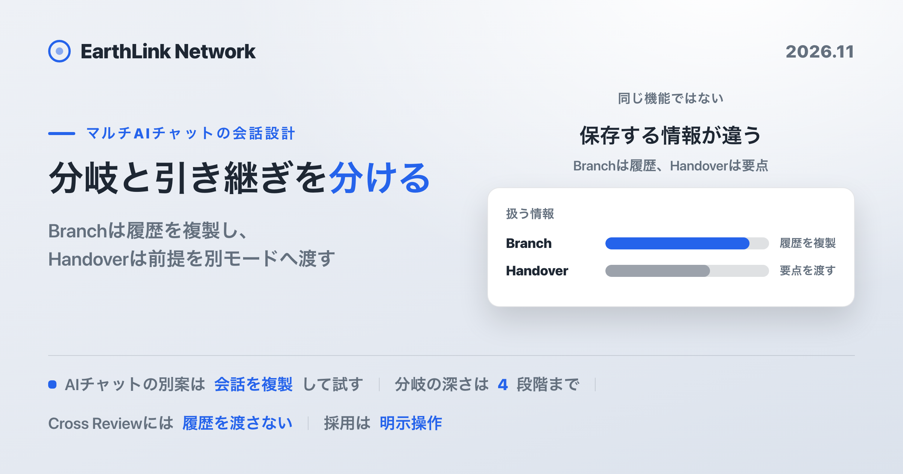
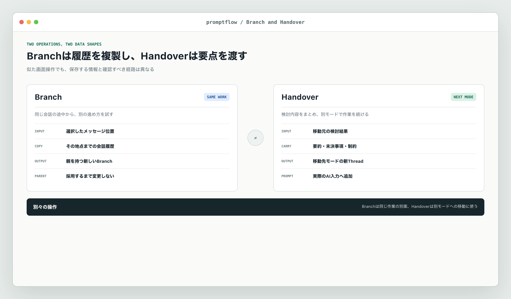
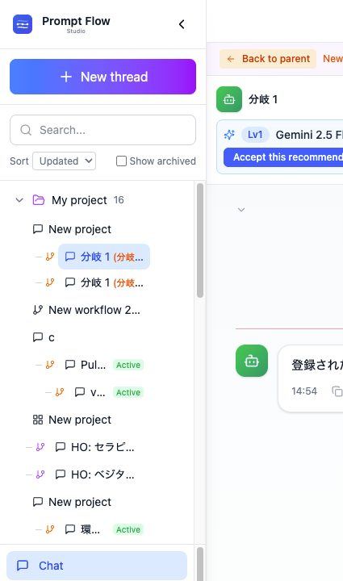
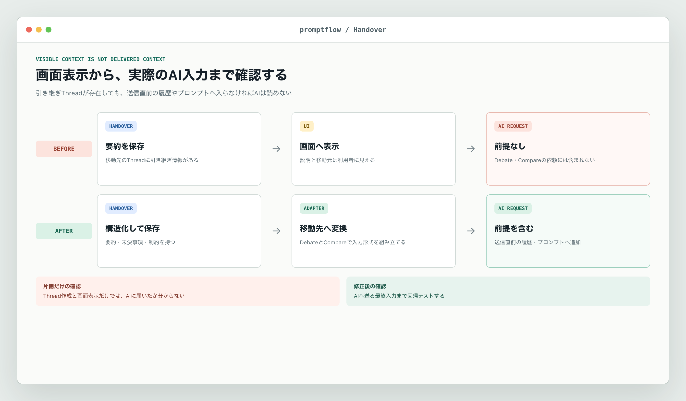
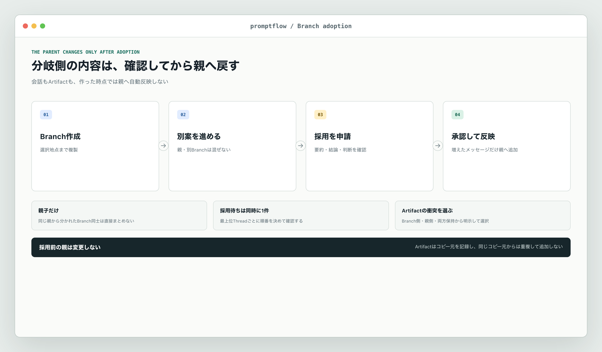

<!-- このファイルは gen-publish.mjs が生成した発行用スケルトン。翻訳(海外媒体)は Claude が en.md 経由で行う。 -->
<!-- gen-publish:src-sha256=15372904159b8f0c91c20eda0b7bfaafff6fc2b2e254036bafad1b3c1386ae6c -->

上原正吉（EarthLink Network Co., Ltd.）。AI会社・AI社員による業務自動化と、人の逐次介入なしに24時間自動開発を回す仕組みを自社で実践しています。開発ノウハウと具体的な設定方法、運用して分かった改善点を公開しています。

<!-- TODO(Claude): この zenn 版は媒体トーン定義（/docs/platform-tone）に合わせてトーン・長さを調整する。方向性: 技術・実装重視。設計判断と数字を厚く。開発者向け。 以下は基となる本文。調整後にこのコメントを消す。 -->

# AIとの会話を上書きしない — BranchとHandoverを分けて作った

## 結論

- **BranchとHandoverは別の機能です。** Branchは会話を途中まで複製し、Handoverは要点を別モードへ渡します。
- **分岐しても元の会話は変わりません。** 戻すには採用の申請と承認が要ります。
- **引き継ぎは、画面に出るだけでは足りません。** AIへ送る依頼に入って初めて届きます。
- **何を渡さないかも決めています。** 要約には上限があり、Cross Reviewで見直すAIには前の会話の履歴を渡しません。

## 本文（読了 約14分）

## 何を作り、何を解決したかったのか

[Prompt Flow Studio](https://prompt-flow.studio)（以下、promptflow）は、複数社のAIを同じ作業場で使えるSaaSです。モードはChat・Compare・Debate・Co-Draft（日本語の画面では「通常チャット」「比較検討」「AI 会議」「AI 推敲」）の4つです。この記事は、どれか1つのモードではなく、会話を残したまま別の進め方を試すBranchとHandoverの説明です。

作りたかったのは、AIとの会話を途中で上書きしない仕組みです。

たとえば、サービスの料金案をAIと詰めているとします。会話の途中で、月額制と利用量に応じた課金の両方を試したくなりました。今の会話へ別案を書き足すと、どこまでが月額制の前提で、どこからが別案なのかが混ざります。新しい会話を作れば分けられますが、それまでに決めた対象者、費用条件、見送った案をもう一度説明しなければなりません。

必要な操作は二つです。

- **同じ会話の途中から別案を試す。** これがBranchです。
- **別のモードへ移り、前の検討を続ける。** これがHandoverです。

二つは似て見えますが、中身は違います。Branchは会話履歴を複製します。Handoverは検討内容を要約して別モードへ渡します。保存するデータも、失敗の仕方も違います。

この違いを曖昧にすると、不具合を見落とします。画面に前の要約が表示されているので、次のAIにも届いていると思ってしまうからです。ところが、表示用の説明とAIへ送る依頼は別の経路でした。

## Branchは、選んだ地点までの会話を複製する

Branchは、同じ作業の中で別案を試す機能です。利用者が会話の途中にあるメッセージを選ぶと、その地点までの履歴を持つ新しいスレッドを作ります。

実装では、選択地点を1から数える位置として受け取ります。たとえば10件目を選んだ場合、各AIとの会話から先頭10件を新しいスレッドへ複製します。選択地点が指定されなかった場合は、その時点の全履歴を引き継ぎます。親の配列そのものを変更せず、新しい配列を作ります。

新しいスレッドには、次の関係も記録します。

- 直接の親になったスレッド
- 最上位のスレッド
- 分岐の深さ
- どの地点から分けたか
- 分岐後の状態

分岐の深さの上限は4段階です。上限を超える新しい分岐は作れません。深さを無制限にすると、どの案が何から分かれたか追いにくくなるためです。

作ったBranchは、画面左の一覧で親のスレッドの下に並びます。Branchの画面の上には「Back to parent」（日本語の画面では「親に戻る」）が出て、親の会話へ戻れます。

新しいBranchでAIへ依頼するときは、そのBranchが持つ会話だけを使います。親や同じ親から分かれた別のBranchのメッセージを、自動で混ぜません。月額制の案と利用量課金の案を分けたのに、片方の会話がもう片方へ入れば、分けた意味がなくなります。

元の会話へ戻す操作も、自動ではありません。Branchは`active`から`adopt_pending`へ進み、承認されたときに`adopted`になります。親子関係にあるスレッドだけを対象にし、同じ親から分かれたBranch同士を直接まとめる操作は許可していません。同じ最上位スレッドの中で、採用待ちにできるBranchも同時に1件です。採用待ちは30日で失効します。

この制約は、利用者が明示していない内容を親へ戻さないために置いています。採用されると、Branchで増えたメッセージだけを親の会話へ追加します。分岐前から引き継いだメッセージは親と同じものなので、二重には入りません。Artifactを戻す処理では、同名の内容が親にある場合に、Branch側を採る、親側を残す、両方を残す、のいずれかを選べます。Artifactについては、どこからコピーしたかも記録します。

Branchを作るだけなら、親は変わりません。採用したときだけ、利用者が確認した内容を戻します。

## Handoverは、別モードへ検討内容を渡す

Handoverは、ChatからDebateへ移る、Compareの候補をChatで詳しく検討する、といった操作に使います。移動元はふだんChat・Compare・Debateです。移動先には、4つのモードのほかにWorkflowも選べます。WorkflowはBetaのため、4つのモードには数えていません。Workflowの結果からも、DebateかChatへ移れます。Workflowとの間の引き継ぎはBetaです。移動元と移動先の組み合わせに応じて、渡す内容を変えています。

Branchとの違いは、会話を選択地点までそのまま複製しないことです。Handoverでは、新しい移動先スレッドを作り、最初のシステムメッセージへ構造化した情報を入れます。

- 前の作業の要約
- 背景として残す内容
- まだ決めていない事項
- 次のモードでも守る制約
- そのスレッドで最初に出した依頼
- どのモードから来たか

たとえば、Compareで3案を並べた後に、そのうち1案をChatへ渡す場合、全候補の全文をそのまま貼りません。選んだ回答と比較で分かった論点をまとめ、Chatで続けます。Debateへ渡す場合は、結論だけでなく、決着していない点と制約も必要です。

全文複製ではなく要約を使う理由は、移動先の依頼が前の長い履歴に埋もれないようにするためです。一方で、要約には情報が落ちる危険があります。Handoverは「前の会話を完全に再現する機能」ではありません。必要な引用やArtifactは、別に確認できる状態で残します。

## 画面には見えるのに、AIへ届いていなかった

開発中に見つかった問題は、Handoverの見た目と、AIが受け取る入力が一致していなかったことです。

見た目だけでは分かりません。

Debateへ移動すると、画面には前の作業の要約が表示されていました。新しいスレッドの説明にも、引き継ぎ元が入っていました。この状態だけを見ると、Debateの参加AIも要約を読んでいるように見えます。

でも、AIへ送る依頼を組み立てる処理は、その表示用データを読んでいませんでした。Debateは議題と役割を受け取り、新しい議論として始めていました。移動前に決めた制約や未決事項は、AIの入力に含まれていません。

Compareへ移る経路にも同じ種類の問題がありました。画面をCompareへ切り替えるだけの経路では、Handover用のスレッドが作られません。利用者には画面が変わったように見えます。しかし、前の文脈を持つ新しいスレッドがないので、各モデルへ送る履歴にも何も入りません。

これは表示の不具合ではありません。AIが前提を知らないまま回答します。内容も変わります。たとえば「個人情報を外部へ出さない」という制約を前のChatで決めていても、Debateの入力に入らなければ、その制約を無視した案が出ます。

画面の表示とAIへの入力は別の経路です。そのため、Handoverは次の二つを分けて確かめる必要があります。

1. 移動先のスレッドが、構造化した引き継ぎ情報を持っているか。
2. 移動先のAIへ送る依頼そのものに、その情報が含まれているか。

スレッド作成だけを確認しても、二つ目は保証できません。画面の説明だけを確認しても同じです。AIへ送る直前の履歴またはプロンプトまで確かめます。

## 修正後は、移動先ごとにAI入力までつなぐ

修正では、Handoverスレッドを作る処理を共通化しました。移動元のモード、要約、背景、未決事項、制約をシステムメッセージへ入れ、移動先のモードを持つ新しいスレッドを作ります。親スレッドとの関係とHandoverの履歴も記録します。

その上で、移動先ごとにAI入力への接続を実装しました。移動先のCompareとDebateでは、画面の上に引き継ぎ元のモードと、要約、未決事項、制約を表示します。利用者は、AIへ渡す要点を画面でも確かめられます。

### Chatへ渡す場合

要約、未決事項、制約を1つの利用者の発言にまとめ、会話履歴の先頭へ入れます。引き継ぎより前の会話そのものは送りません。

promptflowがAIへ送る履歴は、直近20件か推定12,000トークンの少ない方までです。それでも最初の発言は6,000文字まで別に残すので、先頭に入れた要約は会話が長くなっても入力から外れません。間を省いたときは、省いた件数をAIへ伝えます。省いた発言の中身は送りません。

### Debateへ渡す場合

Debateを開始する直前に、Handoverのシステムメッセージを読みます。要約、背景、未決事項、制約、最初の依頼を`priorContext`という項目にまとめ、DebateのAPIへ送ります。API側でも、文字列と文字列配列だけを受け取り、未知の項目を無視します。

構造化した引き継ぎ内容は、最初の`problem_framing`、つまり論点を整理する段階で入れます。要約と背景は合計4,000文字まで、スレッドで最初に出した依頼は、要約とは別に4,000文字までです。未決事項と制約はそれぞれ10件まで、各項目300文字までに制限しています。

さらに各回の発言には、Debateの背景の欄（画面では「＋ 背景・前提を追加（予算・期限など・任意）」から開く欄）の内容も毎回渡します。この欄が空のまま引き継いだ場合は、要約、未決事項、制約から作った文で埋めます。議論が進んでも、最初に決めた前提が抜け落ちないようにするためです。最初の論点整理では同じ内容が二重に入らないよう、利用者が手を加えていない補完文だけを省きます。

上限を設けると情報が落ちる可能性があります。それでも無制限に渡すより、何を渡したかを確認でき、移動後の議題を読みやすくできます。長い資料はArtifactとして参照し、Handoverには次の議論で必要な要点を入れます。

### Compareへ渡す場合

Compareでは、各モデルへ同じ質問を送る前に、Handoverのシステムメッセージを探します。要約、未決事項、制約を「引き継ぎコンテキスト」として組み立て、会話履歴の先頭へ利用者の入力として追加します。

条件は同じです。各候補へ違う引き継ぎ内容を渡すと、モデル差を比べられません。すべての候補へ同じ文脈を渡し、その後に同じ質問を送ります。

### Co-Draftへ渡す場合

引き継いだ結論、未決事項、制約を見出しつきで並べ、Co-Draftの最初の依頼文に入れます。推敲を始めるAIは、前のモードで決めた結論と制約を材料として受け取ります。

## Cross Reviewでは、前の会話を渡さない

引き継ぎとは反対に、前の会話を渡さない機能もあります。Cross Reviewはモードではなく、Compare・Debate・Workflowで出た回答に対して呼ぶ見直しの操作です。出た回答を、会話に参加していない別のAIに独立して見直させます。前の議論を渡すと、先に出た結論に合わせた見直しになるおそれがあります。そのため、見直すAIには対象の回答だけを送り、前の会話の履歴は渡しません。

見直した後に、良かった回答のモデルを選んで会話を続けることはできます。見直しの時点で前の履歴を渡さないことと、見直しの後に会話を続けられることは、別の話です。

引き継がないことも仕様です。単に実装を忘れた状態とは区別し、テストで確認します。

## テストは、保存と送信を別々に確認する

Handoverの情報がどこかに保存されたことを確かめるだけでは、AIへ届いたかは分かりません。そこで、回帰テストも処理の境界ごとに分けました。

まず、Handover用の新しいスレッドを作った時点で、移動元、要約、未決事項、制約がシステムメッセージへ入ることを確認します。次にDebateを開始し、APIへ送る内容に`priorContext`があることを確認します。さらに、構造化した引き継ぎ内容は最初の論点整理に入り、背景の欄の補完文がその回で二重に入らないことを確認します。長い要約と多すぎる項目を渡した場合は、APIとプロンプト生成の両方で上限が効くことも対象です。

Compareでは、Handoverスレッドから作った同じ履歴が各候補へ渡ることを確認します。画面を切り替えただけで終わらず、移動先のスレッドが作られる経路も対象にしました。Cross Reviewでは反対に、前の履歴が入らないことを確認します。

Branchにも別の確認があります。選択地点が指定された場合はその件数まで、未指定の場合は全件、空の会話なら空のまま新しい配列を作ります。親の会話を変更しないことも確認します。採用では親子関係、同時申請数、期限、同名Artifactの処理を個別に確認します。

この分け方にすると、画面だけ、保存だけ、AI入力だけという片側の確認で完了にできません。利用者が見た引き継ぎ内容と、AIが受け取った内容の両方を確認できます。

## 使い分けは、何を残したいかで決める

BranchとHandoverのどちらを使うかは、モデル名ではなく、残したい履歴で決めます。

| やりたいこと | 選ぶ操作 | 残るもの |
|---|---|---|
| 同じ会話の10件目から別案を試す | Branch | 10件目までを複製した別スレッド |
| Chatの検討をDebateで反証する | Handover（移動先はDebate） | 要約、未決事項、制約を持つDebateスレッド |
| Chatで絞った問いを複数モデルへ同条件で送る | Handover（移動先はCompare） | 同じ引き継ぎ内容を先頭に持つCompareスレッド |
| 決めた結論と制約をもとに文章を推敲する | Handover（移動先はCo-Draft） | 結論、未決事項、制約を最初の依頼文に持つCo-Draftスレッド |

例を挙げます。

「説明を短くする案」と「実装の詳細を残す案」を同じ地点から試すならBranchです。二つの履歴を別々に進められます。その後、採用候補へ反対意見を出したいならDebateへHandoverします。複数モデルの修正案を同じ条件で並べたいなら、移動先にCompareを選んでHandoverします。Handoverの後に、これまでの相談内容を知らないAIの指摘がほしいときは、出た回答をCross Reviewで見直します。見直すAIには前の会話の履歴が渡りません。

この順番なら、試した案、モードを移った理由、独立した批評を分けて残せます。一つの長い会話へすべてを書き足すより、どの前提で出た結論かを後から確認しやすくなります。

## 採用時にも、親と分岐側を自動で混ぜない

Branchで良い案ができても、親へ戻す前に確認が必要です。分岐後の会話には、親で同時に進んだ変更が入っていないかもしれません。Artifactにも同じ名前の別版があるかもしれません。

そこで、採用前の確認では、要約、結論、採った判断、次の作業、参照先、Artifact数を表示します。親子関係でないスレッド、同時に別の採用待ちがある場合、許可されない状態のBranchは進めません。

同名のArtifactがあるときは、利用者が処理を選びます。

- Branch側の内容で置き換える
- 親側の内容を残す
- 名前を分けて両方残す

同じBranchからすでにコピーしたArtifactは、もう一度追加しません。コピー元のスレッドとArtifactも記録します。

会話の採用では、Branchで増えたメッセージだけを親へ追加し、時刻の順に並べ直します。分岐前から共通のメッセージは二重に入りません。Branchの中だけで始めた会話は、まとめて親へ追加します。親の会話が変わるのは、採用という明示操作を経たときだけです。

## 制限

この仕組みにも制限があります。

- **Handoverの要約は全文ではありません。** 要約の作り方が悪ければ、前の検討で重要だった条件を落とします。
- **Branchを増やせば整理が必要です。** 深さが4段階までに収まっていても、名前と採用理由が曖昧なら見分けにくくなります。
- **採用しても矛盾は自動で解決しません。** 親とBranchで異なる結論を出していれば、利用者がどちらを残すか確認します。
- **提供範囲はプランで変わります。** Branch管理やHandoverの経路ごとの対応プランは、[料金ページ](https://prompt-flow.studio/pricing)と[引き継ぎの機能ページ](https://prompt-flow.studio/features/handover)で案内しています。

## まとめ

会話を残すことと、文脈を渡すことは同じではありません。Branchは履歴を複製し、Handoverは要点をAIへ送る依頼まで届けます。どちらを使うかは、残したい履歴で決めます。

## 用語

- **スレッド**: promptflowで1つの作業としてまとまった会話です。Branchを作ると、親のスレッドとは別のスレッドができます。
- **Artifact**: AIとの作業から作った文章、表、コードなどの成果物です。会話とは別に保存します。
- **システムメッセージ**: 会話の中で、利用者やAIの発言とは別に置く、前提を伝えるための欄です。Handoverでは、ここに引き継ぎ情報を入れます。
- **`priorContext`**: DebateのAPIへ渡す、引き継ぎ情報をまとめた項目の名前です。
- **`problem_framing`**: Debateの最初の段階で、議題の論点を整理する回の名前です。
- **採用**: Branchで進めた内容を、申請と承認を経て親のスレッドへ戻す操作です。

---

このシリーズでは、旗艦SaaSの Prompt Flow Studio ほか、AI開発・運用の現場で得た知見を順次公開していきます。
興味のある方は、ぜひ「いいね」と記事の購読をお願いいたします。

Prompt Flow Studio は、複数のAIを1画面で使い、比べ、議論させるマルチAIワークスペースです。詳しくは https://prompt-flow.studio をご覧ください。
そのほかの自社プロダクトは https://www.eln.ne.jp/products にまとめています。

## 筆者について

上原正吉。EarthLink Network Co., Ltd. 代表。AI社員に日々の業務を任せ、開発では人が逐一指示しなくても作業が進むHOOTL（Human Out Of The Loop）の仕組みを自社で実践しています。このブログでは、業務自動化と24時間自動開発のノウハウ、具体的な設定方法、日々の運用で見つかった問題と改善を共有します。

また、AIで業務や開発を組み替えたい会社・チーム向けに、AI活用のコンサルティングも受け付けています。ご相談は [www.eln.ne.jp](https://www.eln.ne.jp) からどうぞ。

---

**EarthLink Network** は、会社の全業務を AI で回すために、必要になったものを自社で作っています。いま作っているプロダクトの一覧と概要は、こちらにまとめています。

→ [EarthLink Network が自社でつくっている18のプロダクト](https://zenn.dev/chooser/articles/in-house-products)

会社と各プロダクトの詳細は、公式サイト [www.eln.ne.jp](https://www.eln.ne.jp) をご覧ください。
