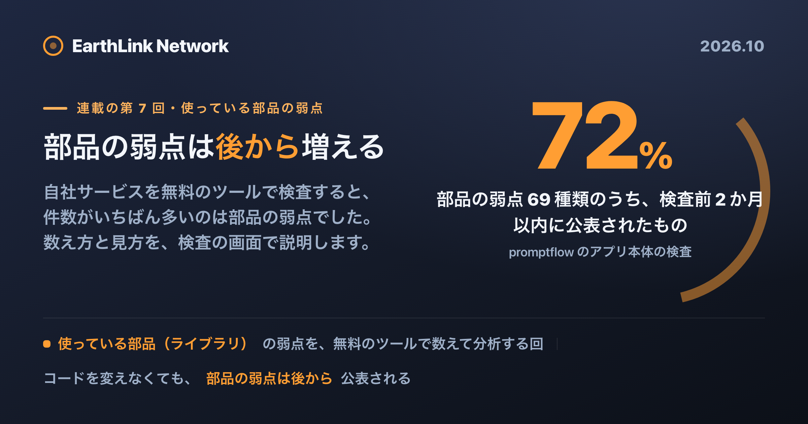
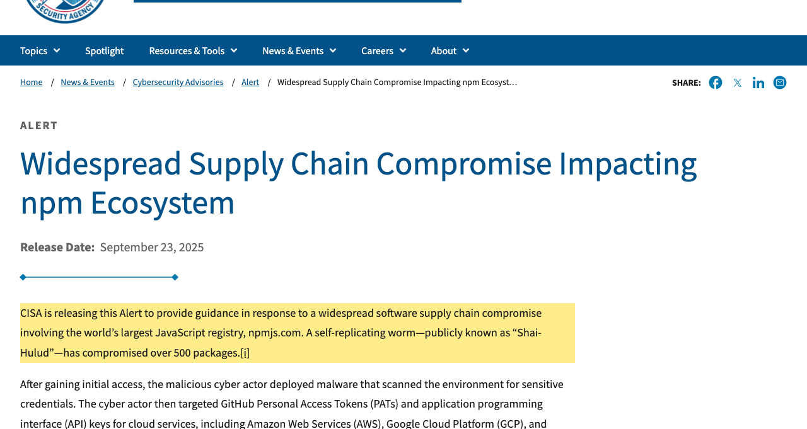
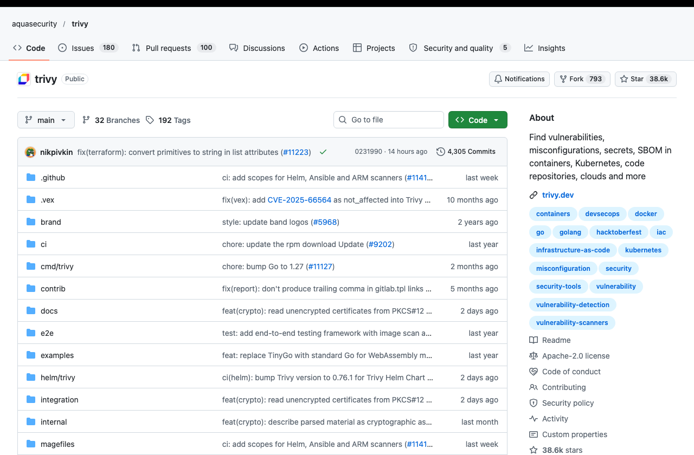
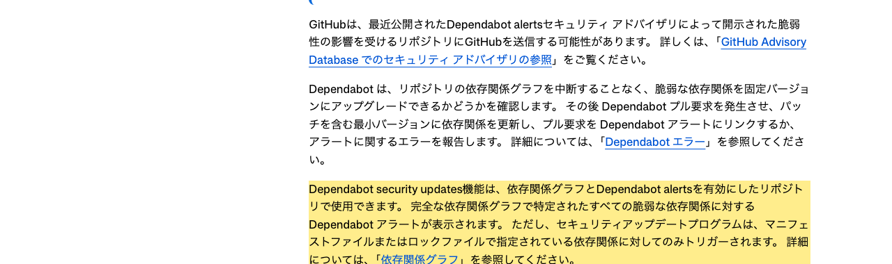
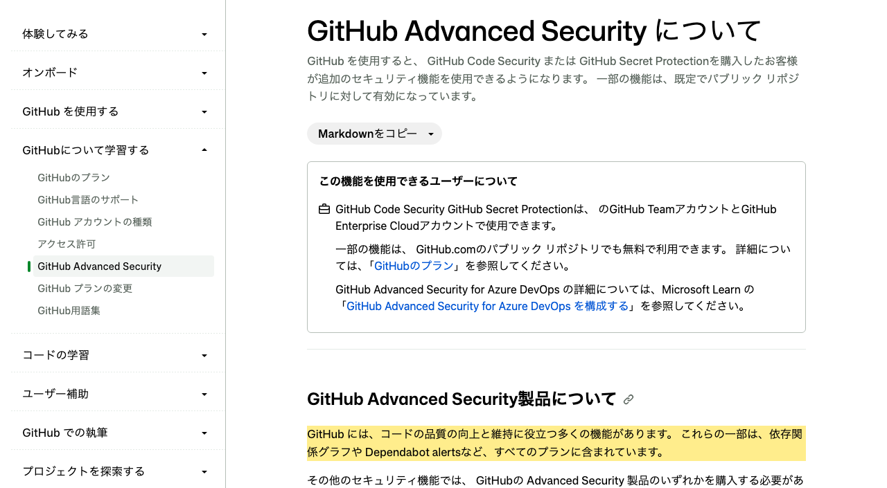

<!-- このファイルは gen-publish.mjs が生成した発行用スケルトン。翻訳(海外媒体)は Claude が en.md 経由で行う。 -->
<!-- gen-publish:src-sha256=3ecb42d5d698801aa8649f73b41fa2bfdee09f8b0aa39f57ebc296b28a690488 -->

上原正吉（EarthLink Network Co., Ltd.）。AI会社・AI社員による業務自動化と、人の逐次介入なしに24時間自動開発を回す仕組みを自社で実践しています。開発ノウハウと具体的な設定方法、運用して分かった改善点を公開しています。

<!-- TODO(Claude): この zenn 版は媒体トーン定義（/docs/platform-tone）に合わせてトーン・長さを調整する。方向性: 技術・実装重視。設計判断と数字を厚く。開発者向け。 以下は基となる本文。調整後にこのコメントを消す。 -->

# 使っている部品の弱点を検査する ── 依存ライブラリ



この記事は、連載「自分のサービスは自分で守る ── AI 時代の自衛セキュリティ」の第 7 回です。自分でできる検査は自分で、難しいときは EarthLink Network が検査を代行し、直せない弱点は私たちが修正します。

**連載の目次**

1. [AIで誰でも攻撃できる時代 ── やられる前に、自分のサイトを自分で検査する](https://note.com/chooser/n/nb1bb5f3e7533)
2. [攻撃する側が持っているツール ── AI が自分で攻撃を進めるとは](https://zenn.dev/chooser/articles/sec-002-research)
3. [検査を始める前に ── 検査の全体像と、本番を壊さない線引き](https://zenn.dev/chooser/articles/sec-003-research)
4. [外から攻めて検査する① ── 準備と、最初の実行まで](https://zenn.dev/chooser/articles/sec-004-research)
5. [外から攻めて検査する② ── 攻撃ツールと正規ツールで、見つかるものは違う](https://zenn.dev/chooser/articles/sec-005-research)
6. [自分の書いたコードを検査する ── 静的解析](https://note.com/chooser/n/nb4e9b553718d)
7. **使っている部品の弱点を検査する ── 依存ライブラリ（この記事）**
8. インフラの設定の誤りを検査する（予定）
9. 検査の結果を 1 か所に集めて、どれから直すかを決める（予定）
10. 見つかった弱点の直し方 ── 3 つの道（予定）
11. 自分で直せないときは ── 保守契約という選択（予定）
12. 毎日自動で検査し続ける ── 作る時代から、守り続ける時代へ（予定）

## 結論

自分のサービスの弱点を調べると、いちばん件数が多いのは、自分の書いたコードではありません。サービスを作るために使っている、出来合いの部品（依存ライブラリ）の弱点です。

私たちのサービス（promptflow）で確かめました。検査した日の最新のコードのコピーを、無料の検査ツール 2 つで調べると、アプリ本体の部品の一覧には 1,931 個の部品が載っていて、npm audit というツールは、弱点のある部品を中に含むものも数えて、50 個の部品に既知の弱点があると出しました。重さの内訳は、最も重いものが 4、重いものが 39、中程度が 7 です。もう一つのツール Trivy は、同じ一覧から 62 件を出し、そのうち 5 件が最も重い弱点でした。同じ日の毎日の自動検査で、自分の書いたコードの検査が出したのは 2 件、コードに残った秘密の情報の検査が出したのも 2 件です。桁が違います。

しかも、この弱点の多くは最近になって公表されたものです。npm audit がアプリ本体で挙げた弱点を、公表情報の種類で重複なしに数えると 69 種類あり、そのうち 50 種類は 2026 年 9 月 1 日以降に公表されていました。検査の前の 7 日間に公表されたものだけで 16 種類あります（公表日は、GitHub の弱点の公表情報に載っている日付です）。私たちがコードを何も変えなくても、部品の弱点は後から増えていきます。

最も重い 5 件の中には、Next.js という画面を作る部品の「Windows で動かしているサーバーなど、条件に合うときに、ログインしていない人がサーバーの上で好きな命令を実行できる」弱点が含まれています。こういう弱点は、自分たちの使い方で影響を受けるかの確認と、直った版への更新を、いちばん優先で進める対象です。件数と種類は隠さずに書きますが、悪用の手順は書きません。

この記事では、部品の弱点の見つけ方（3 つの方法を、入力したコマンドと出てきた画面で）、数え方（ツールで数が違う理由）、見方（どれから見るか）を順に説明します。直し方は第 10 回で扱います。

## サービスは、他人の作った部品でできている

今のサービスは、ほとんどが出来合いの部品の組み合わせでできています。画面を作る部品、データベースとやりとりする部品、ログインを扱う部品。どれも世界のどこかの誰かが作り、公開しているものです。自分で全部を作る人は、もういません。

部品は、さらに別の部品を使っています。私たちが直接選んで入れた部品は百数十個でも、その部品が使っている部品、そのまた先の部品と数えていくと、アプリ本体だけで 1,931 個になりました。この数は、部品の一覧ファイル（package-lock.json）に記録されています。このうち本番で動く部品は 770 個、開発のときだけ使う部品は 928 個です（npm の分類には重なりがあるので、足しても合計にはなりません）。スマホアプリのほうにも別の一覧があり、こちらは 1,111 個です。

部品の数が桁違いに多いので、弱点の件数も桁違いになります。自分の書いたコードの弱点は、自分が書いた行の中にしかありません。部品の弱点は、自分が一度も見たことのない 1,931 個のどこにでもありえます。部品の弱点を調べる検査が、いちばん件数の多い検査になるのはこのためです。

## 依存している先まで、同じ目で見る

部品の弱点には、自分のコードの弱点とは違う、やっかいな性質が二つあります。

一つ目は、後から見つかることです。部品の弱点は、その部品を使っている世界中の人や研究者が調べ続けていて、見つかるたびに公表されます。今日は安全な部品が、明日には危険になる。自分は何も変えていないのに、です。たとえば、今回の検査で出た Sentry（エラーを記録する部品）の最も重い弱点は、検査の直前に公表されたものでした。前の日に調べていたら、出なかったものです。だから部品の検査は、一度やって終わりにはできません。

二つ目は、自分だけ守っても足りないことです。部品を作っている人の側が攻撃され、部品そのものに悪いものを仕込まれることがあります。これを、サプライチェーン（部品の供給の流れ）への攻撃と呼びます。



2025 年 9 月、JavaScript の部品置き場（npm）で、自分で広がる不正なプログラムが 500 以上の部品を乗っ取ったことを、米国の政府機関 CISA が注意喚起しています。乗っ取られた部品を入れた人の環境からは、秘密の情報が探し出されて盗まれました。自分のコードをどれだけ丁寧に書いていても、使っている部品の作り手が乗っ取られれば、そこから入られます。

もう一つ、部品には「共用」の面もあります。今回の検査では、Next.js の弱点が、管理者向けのアプリと利用者向けのアプリの両方に入っている部品として出てきました（下の 7-1 の画面の、packages/admin-app と packages/user-app の行です）。一つの部品の弱点が、それを共用しているすべてのアプリに同時に出ます。

だから、検査は自分のコードの中だけで終わらせず、依存している先まで、同じ目で見る必要があります。といっても、1,931 個の部品を人が一つずつ調べることはできません。ここは、ツールに任せるところです。今回調べたのは、部品の一覧ファイルに載っている部品です。Python の部品の一覧ファイルは、今回のコピーにはありませんでした。

## 調べ方① npm audit ── 部品の一覧を、弱点の公表情報と照らし合わせる

最初のツールは npm audit です。JavaScript の部品を入れるときに使う npm に最初から入っているので、追加で入れるものはありません。無料です。

npm audit が調べるのは、JavaScript の部品だけです。promptflow は部品の一覧が全部 JavaScript のものです。npm の一覧は npm audit で、pnpm の一覧は次の節の Trivy で調べました。PHP や Python などで作ったサービスでは、別のツールを使います（後の節「言語によって、使うツールが変わる」の表）。

調べたのは、promptflow のソースのコピーです。本番のサーバーには一切通信していません。部品の一覧ファイルがあるフォルダで、次のコマンドを実行します。

```
npm audit --package-lock-only
```

`--package-lock-only` は、部品の一覧ファイル（package-lock.json）だけを見て調べる、という指定です。部品を入れる（ダウンロードする）必要がないので、手元に部品をそろえていなくても実行でき、部品の中のプログラムも動きません。npm audit は、一覧に載っている部品と版を、GitHub が公開している弱点の公表情報と照らし合わせて、合うものを出します。


画面の見方です。一つの部品について、次の順で出ます。

1. 部品の名前と、弱点がある版の範囲（例: `next  9.3.4-canary.0 - 16.4.0`）
2. 重さ（`Severity: critical` なら最も重い。high が重い、moderate が中程度、low が軽い）
3. 弱点の題と、公表情報のページの URL（`https://github.com/advisories/...`）
4. 直し方の目安
5. その部品が入っている場所

いちばん下の行が、全体のまとめです。今回は「50 vulnerabilities (7 moderate, 39 high, 4 critical)」、つまり弱点のある部品が 50 個で、その重さの内訳が中程度 7・重い 39・最も重い 4 です。最も重い 4 個は、Next.js、Sentry の Next.js 向けの部品、shell-quote（コマンドの文字を整える小さな部品）、Storybook（画面の部品を開発中に確かめるためのツール）でした。

4 番目の「直し方の目安」は、出方で意味が変わります。

- `fix available via npm audit fix` と出たら、弱点が直った版があり、今の使い方を変えずに上げられる見込みです。
- `fix available via npm audit fix --force` の下に「Will install ...、which is a breaking change」と出たら、直った版はあるものの、大きな版の変更になり、今までの使い方が動かなくなることがあります。
- 直った版がまだ無いときは、そう出ます。スマホアプリの一覧では、弱点のある 59 個のうち 5 個が、この状態でした。

アプリ本体の 50 個のうち、直った版が無いものはありませんでしたが、28 個は大きな版の変更をしないと直りません。画面の最後にある `npm audit fix --force` は、大きな版の変更も含めて全部上げるコマンドです。これをそのまま実行すると、アプリが動かなくなることがあります。どう上げるかは、第 10 回で書きます。

## 調べ方② Trivy ── フォルダの中の一覧を全部探して、まとめて調べる

2 つ目のツールは Trivy です。Aqua Security という会社が公開している、無料のオープンソースの検査ツールです。



npm audit との違いは、フォルダの中にある部品の一覧ファイルを全部探して、まとめて調べることです。JavaScript だけでなく、Python や Go などほかの言語の一覧も調べられます。入れ方は公式の手順にあり、Mac なら Homebrew で入れられます。今回使ったのは 0.74.0 で、弱点の公表情報は検査の前日に更新されたものでした。

同じコピーのフォルダで、次のコマンドを実行しました。

```
trivy fs --scanners vuln .
```

`fs` はフォルダ（ファイルの置き場）を調べる指定、`--scanners vuln` は部品の弱点だけを調べる指定、最後の `.` は今いるフォルダです。Trivy は秘密の情報や設定の誤りも調べられますが、ここでは部品の弱点に絞りました。


画面の上の表（Report Summary）は、見つかった一覧ファイルごとの件数です。Trivy は、フォルダの中から一覧ファイルを 3 つ見つけました。アプリ本体（package-lock.json）が 62 件、スマホアプリ（mobile-app/package-lock.json）が 41 件、画面の試作（mobile/pnpm-lock.yaml）が 0 件です。

その下に、一覧ファイルごとの合計と、1 件ずつの表が続きます。アプリ本体の合計は「Total: 62 (UNKNOWN: 0, LOW: 1, MEDIUM: 19, HIGH: 37, CRITICAL: 5)」で、最も重い（CRITICAL）が 5、重い（HIGH）が 37、中程度（MEDIUM）が 19、軽い（LOW）が 1 です。表の列は、左から次の意味です。

| 列 | 意味 |
|---|---|
| Library | 部品の名前 |
| Vulnerability | 弱点の番号（CVE- や GHSA- で始まる、世界共通の通し番号） |
| Severity | 重さ |
| Status | fixed なら直った版がある。affected なら、まだ無い（空欄のこともあるので、直った版は Fixed Version の列で確かめる） |
| Installed Version | 今入っている版 |
| Fixed Version | 弱点が直った版 |
| Title | 弱点の題 |

アプリ本体の 62 件のうち 60 件は、Fixed Version に直った版が書かれていました。npm audit では「直った版が無い部品は 0」でしたが、数え方が違う（後の節「数え方」）ので、この 2 つの数は一致しません。つまり、ほとんどは「直った版はもう出ているのに、まだ上げていない」状態でした。

## 言語によって、使うツールが変わる

npm audit で調べられるのは、npm で入れた JavaScript の部品だけです。PHP・Python・Ruby などで作ったサービスの部品は、npm audit では 1 つも調べられません。部品を入れる仕組みが言語ごとに違い、検査のツールもそれに合わせて分かれているからです。

主な言語と、無料で使える検査のツールは次のとおりです。

| 言語 | 部品の一覧ファイル | 検査のツール（無料） | コマンドの例 |
|---|---|---|---|
| JavaScript・TypeScript | package-lock.json、pnpm-lock.yaml | npm audit、pnpm audit | `npm audit` |
| PHP | composer.lock | composer audit（Composer 2.4 以降に入っている） | `composer audit` |
| Python | requirements.txt | pip-audit | `pip-audit -r requirements.txt` |
| Ruby | Gemfile.lock | bundler-audit | `bundle-audit check --update` |
| Go | go.mod | govulncheck | `govulncheck ./...` |
| Rust | Cargo.lock | cargo-audit | `cargo audit` |
| Java | pom.xml、build.gradle | OWASP Dependency-Check | `dependency-check --scan .` |
| C#（.NET） | .csproj | .NET に入っている機能 | `dotnet list package --vulnerable` |

言語をまたいで使えるのは、前の節の Trivy と、後の節「調べ方③ Dependabot」です。いくつもの言語を使っているなら、まず Trivy でフォルダ全体を調べると、どの言語の部品の一覧があるかをまとめて洗い出せます。ただし、Trivy が読めない一覧ファイルもあります。表のうち build.gradle（Java）と .csproj（C#）は Trivy では読めないので、その言語は表のツールで調べます。

## 言語の本体の弱点 ── 10 月の Node.js と PHP の件

部品の検査では見つからない弱点もあります。言語の本体の弱点です。

この検査の 2 日前、同じ日に、2 つの言語の本体に大きな弱点が公表されました。

- **Node.js**（JavaScript をサーバーで動かす本体）：Brotli という形式で圧縮されたデータを受け取るアプリで、外からサーバーの上のプログラムを動かされるおそれがある弱点です（CVE-2026-111497）。同じ日に、ほかの 9 件の弱点も直されました。直った版は 22.23.4・24.22.1・26.12.1 です。サポートが終わった Node.js 20 以前には、直った版は出ません。
- **PHP**：外から認証なしでサーバーの上のプログラムを動かされる弱点が 2 つです（CVE-2026-109618 と CVE-2026-109619）。直った版が出る前の日には、弱点の詳しい内容が外に漏れていました。直った版は 8.5.12・8.4.27・8.3.36・8.2.35 です。

どちらも公表の後に、この弱点を使った攻撃が確認され、アメリカの政府機関（CISA）が「悪用が確認された弱点」の一覧に載せています。Node.js で動くサービスも、WordPress をはじめ PHP で動くサイトも世界中にあるので、どちらも各国で大きく報じられました。

npm audit を毎日実行していても、Node.js の本体の弱点は 1 件も出ません。npm audit が調べるのは package-lock.json に載っている部品で、Node.js の本体は package-lock.json に載っていないからです。PHP の本体と composer audit も同じです。

言語の本体の弱点には、部品の検査とは別のところで気づく必要があります。見る場所とツールは次のとおりです。

| 確かめること | Node.js | PHP |
|---|---|---|
| 動いている版 | `node -v` | `php -v`。Web のページを動かしている PHP（php-fpm など）は版が違うことがあるので、`php-fpm -v`（Ubuntu なら `php-fpm8.3 -v` など）も |
| その版に弱点があるか | `npx is-my-node-vulnerable`（Node.js のチームが出している公式のツール。弱点のある版なら、弱点の一覧を出す） | 公式の告知にある直った版と見比べる |
| 新しい弱点の告知 | Node.js の公式ブログの「Vulnerabilities」の記事と、告知専用のメーリングリスト nodejs-sec | php.net のニュースと、告知専用のメーリングリスト php-announce |
| サポートが続いている版か | Node.js の公式サイトの「Releases」のページ | php.net の「Supported Versions」のページ |

`npx is-my-node-vulnerable` は、実行した場所の Node.js の版を調べます。手元の Mac ではなく、本番と同じ版の Node.js で実行します。毎日の自動検査に 1 行足しておけば、告知を読み逃しても気づけます。

動かしている場所によっては、版を見る場所が変わります。

- AWS Lambda などのクラウドで動かしているなら、関数の設定にある「ランタイム」（nodejs22.x など）が、動いている Node.js の系列です。22.23.4 のような細かい版は、既定の設定なら AWS が自動で上げます。サポートが終わるランタイムは、AWS から前もって知らせが届きます。
- Ubuntu などの OS が配る PHP や Node.js を使っているなら、`php -v` や `node -v` に出る数字はそのままで直すことがあるので、OS の告知を見ます。
- サーバーやレンタルサーバーを借りているなら、借り先が直った版に上げたかを、借り先の告知で確かめます。

## 調べ方③ Dependabot ── GitHub に見張らせる

3 つ目は、GitHub に組み込まれている Dependabot です。ここは、私たちの設定と、検査の時点の状態をそのまま見せます。

Dependabot には、似た名前で別々の働きが三つあります。

- 版の更新（version updates）: 決めた間隔で、部品の新しい版が出ていないかを調べ、上げるための変更の依頼（プルリクエスト）を作ります。
- 脆弱性アラート（Dependabot alerts）: 使っている部品に弱点が公表されると、GitHub の画面で知らせます。
- セキュリティ更新（security updates）: 弱点が公表されると、直った版へ上げる依頼を、決めた間隔を待たずに作ります。


上の設定ファイルを見ると、版の更新は 4 種類とも `interval: "monthly"`、つまり月に 1 回です。毎日ではありません。

注目してほしいのは 3 行目のコメントです。「セキュリティ更新は、決めた間隔と関係なく、すぐに依頼が作られる」と書いてあります。ところが、画面の下の、GitHub に脆弱性アラートの状態を問い合わせた応答は「Dependabot alerts are disabled for this repository.」、つまり検査の時点では、脆弱性アラートは無効でした。



GitHub の公式の説明には、セキュリティ更新は、依存関係グラフ（GitHub が部品の一覧ファイルから作る、使っている部品の一覧）と脆弱性アラートを有効にしたリポジトリ（GitHub に置いたコードの置き場）で使える、とあります。脆弱性アラートが無効だったので、設定ファイルのコメントが期待している「すぐに依頼が作られる」は、検査の時点の私たちのリポジトリでは起きていませんでした。設定ファイルに書いてあることと、動いていることが違っていました。

もう一つ、npm の対象は `directory: "/"`、つまりアプリ本体の一覧だけで、検査の時点では、スマホアプリのフォルダ（mobile-app）は書かれていませんでした。Trivy が 41 件を出したスマホアプリの一覧は、Dependabot の版の更新の対象に入っていなかったことになります。


Dependabot が作った依頼を並べると、9 月と 10 月は 1 日に、部品の更新がまとめて届いています。ただし、npm の部品をまとめて上げる依頼（9 月の 58 個、10 月の 69 個）は、どちらも取り込まれずに閉じられています（CLOSED）。なぜ閉じたのか、どう分けて入れることにしたのかは、第 10 回で書きます。

脆弱性アラートそのものは、有料のプランを買わなくても使えます。



GitHub の説明のとおり、依存関係グラフと脆弱性アラートは、すべてのプランに含まれています。リポジトリの設定画面から有効にできます。まだ有効にしていないなら、ここがいちばん手間のかからない一歩です。

## 数え方 ── ツールで数が違う理由

ここまでで、同じアプリ本体の一覧に対して、npm audit は「50」、Trivy は「62」と、違う数を出しました。どちらかが間違っているのではありません。数えているものが違います。

| | npm audit | Trivy | Dependabot alerts |
|---|---|---|---|
| 数えているもの | 弱点のある部品の数 | 部品の版と弱点の組み合わせの数 | アラートの件数（検査の時点では無効） |
| アプリ本体の件数 | 50（最も重い 4・重い 39・中程度 7） | 62（最も重い 5・重い 37・中程度 19・軽い 1） | 無効だったため出ない |
| 開発のときだけ使う部品 | 数える | 既定では数えない | — |
| 調べる一覧 | 実行したフォルダの 1 つ | フォルダの中を全部 | 設定によって決まる |
| 弱点の公表情報 | 実行したときに問い合わせる | ダウンロードしておいたものを使う | — |

違いは四つです。

一つ目は、数える単位です。npm audit は部品の数を数えます。ただし、自分には弱点が無くても、弱点のある部品を中に含んでいるだけで数に入ります。アプリ本体の 50 個のうち、自分自身に弱点の公表情報があるのは 25 個で、残りの 25 個は中に含んでいる部品のせいで数えられていました。Trivy は「どの版の部品に、どの弱点があるか」を 1 行ずつ数えます。同じ部品が 2 つの版で入っていれば、2 行になります。Trivy が出した最も重い 5 件は、Next.js が 2 つの版（15.5.21 と 16.3.0）で入っていて、弱点の種類としては 3 つです。

二つ目は、開発のときだけ使う部品を数えるかどうかです。Trivy は既定では、本番で動く部品だけを数えます。開発のときだけ使う部品も含める指定（`--include-dev-deps`）を付けると、アプリ本体は 62 件から 78 件に、画面の試作の一覧は 0 件から 31 件に増えました。npm audit が最も重いとした Storybook は開発中に使うツールなので、Trivy の既定の数には入っていません。

三つ目は、どの一覧を調べるかです。npm audit は実行したフォルダの一覧だけ、Trivy はフォルダの中を全部、Dependabot は設定に書いた場所だけです。

四つ目は、弱点の公表情報の新しさです。npm audit は、実行したときにその場で問い合わせます。Trivy は、ダウンロードしておいた公表情報を使います。今回 Trivy が使った公表情報は、Sentry の部品の最も重い弱点が公表される 9 時間ほど前に更新されたものでした。そのため、Trivy の結果には、この Sentry の弱点が出ていません。同じ日に調べても、ツールによって、昨日の弱点が見えたり見えなかったりします。

npm audit が挙げた弱点を、公表情報の種類で重複なしに数えると、アプリ本体で 69 種類、スマホアプリと合わせると 90 種類でした。同じように Trivy の 62 件を種類で数えると 46 種類で、ここでもツールによって数が違います。

だから、件数は「どのツールで、どう数えたか」と一緒に覚えておく必要があります。前回と比べるときは、同じツール、同じ指定で数えます。ツールを替えて件数が減っても、弱点が減ったとは限りません。ツールをまたいで結果を 1 か所に集める話は、第 9 回で書きます。

## 見方 ── 1 件ずつ、何を確かめるか

件数が多いので、上から順に全部を見るのは現実的ではありません。部品の弱点の 1 件ずつについて、私たちは次のことを確かめています。ほかの検査の結果と合わせて、どれから直すかの順番を決めるやり方は、第 9 回で書きます。

1. 重さ。最も重い（critical）と重い（high）から見ます。
2. 本番で動く部品か。開発のときだけ使う部品の弱点は、利用者の手元やサーバーの上では動かないので、後回しにできることが多いです。ただし、開発する人のパソコンが狙われることはあるので、無視はしません。
3. 直った版があるか。あれば、上げることで直せます。無ければ、別の手当てを考えます（第 10 回）。
4. 影響を受ける条件。弱点の題や公表情報のページには、影響を受ける条件が書かれていることがあります。今回の Next.js の弱点の題には「Windows で動かしているサーバー」「AVIF という形式の画像を使うとき」「next/og の ImageResponse」といった条件が書かれています。自分たちの使い方がその条件に合うかを、一つずつ確かめます。
5. 公表からの日数。攻撃する側は、公表された弱点をすぐに試します（第 2 回）。公表されたまま直していない日数が長いほど、その間ずっと、試される状態に置かれていることになります。

この見方で、アプリ本体の最も重い 5 件（弱点の種類は 3 つ）を並べると、次のようになります（Trivy の結果と、GitHub の弱点の公表情報から）。

| 部品と検査の時点の版 | 弱点の題（要約） | 直った版 | 公表から検査まで |
|---|---|---|---|
| Next.js 15.5.21 / 16.3.0 | Windows で動かしているサーバーで、ログインなしで遠隔からコードを実行される（CVE-2026-75604） | 15.5.24・16.3.3 | 45 日 |
| Next.js 15.5.21 / 16.3.0 | AVIF 形式の画像を使うとき、画像を最適化する機能で、ログインなしで遠隔からコードを実行される | 15.5.24・16.3.3 | 45 日 |
| Next.js 16.3.0 | next/og の ImageResponse で、遠隔からコードを実行される | 16.3.6 | 23 日 |

どれも直った版が出ていて、本番で配信しているアプリの Next.js（15.5.21）も含まれています。公表から検査まで、3 週間以上たっています。検査したその日のうちに、直った版へ上げました（Next.js は 15.5.28 と 16.4.2、Sentry の部品は 10.76.2）。

なぜ、最も重い弱点が、最新のコードに残っていたのか。調べると、三つの守りのどれもが、ここを止める作りになっていませんでした。

- 変更のたびの検査は、その変更で新しく持ち込んだ重い弱点だけを止める作りです。検査の設定ファイルの説明にも、もとからある弱点は止めない、と書かれています。すでに入っている部品に後から弱点が公表されても、それを止める変更はありません。
- 脆弱性アラートが無効だったので、公表の時点で知らせる仕組みと、すぐに直す依頼を作る仕組みが動いていませんでした。
- 月に 1 回の版の更新は、まとめて上げる依頼が 2 か月続けて取り込まれずに閉じられていました。

この検査のあと、同じ日の夜に、脆弱性アラートを有効にしました。今は、アプリ本体とスマホアプリの両方の部品について、届いた警告を毎日確かめています。

第 3 回で、有効にした夜に届いた警告と Trivy の結果がどこで重なるかを、この回で確かめると書きました。アプリ本体の部品の一覧では、その夜に Dependabot から 52 種類の弱点の警告が届きました。この記事で Trivy が出した 46 種類と比べると、37 種類は同じ弱点でした。違いは次のとおりです。

- Dependabot だけが出した 15 種類のうち 13 種類は、開発のときだけ使う部品（vite・vitest・Storybook など）の弱点でした。Trivy は既定では、本番で動く部品だけを数えるからです。残りの 2 種類は、本番で動く部品（pdfjs-dist と ip-address）の弱点で、Trivy の結果には出ていませんでした。
- Trivy だけが出した 9 種類は、すべて Next.js の弱点でした。警告が届く 2 時間ほど前に、直った版へ上げていたからです。

スマホアプリの一覧（mobile-app）では、32 種類のうち 30 種類が同じでした。画面の試作の一覧（mobile）では、Dependabot が 32 種類を出し、Trivy は 0 件でした。この 32 種類は、どれも開発のときだけ使う部品の弱点です。

同じ部品の一覧を見ていても、ツールによって数える範囲が違います。そのため私たちは、毎日の Trivy と Dependabot の警告を、両方とも動かしています。

毎日の自動検査（第 12 回）は、Trivy の結果を毎日 1 か所に集めています。集める場所（第 9 回で紹介する DefectDojo）で、promptflow の結果をツールごとに数えました（検査した日の夕方の数）。

| ツール（何を調べるか） | まだ直っていない（重さの内訳） | 閉じた |
|---|---|---|
| Trivy（使っている部品） | 98（最も重い 6・重い 64・中程度 27・軽い 1） | 160 |
| npm audit（使っている部品） | 46（最も重い 2・重い 37・中程度 7） | 60 |
| Gitleaks（秘密の文字列） | 2（重い 2） | 22 |
| Semgrep（自分の書いたコード） | 2（中程度 2） | 8 |

件数でいちばん多いのは Trivy で、その時点でまだ直っていなかった 148 件のうち 98 件です。npm audit と合わせると、部品の検査から 144 件が出ています。会社の複数のサービスの合計でも、その時点でまだ直っていなかった 1036 件のうち、Trivy が 673 件、npm audit が 228 件でした。集める場所に入っている 4 つのツールの中で、部品の弱点が件数では最も多い、ということが数で確かめられました。ただし、Trivy と npm audit は同じ弱点をそれぞれ数えていることがあるので、二つを足した数は弱点の種類の数ではありません。また、集める場所の Trivy の 98 件は毎日の検査の数で、この記事で手元で数えた Trivy の 103 件（アプリ本体 62・スマホアプリ 41）とは、調べた時刻も、使った弱点の公表情報の版も違います。

でも、集めただけでは直りません。見つけた後に、誰がいつ見て、どれから直すかを決める仕組みが要ります。これは第 9 回の主題です。部品の検査は、ツールを入れたら終わりではなく、出てきた結果を見る人と順番を決めて、はじめて守りになります。

## 直し方は、第 10 回で

部品の弱点の直し方は、多くの場合、直った版に上げることです。ただ、今回の画面にもあったとおり、大きな版の変更が要るものや、まとめて上げると組み立てが失敗するものがあります。全部を一度に上げようとして、アプリが動かなくなっては本末転倒です。

第 10 回では、私たちが 7 月に Trivy の結果をもとに部品をまとめて上げ、直せる弱点を 73 件から 62 件に減らした変更と、Dependabot の 69 個まとめての依頼を取り込まずに閉じた理由を、画面で説明します。

## 次回

第 8 回は、インフラの設定を検査します。配備の手順と、ファイルの保存場所の設定に、外から入られるところや、外から見えてしまうところが無いかを調べます。サーバーやデータベースを含むクラウド全体の設定を読み取りだけで調べる方法も、そこで紹介します。部品やコードの弱点が無くても、設定一つで情報が外から見えてしまうことがあります。

---

この連載では、攻撃ツールが誰でも無料で手に入る時代に、自分のサービスを自分で検査し、弱いところを先に見つけて直す手順を、順に示します。検査の対象は自社サービスに限り、他人のサイトを攻撃する手順は扱いません。
自分で検査するのが難しい方は、EarthLink Network が検査を代行します。弱点は見つかったが自分では直せない、という方は、私たちが修正まで引き受けます。お気軽にご相談ください。
役に立ったと感じたら、ぜひ「いいね」と記事の購読をお願いいたします。

自社プロダクトは https://www.eln.ne.jp/products にまとめています。

## 筆者について

上原正吉。EarthLink Network Co., Ltd. 代表。AI社員に日々の業務を任せ、開発では人が逐一指示しなくても作業が進むHOOTL（Human Out Of The Loop）の仕組みを自社で実践しています。このブログでは、業務自動化と24時間自動開発のノウハウ、具体的な設定方法、日々の運用で見つかった問題と改善を共有します。

また、AIで業務や開発を組み替えたい会社・チーム向けに、AI活用のコンサルティングも受け付けています。ご相談は [www.eln.ne.jp](https://www.eln.ne.jp) からどうぞ。

---

**EarthLink Network** は、会社の全業務を AI で回すために、必要になったものを自社で作っています。いま作っているプロダクトの一覧と概要は、こちらにまとめています。

→ [EarthLink Network が自社でつくっている18のプロダクト](https://zenn.dev/chooser/articles/in-house-products)

会社と各プロダクトの詳細は、公式サイト [www.eln.ne.jp](https://www.eln.ne.jp) をご覧ください。
